## Part 1: Fun with Filters

### 1.1 Convolutions from Scratch

Both implementations flip the kernel and zero pad the image so the output is the same size as the input, matching `scipy.signal.convolve2d(img, kernel, mode="same", boundary="fill")`. Code: `Assignment 2/src/conv.py`.

```python
def pad(img, kernel):
    kh, kw = kernel.shape
    return np.pad(img, ((kh // 2, (kh - 1) // 2), (kw // 2, (kw - 1) // 2)))


def conv4(img, kernel):
    k = kernel[::-1, ::-1]
    kh, kw = k.shape
    p = pad(img, k)
    out = np.zeros_like(img)
    for i in range(img.shape[0]):
        for j in range(img.shape[1]):
            total = 0.0
            for u in range(kh):
                for v in range(kw):
                    total += p[i + u, j + v] * k[u, v]
            out[i, j] = total
    return out


def conv2(img, kernel):
    k = kernel[::-1, ::-1]
    kh, kw = k.shape
    p = pad(img, k)
    out = np.zeros_like(img)
    for i in range(img.shape[0]):
        for j in range(img.shape[1]):
            out[i, j] = np.sum(p[i:i + kh, j:j + kw] * k)
    return out
```

#### 9x9 box filter

Every entry of the 9x9 box filter is 1/81, so each output pixel is the mean of the 9x9 neighbourhood around it:

$$ B = \frac{1}{81} \begin{bmatrix} 1 & 1 & 1 & 1 & 1 & 1 & 1 & 1 & 1 \\ 1 & 1 & 1 & 1 & 1 & 1 & 1 & 1 & 1 \\ 1 & 1 & 1 & 1 & 1 & 1 & 1 & 1 & 1 \\ 1 & 1 & 1 & 1 & 1 & 1 & 1 & 1 & 1 \\ 1 & 1 & 1 & 1 & 1 & 1 & 1 & 1 & 1 \\ 1 & 1 & 1 & 1 & 1 & 1 & 1 & 1 & 1 \\ 1 & 1 & 1 & 1 & 1 & 1 & 1 & 1 & 1 \\ 1 & 1 & 1 & 1 & 1 & 1 & 1 & 1 & 1 \\ 1 & 1 & 1 & 1 & 1 & 1 & 1 & 1 & 1 \end{bmatrix} $$

The filter is applied to a 635 x 900 grayscale picture of me with each of the three methods:

```python
img = load_image(DATA_DIR / "pasta-boy.jpg", gray=True)
box = np.ones((9, 9)) / 81

out_four = conv4(img, box)
out_two = conv2(img, box)
out_scipy = convolve2d(img, box, mode="same", boundary="fill")
```

<div class="media-grid media-grid--2x2">
  <figure>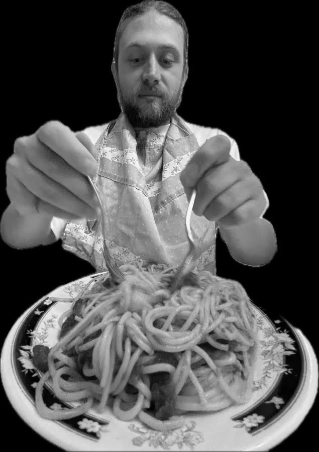<figcaption>Input (grayscale)</figcaption></figure>
  <figure><figcaption>Four loops</figcaption></figure>
  <figure><figcaption>Two loops</figcaption></figure>
  <figure><figcaption>scipy convolve2d</figcaption></figure>
</div>

Every method computes the same sum: one multiply-add per kernel entry per output pixel, so $$ 635 \times 900 \times 81 = 46{,}291{,}500 $$ multiply-adds. What changes is how many of the loop iterations run in Python.

| Method | Runtime (s) | Multiply-adds | Python loop iterations | Multiply-adds per second | Max abs difference from scipy |
|--------|-------------|---------------|------------------------|--------------------------|-------------------------------|
| Four loops | 20.70 | 46,291,500 | 46,291,500 | 2.2 million | 2.98e-08 |
| Two loops | 2.98 | 46,291,500 | 571,500 | 15.5 million | 2.98e-08 |
| `scipy.signal.convolve2d` | 0.10 | 46,291,500 | 0 | 463 million | - |

Each method is faster than the last because it reduces the number of loop iterations done in Python. The four-loop version is the slowest because every multiply-add is performed in Python. The two-loop version is faster because the multiplication and summation over each 9x9 window are done by numpy, which runs in C. Its remaining cost is the overhead of each numpy call: each of the 571,500 iterations makes a slice, a temporary product array, and a call for only 81 numbers, so that fixed cost is larger than the maths itself. The scipy convolution is the fastest because it computes entirely within C.

If the kernel size is increased, the number of multiply-adds grows with $$ k^2 $$ per pixel (441 for a 21x21 kernel vs 81 for 9x9). The four-loop iterations grow with it. The two-loop version still does one Python iteration per pixel, with more work inside each numpy call, and scipy grows with $$ k^2 $$ entirely in C. Measured on a 150 x 150 crop:

| Kernel | Four / two | Two / scipy | Four / scipy |
|--------|------------|-------------|--------------|
| 3x3 | 0.8x | 175x | 147x |
| 9x9 | 6.8x | 32x | 215x |
| 21x21 | 30x | 7.4x | 224x |

So the gap between four and two loops grows, the gap between two loops and scipy shrinks because the fixed per-call cost is spread over more work, and four loops vs scipy stays roughly constant since both scale with $$ k^2 $$.

At the boundaries, all three methods zero pad, so near the edges part of each 9x9 window is filled with black. This darkens the outer 4 pixels on every side of the box-filtered image: the outermost two rows at the bottom come out at an average of 0.27 instead of 0.42 with symmetric padding, about 35% darker. The interior is not affected. `scipy.signal.convolve2d` also offers `boundary="wrap"`, which takes the missing pixels from the opposite side of the image, and `boundary="symm"`, which mirrors the image at the edge and avoids the dark border.

The largest difference from scipy is 2.98e-08, which is exactly $$ 2^{-25} $$, half the spacing between float32 numbers in $$ [0.5, 1) $$. The image is loaded as float32 and both of my implementations store their output in a float32 array, while scipy returns float64. The sums agree, and the difference is only the rounding of the result to float32.

#### Finite difference operators

$$ D_x = \begin{bmatrix} 1 & 0 & -1 \end{bmatrix}, \quad D_y = \begin{bmatrix} 1 \\ 0 \\ -1 \end{bmatrix} $$

The same central difference along the two diagonals:

$$ D_{45} = \begin{bmatrix} 0 & 0 & 1 \\ 0 & 0 & 0 \\ -1 & 0 & 0 \end{bmatrix}, \quad D_{135} = \begin{bmatrix} 1 & 0 & 0 \\ 0 & 0 & 0 \\ 0 & 0 & -1 \end{bmatrix} $$

Computed with the two-loop convolution. Mid grey is zero.

<div class="media-grid media-grid--2x2">
  <figure>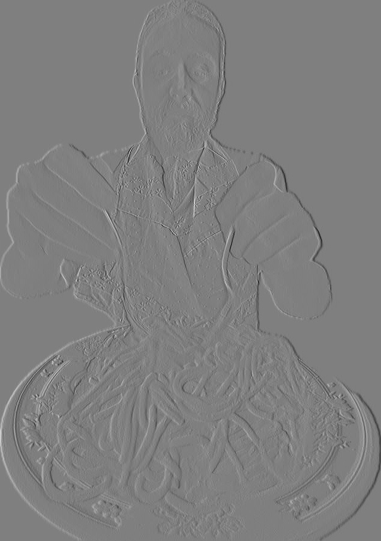<figcaption>Image * Dx</figcaption></figure>
  <figure>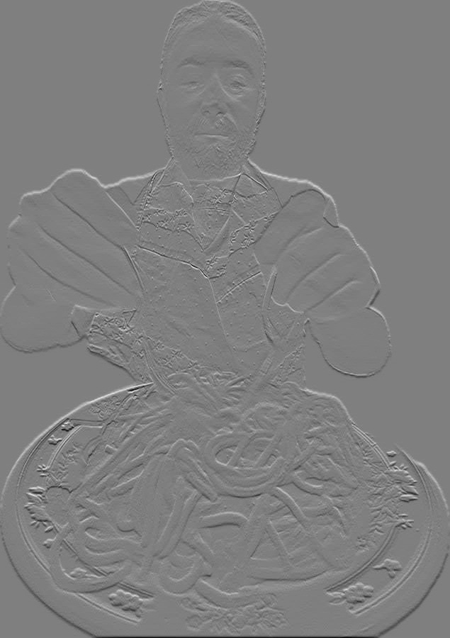<figcaption>Image * Dy</figcaption></figure>
  <figure>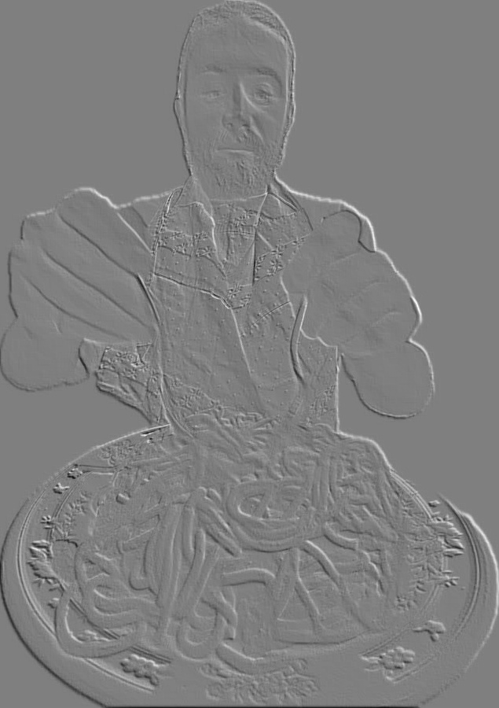<figcaption>Image * D45</figcaption></figure>
  <figure>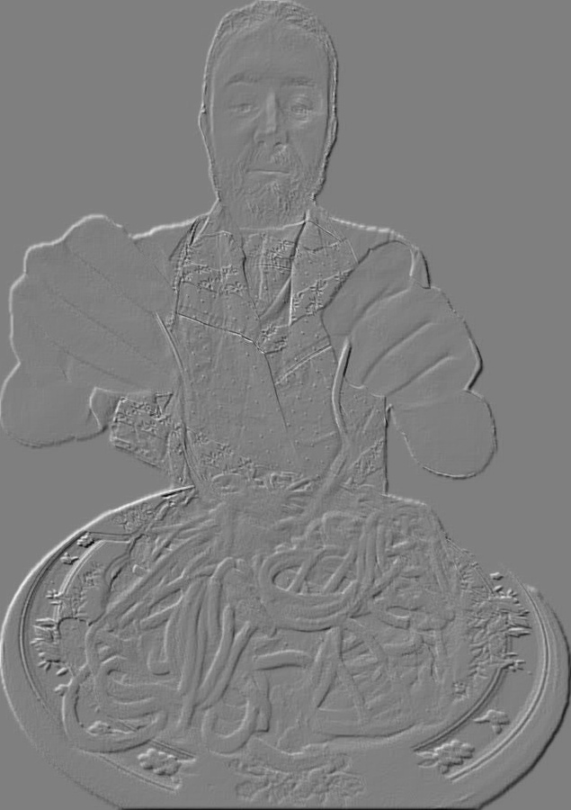<figcaption>Image * D135</figcaption></figure>
</div>

Dx picks up mainly vertical edges and Dy mainly horizontal ones. D45 and D135 pick up the diagonals in between.

The sign shows which side of the edge is brighter. Convolution flips $$ D_x $$, so the output is $$ I(x+1) - I(x-1) $$: it is positive (white) where the image gets brighter to the right and negative (black) where it gets darker. $$ D_y $$ works the same way downward, so a dark object on a bright background gets a black edge on one side and a white edge on the other.

### 1.2 Finite Difference Operator

The cameraman image is convolved with $$ D_x $$ and $$ D_y $$ using `scipy.signal.convolve2d`, and the gradient magnitude is computed from the two partial derivatives. The image borders are reflected (`boundary="symm"`) rather than zero padded. The edge image is the gradient magnitude binarized at a threshold. Code: `Assignment 2/src/finite_diff.py`.

$$ \lVert \nabla f \rVert = \sqrt{\left(\frac{\partial f}{\partial x}\right)^2 + \left(\frac{\partial f}{\partial y}\right)^2} $$

```python
dx = convolve2d(img, DX, mode="same", boundary="symm")
dy = convolve2d(img, DY, mode="same", boundary="symm")
mag = np.sqrt(dx ** 2 + dy ** 2)
edges = mag > threshold
```

<div class="media-grid media-grid--2x2">
  <figure>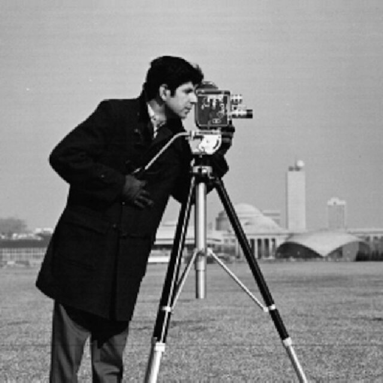<figcaption>Input</figcaption></figure>
  <figure>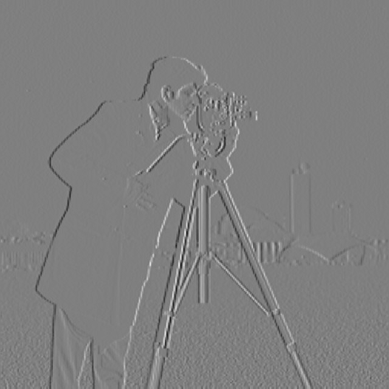<figcaption>df/dx</figcaption></figure>
  <figure>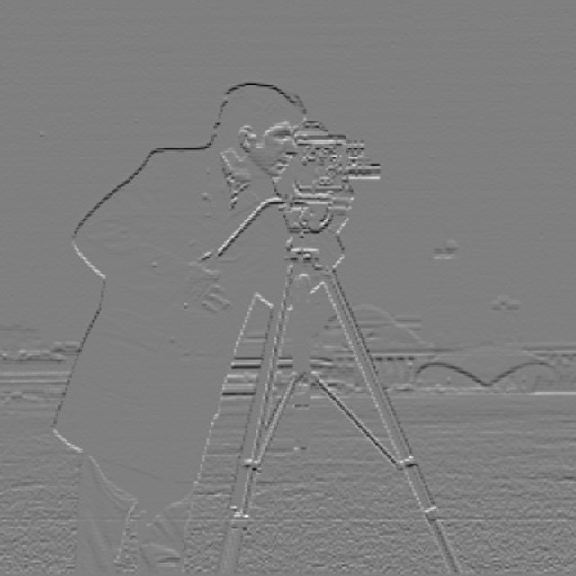<figcaption>df/dy</figcaption></figure>
  <figure>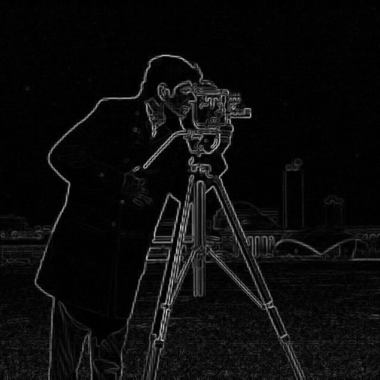<figcaption>Gradient magnitude</figcaption></figure>
</div>

#### Threshold progression

The gradient magnitude ranges from 0 to 0.86. The median is 0.012 and the 99th percentile is 0.39.

<div class="media-grid">
  <figure>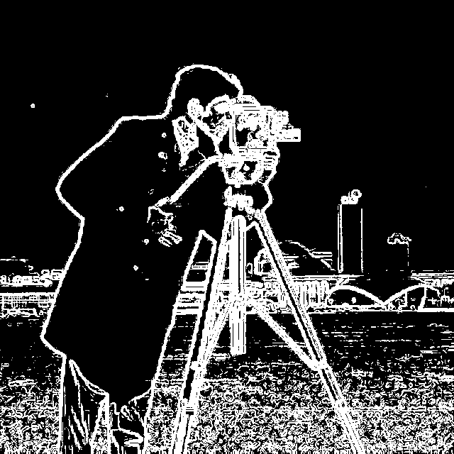<figcaption>t = 0.05</figcaption></figure>
  <figure>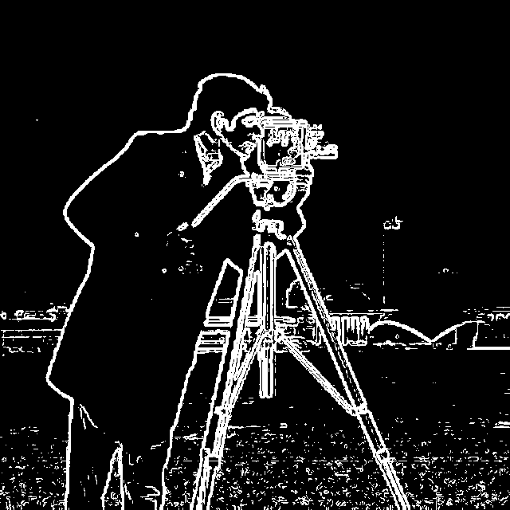<figcaption>t = 0.10</figcaption></figure>
  <figure>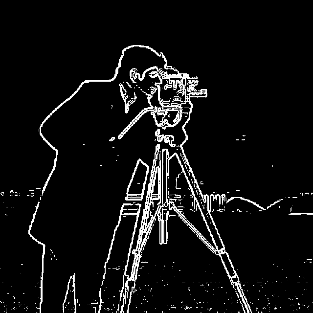<figcaption>t = 0.15</figcaption></figure>
</div>
<div class="media-grid">
  <figure>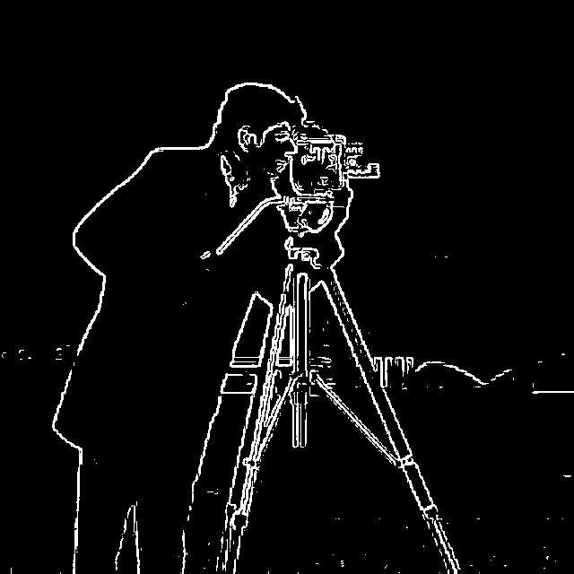<figcaption>t = 0.20</figcaption></figure>
  <figure>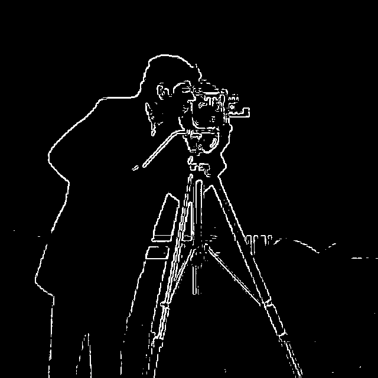<figcaption>t = 0.25</figcaption></figure>
  <figure>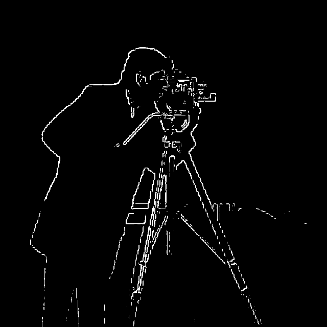<figcaption>t = 0.30</figcaption></figure>
</div>

#### Chosen threshold: t = 0.20

<figure>
  
  <figcaption>Binarized gradient magnitude, t = 0.20</figcaption>
</figure>

Much of the noise comes from the grass and the texture of the man's clothing. Small changes in brightness along the surface of the grass create high-frequency signals, which show up as noise in the thresholded image. I chose t = 0.20 as the best tradeoff: most of the noise is gone while the main edges stay.

The low-contrast edges in the background disappear first as the threshold rises. At t = 0.10 the thin tower and the outlines of the buildings are visible; by t = 0.20 the tower is gone and the buildings are faint; by t = 0.30 the buildings and the horizon are mostly gone, and the edges of the tripod legs start to break into dashes. The outline of the man against the sky has the highest contrast and survives every threshold.

### 1.3 Derivative of Gaussian (DoG) Filter

The 2D Gaussian is the outer product of a 1D kernel from `cv2.getGaussianKernel`, with $$ \sigma = 2 $$ and a kernel size of $$ 6\sigma + 1 = 13 $$. Code: `Assignment 2/src/dog.py`.

```python
def gaussian_2d(sigma):
    g = cv2.getGaussianKernel(int(6 * sigma) | 1, sigma)
    return g @ g.T
```

#### Blur, then finite differences

The cameraman image is blurred with the Gaussian, and then the 1.2 steps are repeated on the blurred image.

```python
blurred = convolve2d(img, G, mode="same", boundary="symm")
dx = convolve2d(blurred, DX, mode="same", boundary="symm")
dy = convolve2d(blurred, DY, mode="same", boundary="symm")
mag = np.sqrt(dx ** 2 + dy ** 2)
```

<div class="media-grid media-grid--2x2">
  <figure><figcaption>Blurred (sigma = 2)</figcaption></figure>
  <figure>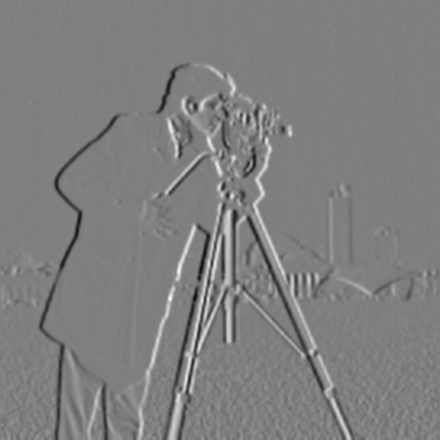<figcaption>df/dx of blurred</figcaption></figure>
  <figure><figcaption>df/dy of blurred</figcaption></figure>
  <figure>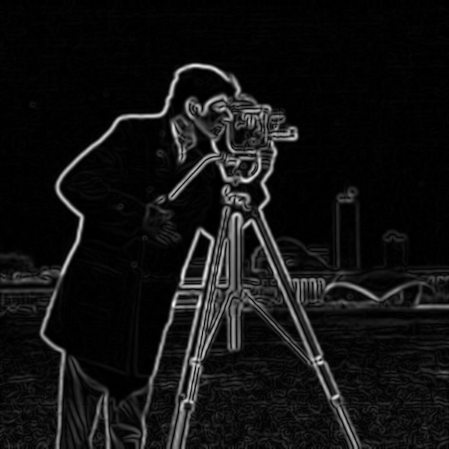<figcaption>Gradient magnitude of blurred</figcaption></figure>
</div>

The gradient magnitude of the blurred image goes up to 0.32 (it was 0.86 without blur). The median is 0.005 and the 99th percentile is 0.20, so the thresholds below are lower than in 1.2.

<div class="media-grid">
  <figure>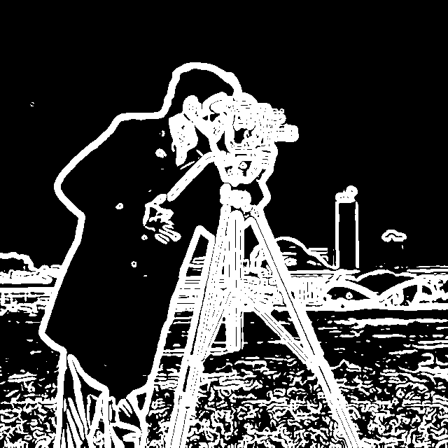<figcaption>t = 0.02</figcaption></figure>
  <figure>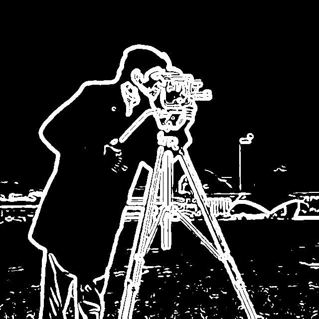<figcaption>t = 0.04</figcaption></figure>
  <figure>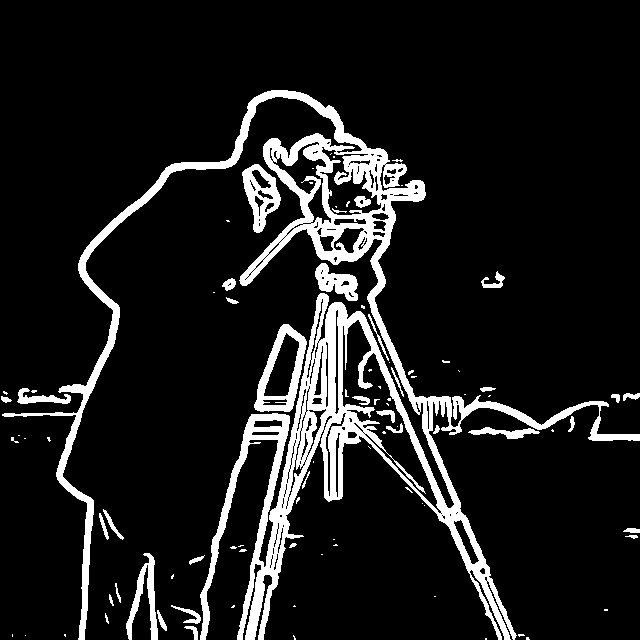<figcaption>t = 0.06</figcaption></figure>
</div>
<div class="media-grid">
  <figure>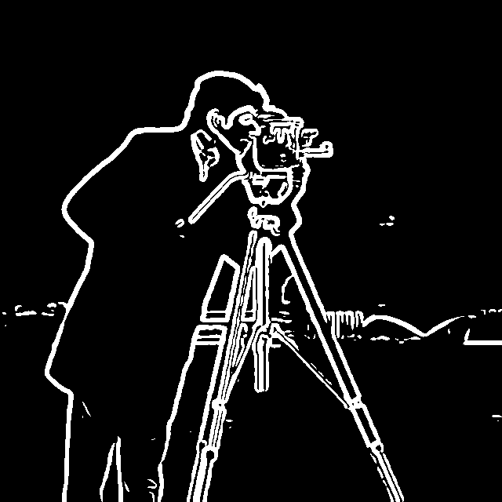<figcaption>t = 0.08</figcaption></figure>
  <figure>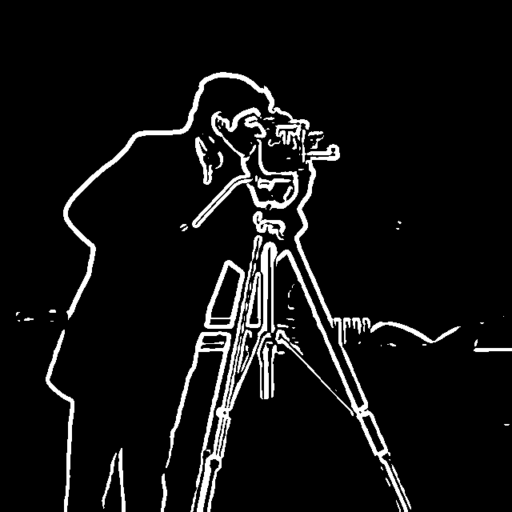<figcaption>t = 0.10</figcaption></figure>
  <figure>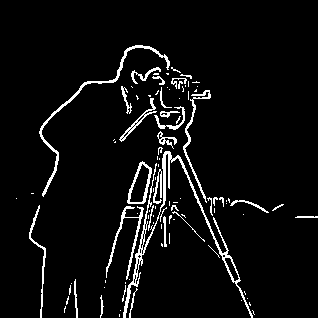<figcaption>t = 0.12</figcaption></figure>
</div>

#### Comparison with the finite difference method

<div class="media-grid">
  <figure><figcaption>Finite difference only (1.2), t = 0.20</figcaption></figure>
  <figure><figcaption>Gaussian, then finite difference, t = 0.06</figcaption></figure>
</div>

Blurring first removes much of the high-frequency noise, so the noise from the grass and the sky is reduced. The blur also removes some of the texture, since texture is mostly high frequency. The edges are more pronounced, because blurring makes them thicker. With less noise, a much lower threshold captures the edges than with the finite difference alone.

The magnitude range shrinks because the blur acts as a low-pass filter, so the maximum magnitude present in the image is reduced.

The cost of blurring is localization and fine detail. The thicker edges make the exact position of each edge less precise, and nearby edges merge: the details of the camera run together into blobs, and the thin tower in the background disappears.

#### DoG filters

Convolving the Gaussian with $$ D_x $$ and $$ D_y $$ gives the derivative of Gaussian filters, so the blur and the derivative become one convolution:

$$ (I * G) * D_x = I * (G * D_x) $$

```python
dog_x = convolve2d(G, DX)
dog_y = convolve2d(G, DY)
dx = convolve2d(img, dog_x, mode="same", boundary="symm")
dy = convolve2d(img, dog_y, mode="same", boundary="symm")
```

<div class="media-grid">
  <figure>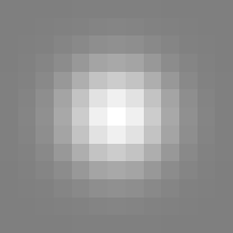<figcaption>Gaussian G (13 x 13)</figcaption></figure>
  <figure>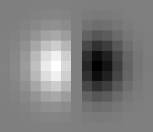<figcaption>G * Dx (13 x 15)</figcaption></figure>
  <figure>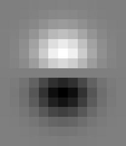<figcaption>G * Dy (15 x 13)</figcaption></figure>
</div>

Applying the DoG filters directly to the image:

<div class="media-grid media-grid--2x2">
  <figure><figcaption>Image * (G * Dx)</figcaption></figure>
  <figure>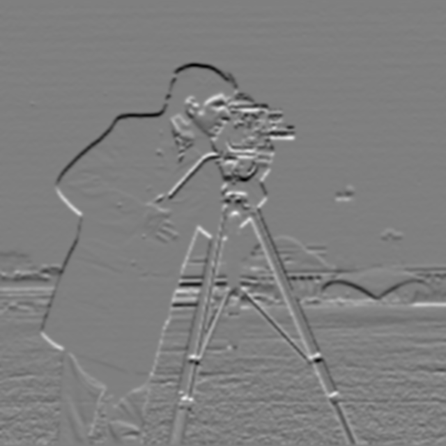<figcaption>Image * (G * Dy)</figcaption></figure>
  <figure><figcaption>Gradient magnitude (DoG)</figcaption></figure>
  <figure>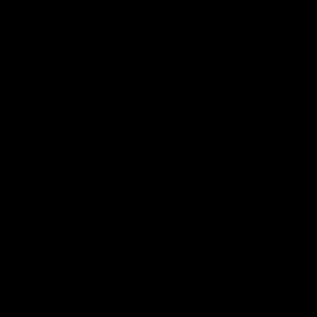<figcaption>|two-step - DoG| on the magnitude scale</figcaption></figure>
</div>

The difference image is shown on the same scale as the gradient magnitude images and comes out completely black. The largest difference between the two-step and DoG magnitudes is 1.65e-15, about 5e-15 of the brightest magnitude. That is far below one grey level (1/255), so every pixel rounds to 0.

The result is the same for every image, not just this one. Convolution is associative, so $$ (I * G) * D = I * (G * D) $$ exactly. The ~1e-15 difference is floating-point rounding, because the two methods do the arithmetic in a different order. One convolution is not fewer multiplications: the two-step method does 169 + 2 per pixel and the 13 x 15 DoG does 195. The benefit is a single pass over the image with no intermediate blurred image, and one filter that is built once, can be shown as an image, and can be reused on any image.

### Bells & Whistles: Gradient Orientation

The orientation comes from the DoG gradients in 1.3 ($$ \sigma = 2 $$). $$ g_y $$ is negated so that positive y points up, which makes angles count counter-clockwise from the +x axis as on a unit circle. The angle is built up from the first octant using the half-angle identity and a Taylor series:

$$ \arctan t = 2 \arctan \frac{t}{1 + \sqrt{1 + t^2}}, \qquad \arctan t \approx \sum_{k=0}^{7} \frac{(-1)^k \, t^{2k+1}}{2k + 1} $$

The result matches the true angle to within 3e-13 rad. Code: `Assignment 2/src/orientation.py`.

```python
def arctan(t, terms=8):
    for _ in range(2):
        t = t / (1 + np.sqrt(1 + t * t))
    return 4 * sum((-1) ** k * t ** (2 * k + 1) / (2 * k + 1) for k in range(terms))


def orientation(gx, gy):
    ax, ay = np.abs(gx), np.abs(gy)
    big, small = np.maximum(ax, ay), np.minimum(ax, ay)
    t = np.divide(small, big, out=np.zeros_like(big), where=big > 0)
    theta = arctan(t)                                    # [0, pi/4]
    theta = np.where(ay > ax, np.pi / 2 - theta, theta)  # [0, pi/2]
    theta = np.where(gx < 0, np.pi - theta, theta)       # [0, pi]
    theta = np.where(gy < 0, 2 * np.pi - theta, theta)   # [0, 2*pi]
    return np.mod(theta, 2 * np.pi)
```

Computing the ratio of $$ g_y $$ and $$ g_x $$ disregards the signs, so slopes in opposing directions return the same value: a slope up to the right and a slope down to the left produce the same result. The signs therefore need to be preserved. This is done by first computing the ratio from the absolute values of $$ g_x $$ and $$ g_y $$, which puts the result in the first quadrant. Afterwards the signs place it in the correct quadrant: if $$ g_x < 0 $$ it points left, and if $$ g_y < 0 $$ it points down. The min/max of $$ \lvert g_x \rvert $$ and $$ \lvert g_y \rvert $$ normalizes the ratio to $$ [0, 1] $$, but it matters which one is larger: if $$ \lvert g_y \rvert > \lvert g_x \rvert $$ the angle is mirrored across the 45 degree line, and that has to be undone. This also keeps $$ t $$ in the range where the Taylor series works and avoids dividing by zero when $$ g_x = 0 $$. Three reflections then rebuild the full circle from the first octant: $$ \theta \to \pi/2 - \theta $$ when $$ \lvert g_y \rvert > \lvert g_x \rvert $$, $$ \theta \to \pi - \theta $$ when $$ g_x < 0 $$, and $$ \theta \to 2\pi - \theta $$ when $$ g_y < 0 $$.

The Taylor series for arctan is $$ t - t^3/3 + t^5/5 - \dots $$, and each term is about $$ t^2 $$ times the one before it. At $$ t = 1 $$ the terms barely shrink (1, 1/3, 1/5, ...), so it would take a huge number of terms to be accurate. The half-angle identity halves the angle using only a square root. Applying it twice takes the largest angle from 45 to 11.25 degrees ($$ t \approx 0.2 $$), where each term is about 25 times smaller than the last, so 8 terms are accurate to about 1e-13. The result is multiplied by 4 to undo the two halvings.

The orientation sets the hue and the gradient magnitude sets the brightness, so flat regions go dark. Hue is periodic, which means 0 and $$ 2\pi $$ get the same colour. The magnitude is scaled by its 99th percentile and clipped to 1. In the "edges only" images, the brightness is the binary edge map from 1.3 (t = 0.06), so every edge pixel is shown at full brightness.

```python
hsv = np.dstack([theta / (2 * np.pi), np.ones_like(theta), value])
rgb = hsv_to_rgb(hsv)                                        # HSV colour space
rgb = colormaps["twilight"](theta / (2 * np.pi))[..., :3] * value[..., None]  # cyclic colormap
```

Each wheel is the legend: angle is the gradient direction, and the distance from the centre is the magnitude.

#### HSV

<div class="media-grid">
  <figure>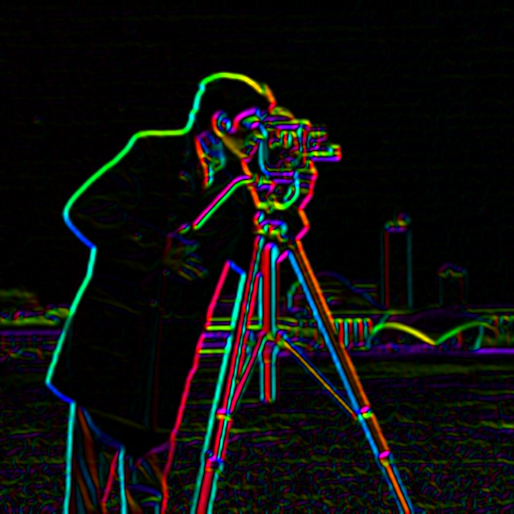<figcaption>Brightness = magnitude</figcaption></figure>
  <figure>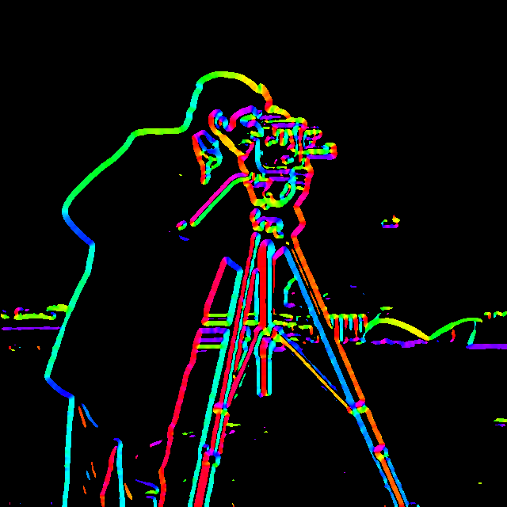<figcaption>Edges only</figcaption></figure>
  <figure>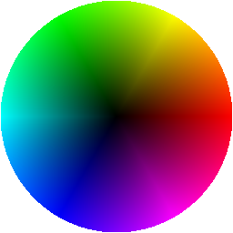<figcaption>Legend</figcaption></figure>
</div>

#### Matplotlib `twilight` (cyclic)

<div class="media-grid">
  <figure>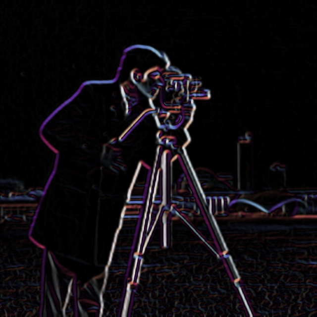<figcaption>Brightness = magnitude</figcaption></figure>
  <figure>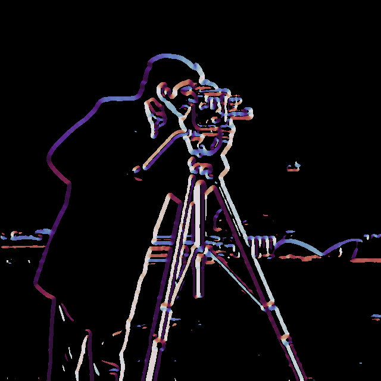<figcaption>Edges only</figcaption></figure>
  <figure>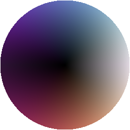<figcaption>Legend</figcaption></figure>
</div>

The hue corresponds to the orientation of the gradient and the brightness corresponds to its magnitude. The gradient points from dark to bright and is perpendicular to the edge, so a horizontal edge has a vertical gradient, and its hue is at the top or the bottom of the wheel depending on which side is brighter. As an example, the tripod's pan handle runs at 45 degrees from the camera down toward the bottom left of the image. It is a bright rod in front of the dark coat, so the gradient on each side points toward the rod. Its upper-left side is magenta (gradient pointing down and to the right on the wheel) and its lower-right side is green (pointing up and to the left), both perpendicular to the direction of the handle itself.

The colormap needs to be cyclic because the gradient direction is cyclic. An edge facing 359 degrees and an edge facing 1 degree point in almost the same direction. With a linear colormap those two edges would get opposite ends of the scale, so they would look completely different. A cyclic colormap joins the two ends, so the transition is seamless.

The two edges of a tripod leg get different colours because the gradient points toward the brighter side. On the left edge of the leg that is to the left, and on the right edge it is to the right, so the two sides are 180 degrees apart. That is why they show up as red and cyan, which are opposite each other on the wheel.

HSV reads better in my opinion, because the hues are more distinct and easier to tell apart. However, twilight is perceptually more uniform. In HSV, cyan and yellow edges appear brighter than blue edges, even though the blue edges may have a higher magnitude.

## Part 2: Fun with Frequencies

### 2.1 Image Sharpening

The Gaussian $$ G $$ (from 1.3, $$ \sigma = 2 $$) is a low-pass filter, so subtracting the blurred image from the original leaves the high frequencies. Adding a scaled amount $$ \alpha $$ of those back to the original gives the sharpened image, and the whole operation collapses into a single kernel, the unsharp mask filter:

$$ f + \alpha (f - f * G) = f * \big( (1 + \alpha)\, e - \alpha G \big) $$

where $$ e $$ is the unit impulse (1 at the centre, 0 elsewhere). Colour images are filtered one channel at a time. Code: `Assignment 2/src/unsharp.py`.

```python
def unsharp_kernel(sigma, a):
    g = gaussian_2d(sigma)
    impulse = np.zeros_like(g)
    impulse[g.shape[0] // 2, g.shape[1] // 2] = 1
    return (1 + a) * impulse - a * g


sharpened = conv(img, unsharp_kernel(sigma, a))
```

#### Taj Mahal

<div class="media-grid">
  <figure><figcaption>Original</figcaption></figure>
  <figure><figcaption>Blurred, f * G</figcaption></figure>
  <figure>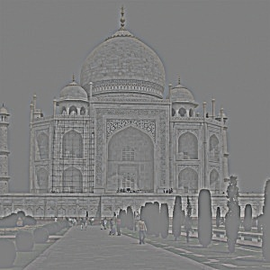<figcaption>High frequencies, f - f * G</figcaption></figure>
</div>

<div class="media-grid media-grid--2x2">
  <figure>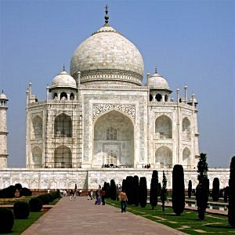<figcaption>Sharpened, alpha = 0.5</figcaption></figure>
  <figure><figcaption>Sharpened, alpha = 1</figcaption></figure>
  <figure>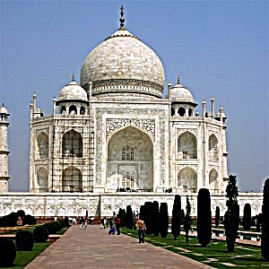<figcaption>Sharpened, alpha = 2</figcaption></figure>
  <figure>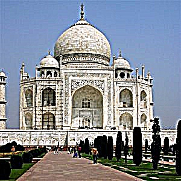<figcaption>Sharpened, alpha = 4</figcaption></figure>
</div>

#### Crazy cat

<div class="media-grid">
  <figure><figcaption>Original</figcaption></figure>
  <figure>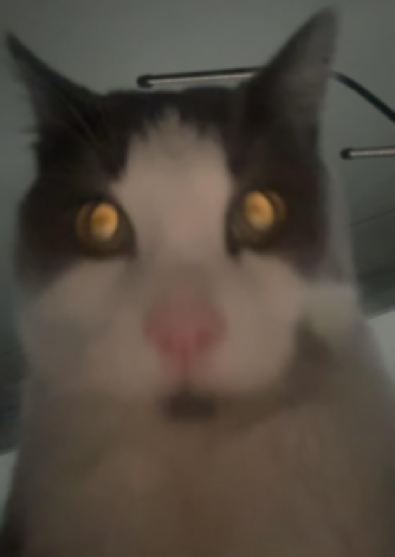<figcaption>Blurred, f * G</figcaption></figure>
  <figure>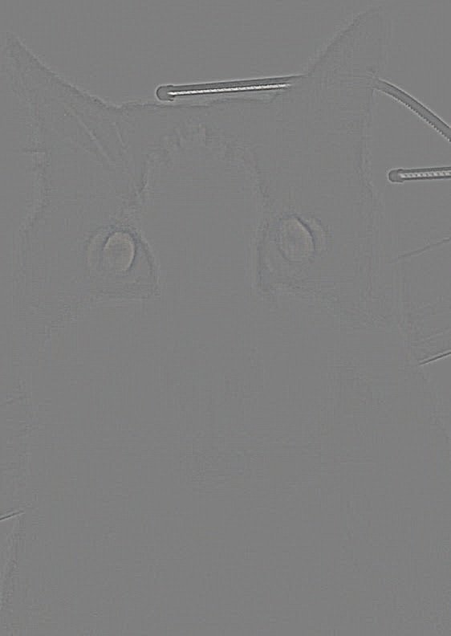<figcaption>High frequencies, f - f * G</figcaption></figure>
</div>

<div class="media-grid media-grid--2x2">
  <figure><figcaption>Sharpened, alpha = 0.5</figcaption></figure>
  <figure>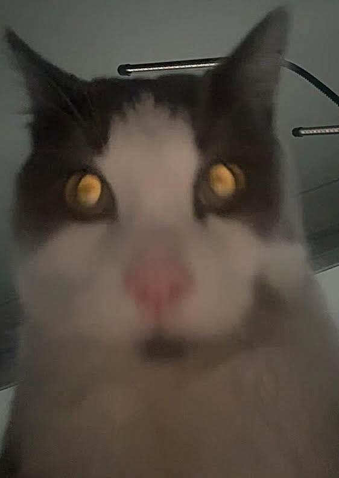<figcaption>Sharpened, alpha = 1</figcaption></figure>
  <figure>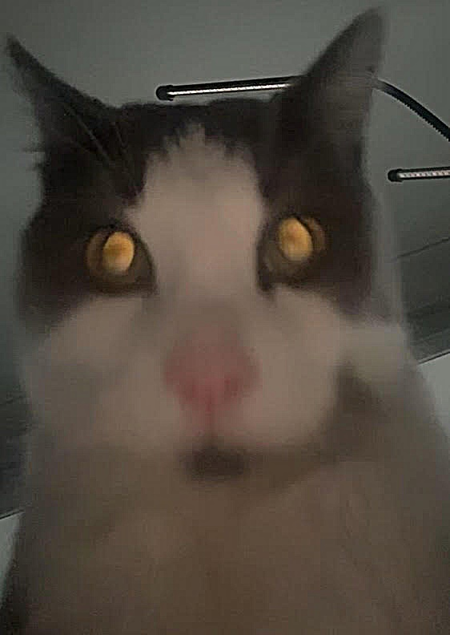<figcaption>Sharpened, alpha = 2</figcaption></figure>
  <figure>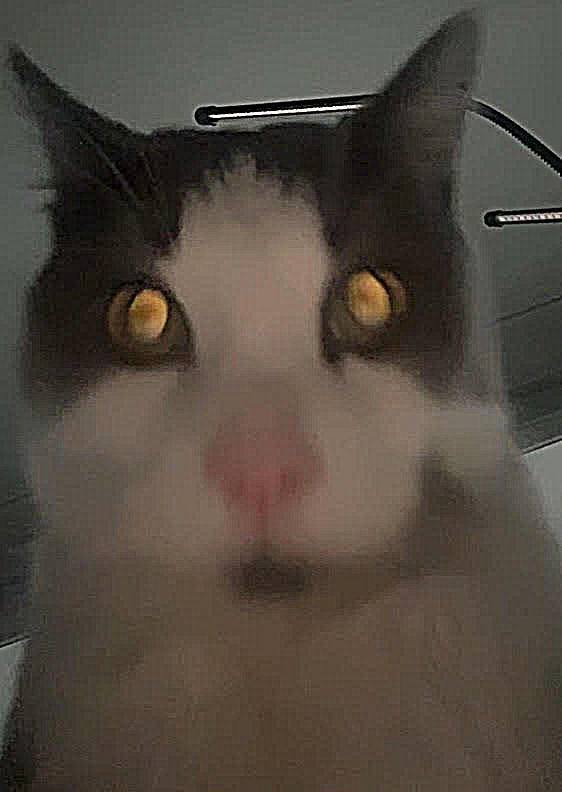<figcaption>Sharpened, alpha = 4</figcaption></figure>
</div>

Increasing $$ \alpha $$ adds more of the high frequencies back, so edges get crisper: the dome, arches, and minarets of the Taj Mahal, and the cat's eyes, whiskers, and the lamp behind it. Too much sharpening overshoots. Each channel is pushed past its true value on both sides of an edge, which creates bright and dark halos. At $$ \alpha = 4 $$ these are clear around the dome and the tops of the trees against the sky. Values that overshoot are clipped to 0 or 1, and when one channel clips more than the others the colour shifts. Noise and JPEG blocks are also high frequency, so they are amplified along with the real edges: the sky of the Taj Mahal turns blotchy, and the wall and fur in the cat photo show visible JPEG blocks. For both images, I think $$ \alpha = 1 $$ is the best tradeoff between crisp edges and minimal artifacts.

#### Blur, then re-sharpen

A sharp image is blurred with the same Gaussian and then sharpened again with the unsharp mask filter.

<div class="media-grid">
  <figure><figcaption>Original (sharp)</figcaption></figure>
  <figure><figcaption>Blurred, sigma = 2</figcaption></figure>
</div>

<div class="media-grid media-grid--2x2">
  <figure><figcaption>Re-sharpened, alpha = 0.5</figcaption></figure>
  <figure><figcaption>Re-sharpened, alpha = 1</figcaption></figure>
  <figure><figcaption>Re-sharpened, alpha = 2</figcaption></figure>
  <figure>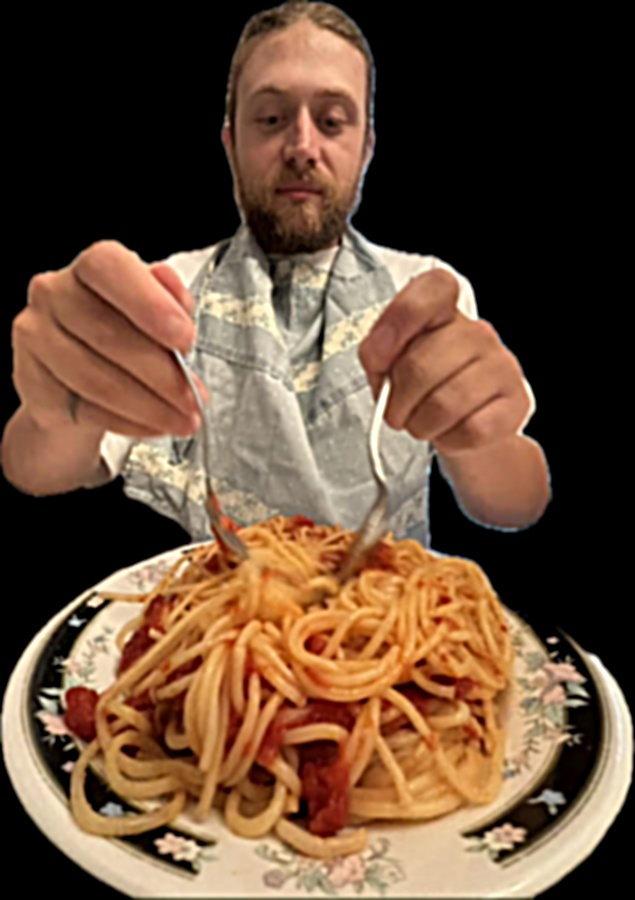<figcaption>Re-sharpened, alpha = 4</figcaption></figure>
</div>

The table gives the root mean square error between each image and the original (pixel values in [0, 1]):

| Image | RMSE vs original |
|-------|------------------|
| Blurred | 0.0334 |
| Re-sharpened, alpha = 0.5 | 0.0292 |
| Re-sharpened, alpha = 1 | 0.0260 |
| Re-sharpened, alpha = 2 | 0.0235 |
| Re-sharpened, alpha = 4 | 0.0336 |

Re-sharpening does not recover the original. The blur removes the smallest high-frequency details, and once they are gone the unsharp mask has nothing to amplify. For example, the pattern on the napkin around my neck is different in the original and the re-sharpened images. Instead, the filter sharpens the larger edges that survived the blur.

The error goes down and then back up. The blur weakens the mid frequencies without removing them completely, so a moderate $$ \alpha $$ boosts them back toward their original strength, and the RMSE drops from 0.0334 to 0.0235 at $$ \alpha = 2 $$. Past that point the same frequencies are boosted beyond their original strength, so the edges overshoot into halos, and at $$ \alpha = 4 $$ the error is higher than for the blurred image.

### 2.2 Hybrid Images

A hybrid image adds the low frequencies of one image to the high frequencies of another (Oliva, Torralba, and Schyns, 2006). Up close the high frequencies dominate, and from far away only the low frequencies are visible. The code is a Python port of the MATLAB starter (`hybrid_image_starter.m` and `align_images.m`). Code: `Assignment 2/src/hybrid.py`.

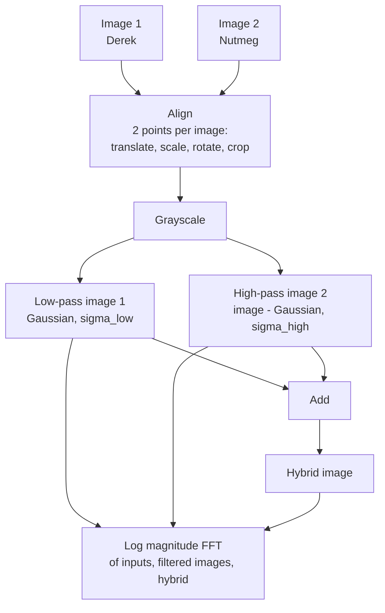

#### Alignment

Two points are clicked on each image (the eyes). `align_images` follows the MATLAB version step by step:

1. Pad each image so the midpoint of its two points is at the image centre.
2. Downscale the larger image so the distance between the points matches.
3. Rotate one image so the angle of the line between the points matches.
4. Crop both images to the same size.

The starter also has an optional manual crop at the end. Here it is done automatically instead: the borders are trimmed until neither image has any of the black fill left by the padding and rotation. The clicked points are saved, so the alignment is repeatable.

```python
def align_images(im1, im2, pts1, pts2):
    (x1, y1), (x2, y2) = pts1.T, pts2.T
    h1, w1 = im1.shape[:2]
    h2, w2 = im2.shape[:2]
    im1 = pad_y(pad_x(im1, round((w1 / 2 - x1.mean()) * 2)), round((h1 / 2 - y1.mean()) * 2))
    im2 = pad_y(pad_x(im2, round((w2 / 2 - x2.mean()) * 2)), round((h2 / 2 - y2.mean()) * 2))

    len1 = np.hypot(x1[1] - x1[0], y1[1] - y1[0])
    len2 = np.hypot(x2[1] - x2[0], y2[1] - y2[0])
    dscale = len2 / len1
    if dscale < 1:
        im1 = resize(im1, dscale)
    else:
        im2 = resize(im2, 1 / dscale)

    theta1 = np.arctan2(-(y1[1] - y1[0]), x1[1] - x1[0])
    theta2 = np.arctan2(-(y2[1] - y2[0]), x2[1] - x2[0])
    im1 = rotate(im1, np.degrees(theta2 - theta1), reshape=True, order=1)
    ...  # crop both to the same height and width
```

<div class="media-grid media-grid--2x2">
  <figure><figcaption>Derek (original)</figcaption></figure>
  <figure>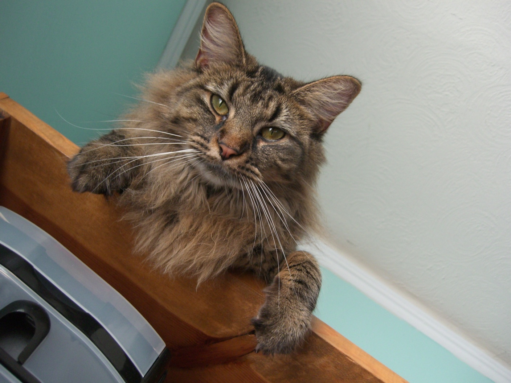<figcaption>Nutmeg (original)</figcaption></figure>
  <figure>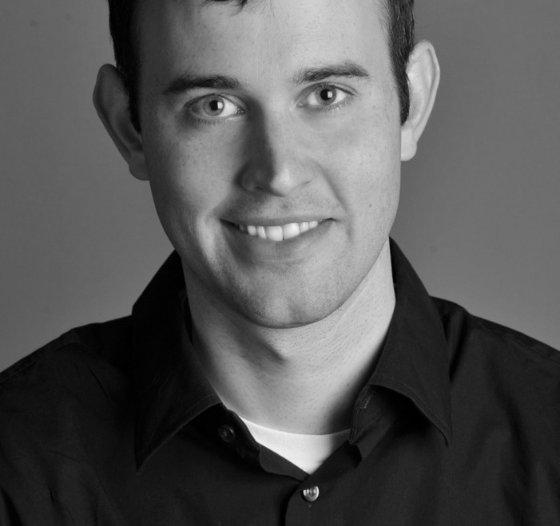<figcaption>Derek (aligned, grayscale)</figcaption></figure>
  <figure>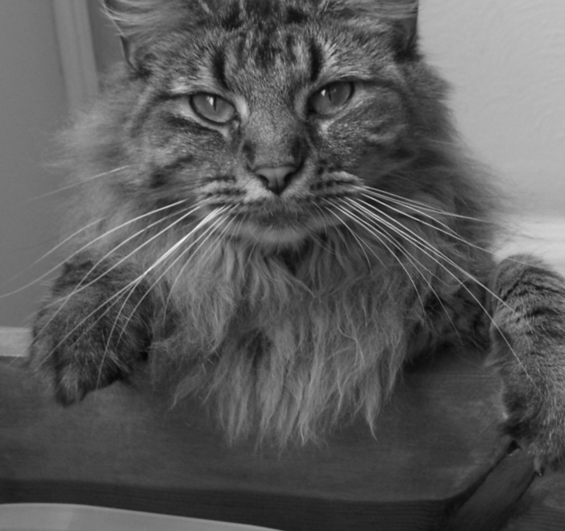<figcaption>Nutmeg (aligned, grayscale)</figcaption></figure>
</div>

Alignment is what makes the illusion work. When the eyes, nose, and mouth of the two faces line up, the visual system groups the low and high frequencies into one object (Oliva et al.), and sees one face at each distance. Without alignment, the result looks like a mess of high-frequency detail on top of an unrelated blurry background. Some of this shows in the family hybrids below, where faces photographed from different angles only line up around the eyes. The automatic crop removed the top of Derek's hair and the tips of Nutmeg's ears. They had to go because the black fill from padding and rotation creates sharp edges, which are high frequency and would show up in the hybrid as a frame.

#### Filtering

The low-pass filter is a Gaussian, and the high-pass filter is the impulse minus a Gaussian, computed by subtracting the blurred image from the original:

$$ H = I_1 * G_{\sigma_{low}} + \left( I_2 - I_2 * G_{\sigma_{high}} \right) $$

```python
def hybrid_image(im1, im2, sigma_low, sigma_high):
    low = gaussian_blur(im1, sigma_low)
    high = im2 - gaussian_blur(im2, sigma_high)
    return low, high, low + high
```

The cutoff of each filter is set by its $$ \sigma $$. The Fourier transform of a Gaussian is also a Gaussian, with a standard deviation of $$ 1 / (2\pi\sigma) $$ cycles per pixel. Its response falls to one half at

$$ f_c = \frac{\sqrt{2 \ln 2}}{2 \pi \sigma} \approx \frac{0.187}{\sigma} \text{ cycles per pixel} $$

The aligned images are 659 x 701, so the frequencies below are given in cycles per image (multiplied by 701).

#### Cutoff frequency

Rows change $$ \sigma_{low} $$ (Derek) and columns change $$ \sigma_{high} $$ (Nutmeg).

<div class="media-grid">
  <figure><figcaption>sigma_low 4 (33), sigma_high 2 (66)</figcaption></figure>
  <figure><figcaption>sigma_low 4 (33), sigma_high 4 (33)</figcaption></figure>
  <figure><figcaption>sigma_low 4 (33), sigma_high 8 (16)</figcaption></figure>
</div>
<div class="media-grid">
  <figure>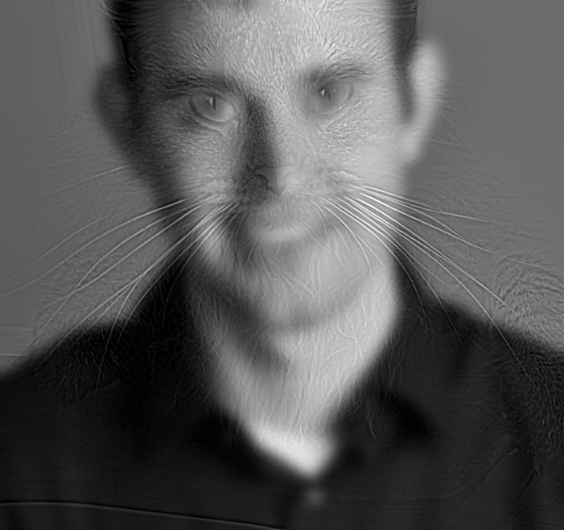<figcaption>sigma_low 8 (16), sigma_high 2 (66)</figcaption></figure>
  <figure><figcaption>sigma_low 8 (16), sigma_high 4 (33)</figcaption></figure>
  <figure><figcaption>sigma_low 8 (16), sigma_high 8 (16)</figcaption></figure>
</div>
<div class="media-grid">
  <figure><figcaption>sigma_low 16 (8), sigma_high 2 (66)</figcaption></figure>
  <figure><figcaption>sigma_low 16 (8), sigma_high 4 (33)</figcaption></figure>
  <figure><figcaption>sigma_low 16 (8), sigma_high 8 (16)</figcaption></figure>
</div>

Cutoffs in brackets are in cycles per image.

A larger $$ \sigma_{low} $$ blurs Derek more and keeps only his coarsest shapes. Those carry little contrast up close, so Nutmeg takes over sooner as $$ \sigma_{low} $$ grows. A larger $$ \sigma_{high} $$ also blurs more, but the blur is subtracted, so the high-pass filter keeps a wider band of frequencies and more of Nutmeg comes through. $$ \sigma_{high} = 2 $$ has the highest cutoff, so it keeps only the finest detail, the whiskers and fur. Raising it brings in lower frequencies such as the shading and the shape of her head.

The two images "leak" at the extremes of the grid. In the $$ \sigma_{low} = 4 $$ row, Derek's face and smile stay sharp enough to compete with the whiskers up close. In the $$ \sigma_{high} = 8 $$ column, Nutmeg's stripes and nose are still visible from across the room, most clearly at 16 / 8.

I chose $$ \sigma_{low} = 8 $$ and $$ \sigma_{high} = 4 $$ because it sits between those leaks. Derek keeps frequencies below about 16 cycles per image and Nutmeg keeps frequencies above about 33, so there is a small gap between the two bands. The gap is what makes the result look natural: with no gap, or an overlap, both Derek and Nutmeg would be visible at the same distance, like a double exposure. Because the Gaussians have soft tails, the gap is not empty, so the switch between the two is gradual.

#### Chosen result: sigma_low = 8, sigma_high = 4

<div class="media-grid">
  <figure><figcaption>Low-pass Derek</figcaption></figure>
  <figure>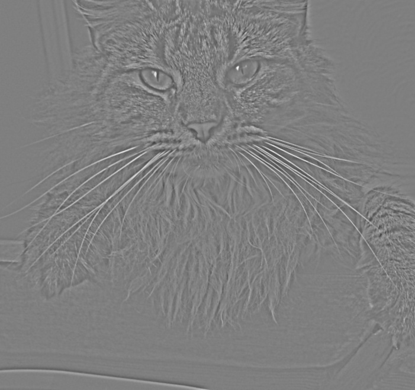<figcaption>High-pass Nutmeg (mid grey is zero)</figcaption></figure>
</div>

<figure>
  
  <figcaption>Hybrid</figcaption>
</figure>

The same hybrid at 1/2, 1/4, and 1/8 size, which is like viewing it from further away:

<div class="media-grid">
  <figure><figcaption>1/2</figcaption></figure>
  <figure><figcaption>1/4</figcaption></figure>
  <figure><figcaption>1/8</figcaption></figure>
</div>

#### Frequency analysis

Log magnitude of the 2D Fourier transform, computed as `np.log(np.abs(np.fft.fftshift(np.fft.fft2(gray_image))))`. All five spectra use the same grey scale (set from the two inputs), so brightness can be compared between them.

<div class="media-grid">
  <figure><figcaption>Derek</figcaption></figure>
  <figure><figcaption>Nutmeg</figcaption></figure>
</div>
<div class="media-grid">
  <figure><figcaption>Low-pass Derek</figcaption></figure>
  <figure><figcaption>High-pass Nutmeg</figcaption></figure>
  <figure><figcaption>Hybrid</figcaption></figure>
</div>

Low-pass filtering removes the high frequencies from Derek's image, such as texture, and weakens his edges. Only the bright blob in the centre of the spectrum is left, which holds the overall structure of his face. High-pass filtering does the opposite to Nutmeg: the centre of her spectrum goes dark, and the energy further out, from the fur and whiskers, is kept. Both contributions are easy to see in the hybrid spectrum, with Derek's low frequencies in the centre and Nutmeg's high frequencies around the outside.

The bright horizontal and vertical lines through the centre appear in every spectrum, so they are not part of either face. The FFT treats the image as if it repeats, so the left edge meets the right edge and the top meets the bottom. The jump in brightness at those borders is a sharp edge, and it shows up as the cross. Fading the image to black near its borders with a window function, such as a Hann window, would remove the jump and reduce the lines.

#### Cats

Two different cats, aligned on the eyes. Each photo was cropped around the cat's face before alignment, to a box 3.5 eye distances wide centred on the eyes, so the faces fill the frame and the two backgrounds take up less of it. Both arrangements are shown: each cat is used once as the low-frequency image and once as the high-frequency image. Both use $$ \sigma_{low} = 8 $$ and $$ \sigma_{high} = 4 $$.

<div class="media-grid">
  <figure><figcaption>Big cat (low frequencies)</figcaption></figure>
  <figure><figcaption>Little cat (high frequencies)</figcaption></figure>
  <figure><figcaption>Hybrid</figcaption></figure>
</div>

<div class="media-grid">
  <figure><figcaption>Little cat (low frequencies)</figcaption></figure>
  <figure><figcaption>Big cat (high frequencies)</figcaption></figure>
  <figure><figcaption>Hybrid</figcaption></figure>
</div>

The little cat (low) with the big cat (high) works better. The little cat's photo has the patterned pillow, and using it as the low-frequency image blurs that texture away. In the other arrangement the pillow pattern comes through strongly on the left. Even so, these two cats are not a great pair for a hybrid, because their faces are too similar to give two clearly different readings.

Some background clutter is left in both hybrids. The high-pass filter keeps every fine detail in its image, not only the cat. The patterned pillow and the printed blanket are full of high-frequency texture, so they come through as faint patterns around the cat. The low-pass image adds its own background as large blurred patches of colour and brightness. The two backgrounds do not match, so they do not cancel out the way the aligned faces do. Only the eyes are aligned, so anything that differs between the photos also shows up as faint double outlines, such as the ear shapes, the head tilt, and the body pose. Cropping to the faces reduced how much background is in the frame, but it cannot remove the background inside the crop. A tighter crop around each face would remove most of these artifacts. I deliberately left the crop looser so that this limitation of hybrid images stays visible.

#### Three-band hybrid: father and sisters

This extends the hybrid to three images. A third image adds a middle band of frequencies, taken with a band-pass filter: the difference of two Gaussians. Up close the high-pass image dominates, at a middle distance the band-pass image does, and from far away the low-pass image does.

$$ H = I_1 * G_{\sigma_{low}} + \left( I_2 * G_{\sigma_a} - I_2 * G_{\sigma_b} \right) + \left( I_3 - I_3 * G_{\sigma_{high}} \right) $$

```python
def three_band(im1, im_mid, im2, sigma_low, sigma_mid, sigma_high):
    low = gaussian_blur(im1, sigma_low)
    mid = gaussian_blur(im_mid, sigma_mid[0]) - gaussian_blur(im_mid, sigma_mid[1])
    high = im2 - gaussian_blur(im2, sigma_high)
    return low, mid, high, low + mid + high
```

The middle and high images are aligned to the low-frequency image using the same two-point translation, scale, and rotation as `align_images`, applied as a single warp. Both results use $$ \sigma_{low} = 14 $$, $$ \sigma_a = 4 $$, $$ \sigma_b = 10 $$, and $$ \sigma_{high} = 2 $$. For a 1350 px tall image this keeps the three bands apart:

| Band | Cycles per image |
|------|------------------|
| Low | below 18 |
| Middle | 25 to 63 |
| High | above 126 |

##### Father (low), sister 1 (middle), sister 2 (high)

<div class="media-grid">
  <figure><figcaption>Father (low)</figcaption></figure>
  <figure><figcaption>Sister 1 (middle)</figcaption></figure>
  <figure><figcaption>Sister 2 (high)</figcaption></figure>
</div>

<figure>
  
  <figcaption>Three-band hybrid</figcaption>
</figure>

<div class="media-grid">
  <figure><figcaption>1/2</figcaption></figure>
  <figure><figcaption>1/4</figcaption></figure>
  <figure><figcaption>1/8</figcaption></figure>
</div>

##### Sister 1 (low), father (middle), sister 2 (high)

<div class="media-grid">
  <figure><figcaption>Sister 1 (low)</figcaption></figure>
  <figure><figcaption>Father (middle)</figcaption></figure>
  <figure><figcaption>Sister 2 (high)</figcaption></figure>
</div>

<figure>
  
  <figcaption>Three-band hybrid</figcaption>
</figure>

<div class="media-grid">
  <figure><figcaption>1/2</figcaption></figure>
  <figure><figcaption>1/4</figcaption></figure>
  <figure><figcaption>1/8</figcaption></figure>
</div>

In both arrangements, the low band dominates at every size, from full size down to 1/8. The middle person is almost never clearly visible on their own and mixes with both neighbours. This is not because the bands overlap, since the table above shows they are kept apart. The middle band is narrow, so it holds much less of the image's energy than the low band, and the faces are already similar, so the middle face has nothing distinctive enough to stand out. The sister 1, father, sister 2 arrangement looks the most cohesive to me.

### Bells & Whistles: Hybrid Images

The same hybrid ($$ \sigma_{low} = 8 $$, $$ \sigma_{high} = 4 $$), with colour kept in the low-frequency image, the high-frequency image, both, or neither. Colour images are filtered one channel at a time.

<div class="media-grid media-grid--2x2">
  <figure><figcaption>Grayscale</figcaption></figure>
  <figure><figcaption>Colour low frequencies (Derek)</figcaption></figure>
  <figure><figcaption>Colour high frequencies (Nutmeg)</figcaption></figure>
  <figure><figcaption>Colour both</figcaption></figure>
</div>

Colour works best in the low-frequency image. Colour in most photos changes slowly across large regions such as skin, clothing, and walls, so it is mostly low-frequency information. The low-pass image keeps it, while the high-pass image keeps only the small amount of colour on fine edges. Nutmeg is almost grey, so colour in her high frequencies adds almost nothing: the high-frequency colour version looks nearly the same as the grayscale one. A colourful high-frequency subject would show more, but only as coloured fringes up close that fade out with distance like the rest of the high band. This matches human vision, which is much less sensitive to fine detail in colour than in brightness. That is also why JPEG stores colour at a lower resolution than brightness.

#### Cats

Same settings as above ($$ \sigma_{low} = 8 $$, $$ \sigma_{high} = 4 $$, cropped to the faces).

##### Big cat (low), little cat (high)

<div class="media-grid media-grid--2x2">
  <figure><figcaption>Grayscale</figcaption></figure>
  <figure><figcaption>Colour low frequencies (big cat)</figcaption></figure>
  <figure><figcaption>Colour high frequencies (little cat)</figcaption></figure>
  <figure><figcaption>Colour both</figcaption></figure>
</div>

##### Little cat (low), big cat (high)

<div class="media-grid media-grid--2x2">
  <figure><figcaption>Grayscale</figcaption></figure>
  <figure><figcaption>Colour low frequencies (little cat)</figcaption></figure>
  <figure><figcaption>Colour high frequencies (big cat)</figcaption></figure>
  <figure><figcaption>Colour both</figcaption></figure>
</div>

#### Three-band hybrids

With three bands, colour can be kept in the low, middle, or high band, or in all three. Same settings as above.

##### Father (low), sister 1 (middle), sister 2 (high)

<div class="media-grid">
  <figure><figcaption>Grayscale</figcaption></figure>
  <figure><figcaption>Colour low (father)</figcaption></figure>
  <figure><figcaption>Colour middle (sister 1)</figcaption></figure>
</div>
<div class="media-grid">
  <figure><figcaption>Colour high (sister 2)</figcaption></figure>
  <figure><figcaption>Colour all three</figcaption></figure>
</div>

##### Sister 1 (low), father (middle), sister 2 (high)

<div class="media-grid">
  <figure><figcaption>Grayscale</figcaption></figure>
  <figure><figcaption>Colour low (sister 1)</figcaption></figure>
  <figure><figcaption>Colour middle (father)</figcaption></figure>
</div>
<div class="media-grid">
  <figure><figcaption>Colour high (sister 2)</figcaption></figure>
  <figure><figcaption>Colour all three</figcaption></figure>
</div>

The cats are both grey and white, so colour mostly adds the pink nose and the warm background. In the three-band hybrids, colour fades as the cutoff frequency increases, because it is mainly low-frequency information. Colour in the low band carries over the whole image, very little of the middle band's colour comes through, and almost none of the high band's, although its edges are still visible. This supports the idea that colour helps most in the low frequencies, and the answer is the same as for Derek and Nutmeg: the low-frequency image carries almost all of the visible colour.

### 2.3 Gaussian and Laplacian Stacks

A stack is like a pyramid without downsampling: every level stays the same size as the original image. Each level of the Gaussian stack is the previous level blurred with the 5-tap binomial filter from the lecture, $$ \tfrac{1}{16}[1\ 4\ 6\ 4\ 1] $$, applied separably in x and y. A pyramid halves the image at each level, so a fixed-size filter covers twice as much of the scene each time. Without downsampling, the same effect comes from spreading the filter taps out instead: at level $$ i $$ there are $$ 2^i - 1 $$ zeros between taps. Only the 5 non-zero taps are computed, by adding shifted copies of the image. Each Laplacian level is the difference between neighbouring Gaussian levels. The last level is the Gaussian residual, so adding up the Laplacian stack gives back the original image. All images use 8 levels, and colour images are filtered one channel at a time. Code: `Assignment 2/src/stacks.py`.

$$ G_0 = I, \quad G_{i+1} = G_i * b_i, \quad L_i = G_i - G_{i+1}, \quad L_{N-1} = G_{N-1}, \quad \sum_i L_i = I $$

```python
BINOMIAL = np.array([1, 4, 6, 4, 1]) / 16


def blur(img, level):
    step = 2 ** level
    for axis in (0, 1):
        pad = [(0, 0)] * img.ndim
        pad[axis] = (2 * step, 2 * step)
        p = np.pad(img, pad, mode="symmetric")
        n = img.shape[axis]
        img = sum(w * np.take(p, np.arange(j * step, j * step + n), axis=axis) for j, w in enumerate(BINOMIAL))
    return img


def gaussian_stack(img, levels):
    stack = [img]
    for i in range(levels - 1):
        stack.append(blur(stack[-1], i))
    return stack


def laplacian_stack(img, levels):
    g = gaussian_stack(img, levels)
    return [g[i] - g[i + 1] for i in range(levels - 1)] + [g[-1]]
```

Adding up the Laplacian stack reproduces each input to within 2.2e-16. The family photos are downscaled so their longest side is 1000 px.

The Laplacian levels are band-pass images with positive and negative values. They are shown around mid grey (zero), each scaled by its own 99th percentile of absolute value so that the weaker fine levels are still visible. The residual is shown as is.

#### Apple

<div class="media-set">
<div class="media-grid">
  <figure><figcaption>G0</figcaption></figure>
  <figure><figcaption>G1</figcaption></figure>
  <figure><figcaption>G2</figcaption></figure>
  <figure><figcaption>G3</figcaption></figure>
</div>
<div class="media-grid">
  <figure><figcaption>G4</figcaption></figure>
  <figure><figcaption>G5</figcaption></figure>
  <figure><figcaption>G6</figcaption></figure>
  <figure><figcaption>G7</figcaption></figure>
</div>
</div>

<div class="media-set">
<div class="media-grid">
  <figure><figcaption>L0</figcaption></figure>
  <figure><figcaption>L1</figcaption></figure>
  <figure><figcaption>L2</figcaption></figure>
  <figure><figcaption>L3</figcaption></figure>
</div>
<div class="media-grid">
  <figure><figcaption>L4</figcaption></figure>
  <figure><figcaption>L5</figcaption></figure>
  <figure><figcaption>L6</figcaption></figure>
  <figure><figcaption>L7 (residual)</figcaption></figure>
</div>
</div>

#### Orange

<div class="media-set">
<div class="media-grid">
  <figure><figcaption>G0</figcaption></figure>
  <figure><figcaption>G1</figcaption></figure>
  <figure><figcaption>G2</figcaption></figure>
  <figure><figcaption>G3</figcaption></figure>
</div>
<div class="media-grid">
  <figure><figcaption>G4</figcaption></figure>
  <figure><figcaption>G5</figcaption></figure>
  <figure><figcaption>G6</figcaption></figure>
  <figure><figcaption>G7</figcaption></figure>
</div>
</div>

<div class="media-set">
<div class="media-grid">
  <figure><figcaption>L0</figcaption></figure>
  <figure><figcaption>L1</figcaption></figure>
  <figure><figcaption>L2</figcaption></figure>
  <figure><figcaption>L3</figcaption></figure>
</div>
<div class="media-grid">
  <figure><figcaption>L4</figcaption></figure>
  <figure><figcaption>L5</figcaption></figure>
  <figure><figcaption>L6</figcaption></figure>
  <figure><figcaption>L7 (residual)</figcaption></figure>
</div>
</div>

#### Father

<div class="media-set">
<div class="media-grid">
  <figure><figcaption>G0</figcaption></figure>
  <figure><figcaption>G1</figcaption></figure>
  <figure><figcaption>G2</figcaption></figure>
  <figure><figcaption>G3</figcaption></figure>
</div>
<div class="media-grid">
  <figure><figcaption>G4</figcaption></figure>
  <figure><figcaption>G5</figcaption></figure>
  <figure><figcaption>G6</figcaption></figure>
  <figure><figcaption>G7</figcaption></figure>
</div>
</div>

<div class="media-set">
<div class="media-grid">
  <figure><figcaption>L0</figcaption></figure>
  <figure><figcaption>L1</figcaption></figure>
  <figure><figcaption>L2</figcaption></figure>
  <figure><figcaption>L3</figcaption></figure>
</div>
<div class="media-grid">
  <figure><figcaption>L4</figcaption></figure>
  <figure><figcaption>L5</figcaption></figure>
  <figure><figcaption>L6</figcaption></figure>
  <figure><figcaption>L7 (residual)</figcaption></figure>
</div>
</div>

#### Sister 1

<div class="media-set">
<div class="media-grid">
  <figure><figcaption>G0</figcaption></figure>
  <figure><figcaption>G1</figcaption></figure>
  <figure><figcaption>G2</figcaption></figure>
  <figure><figcaption>G3</figcaption></figure>
</div>
<div class="media-grid">
  <figure><figcaption>G4</figcaption></figure>
  <figure><figcaption>G5</figcaption></figure>
  <figure><figcaption>G6</figcaption></figure>
  <figure><figcaption>G7</figcaption></figure>
</div>
</div>

<div class="media-set">
<div class="media-grid">
  <figure><figcaption>L0</figcaption></figure>
  <figure><figcaption>L1</figcaption></figure>
  <figure><figcaption>L2</figcaption></figure>
  <figure><figcaption>L3</figcaption></figure>
</div>
<div class="media-grid">
  <figure><figcaption>L4</figcaption></figure>
  <figure><figcaption>L5</figcaption></figure>
  <figure><figcaption>L6</figcaption></figure>
  <figure><figcaption>L7 (residual)</figcaption></figure>
</div>
</div>

#### Sister 2

<div class="media-set">
<div class="media-grid">
  <figure><figcaption>G0</figcaption></figure>
  <figure><figcaption>G1</figcaption></figure>
  <figure><figcaption>G2</figcaption></figure>
  <figure><figcaption>G3</figcaption></figure>
</div>
<div class="media-grid">
  <figure><figcaption>G4</figcaption></figure>
  <figure><figcaption>G5</figcaption></figure>
  <figure><figcaption>G6</figcaption></figure>
  <figure><figcaption>G7</figcaption></figure>
</div>
</div>

<div class="media-set">
<div class="media-grid">
  <figure><figcaption>L0</figcaption></figure>
  <figure><figcaption>L1</figcaption></figure>
  <figure><figcaption>L2</figcaption></figure>
  <figure><figcaption>L3</figcaption></figure>
</div>
<div class="media-grid">
  <figure><figcaption>L4</figcaption></figure>
  <figure><figcaption>L5</figcaption></figure>
  <figure><figcaption>L6</figcaption></figure>
  <figure><figcaption>L7 (residual)</figcaption></figure>
</div>
</div>

Going down the Gaussian stack, the high frequencies disappear first: texture goes first, then edges, until only large shapes and colour are left. Each Laplacian level holds one band of frequencies, getting coarser with each level. L0 holds the finest texture, such as hair, stubble, and fabric. The middle levels hold edges and outlines, like the rim of the apple in L3, and the later levels hold large blobs of brightness and colour. The only level that looks like a Gaussian level is the last one, because L7 is the residual G7. L0 is almost empty for the apple and the orange because they are old, soft scans with very little detail at the finest scale. Father L0, by comparison, is full of hair and beard detail.

Compared with a pyramid, a stack uses more memory, since every level is full size: 8 times the image instead of about 4/3 for a pyramid. Spreading the filter taps replaces the downsampling, and in exchange every level lines up pixel for pixel with the original, which makes the levels easy to display side by side and to blend with a mask.

#### Blends made from the family stacks

The father and sister stacks above are blended in 2.4. The results are repeated here next to the stacks that made them.

<div class="media-set">
<div class="media-grid">
  <figure><figcaption>Father | sister 1 (seam)</figcaption></figure>
  <figure><figcaption>Father | sister 2 (seam)</figcaption></figure>
  <figure><figcaption>Sister 1 | sister 2 (seam)</figcaption></figure>
</div>
<div class="media-grid">
  <figure><figcaption>Sister 2's eyes on father</figcaption></figure>
  <figure><figcaption>Father's face on sister 1</figcaption></figure>
  <figure><figcaption>Father's nose and mouth on sister 2</figcaption></figure>
</div>
</div>

#### Recreating Szeliski figure 3.42

The figure uses the mask blending described in 2.4, with a vertical step mask. The masked apple is $$ G^M_i L^A_i $$, the masked orange is $$ (1 - G^M_i) L^B_i $$, and the blended level is their sum. Within each of the first three rows, all three images share the same display scale. The bottom row adds up all 8 levels of each stack.

<div class="media-set">
<div class="media-grid">
  <figure><figcaption>(a) Masked apple, level 0</figcaption></figure>
  <figure><figcaption>(b) Masked orange, level 0</figcaption></figure>
  <figure><figcaption>(c) Blended, level 0</figcaption></figure>
</div>
<div class="media-grid">
  <figure><figcaption>(d) Masked apple, level 2</figcaption></figure>
  <figure><figcaption>(e) Masked orange, level 2</figcaption></figure>
  <figure><figcaption>(f) Blended, level 2</figcaption></figure>
</div>
<div class="media-grid">
  <figure><figcaption>(g) Masked apple, level 4</figcaption></figure>
  <figure><figcaption>(h) Masked orange, level 4</figcaption></figure>
  <figure><figcaption>(i) Blended, level 4</figcaption></figure>
</div>
<div class="media-grid">
  <figure><figcaption>(j) Masked apple, collapsed</figcaption></figure>
  <figure><figcaption>(k) Masked orange, collapsed</figcaption></figure>
  <figure><figcaption>(l) Blended, collapsed</figcaption></figure>
</div>
</div>

Each level is blended with the mask blurred to the matching level. At level 0 the mask is nearly a hard step, so the fine texture switches from apple to orange in a narrow strip. At level 4 the mask is very blurred, so the large shapes and colour cross-fade over a wide band. Adding the levels together gives a seam that is sharp for fine detail but gradual for brightness and colour, so no line is visible in the collapsed result.

### 2.4 Multiresolution Blending

Blending follows the mask algorithm on page 230 of Burt and Adelson. A Laplacian stack is built for each image, and a Gaussian stack for the mask. Each level is blended using the mask blurred to the same level, and the blended levels are added up. Because the mask gets wider at coarser levels, low frequencies mix over a wide band while fine detail switches over sharply, so no single seam is visible. The stacks are the ones from 2.3 (8 levels). Code: `Assignment 2/src/blend.py`.

$$ L^{blend}_i = G^M_i \, L^A_i + \left(1 - G^M_i\right) L^B_i, \qquad I^{blend} = \sum_i L^{blend}_i $$

```python
def blend_stacks(im1, im2, mask, levels):
    gm = gaussian_stack(mask, levels)
    l1, l2 = laplacian_stack(im1, levels), laplacian_stack(im2, levels)
    a = [m * x for m, x in zip(gm, l1)]
    b = [(1 - m) * x for m, x in zip(gm, l2)]
    return a, b, [x + y for x, y in zip(a, b)]


result = sum(blend_stacks(im1, im2, mask, 8)[2])
```

The mask method is needed because of the stacks. The simpler algorithm on page 226 joins the two Laplacian pyramids with a hard cut at every level. In a pyramid, the downsampling and upsampling blur that cut at the coarse levels, so it works. A stack never downsamples, so the cut would stay a hard step at every level and the result would look like a cut-and-paste.

#### The oraple

The mask is a vertical step: 1 on the left half (apple), 0 on the right (orange).

<figure>
  
  <figcaption>Oraple</figcaption>
</figure>

A hard cut would show a straight vertical line down the middle, where the red apple meets the brighter orange. The jump in overall brightness and colour would be the most obvious part, more than the change in texture. With the blended mask, the brightness and colour change is spread across a wide band, while the peel texture still stops sharply at the centre, where it does not stand out.

#### Vertical seams: father and sisters

Each pair is aligned on the eyes: the second photo is warped onto the first with the same two-point transform used in 2.2. The seam runs vertically through the midpoint between the eyes, with the first person on the left. If the warped photo does not cover part of the frame, the first photo is used there.

<div class="media-grid">
  <figure><figcaption>Father</figcaption></figure>
  <figure><figcaption>Sister 1 (aligned)</figcaption></figure>
  <figure><figcaption>Blended</figcaption></figure>
</div>

<div class="media-grid">
  <figure><figcaption>Father</figcaption></figure>
  <figure><figcaption>Sister 2 (aligned)</figcaption></figure>
  <figure><figcaption>Blended</figcaption></figure>
</div>

<div class="media-grid">
  <figure><figcaption>Sister 1</figcaption></figure>
  <figure><figcaption>Sister 2 (aligned)</figcaption></figure>
  <figure><figcaption>Blended</figcaption></figure>
</div>

Sister 1 and sister 2 blend best. Their skin tone and lighting are close, so the seam down the forehead and nose is hard to find, and the main giveaway is the different hairline at the top. Father and sister 2 blend worst: sister 2's forehead is much lighter, so a bright half and a darker half are visible even with the blend. Father and sister 1 are in between. Their tones are close, but their faces are angled differently, so the nose and mouth do not line up and the seam shows as a kink in the lips.

#### Irregular masks

The masks are generated shapes placed relative to the eyes of the base image. They are positioned from the midpoint between the eyes and sized by the distance between them. Ellipses are filled with the ellipse equation, and polygons are filled with matplotlib's `Path.contains_points`. In each mask, white keeps the base image and black brings in the second image.

```python
def make_mask(kind, shape, pts):
    c, d = pts.mean(0), np.hypot(*(pts[1] - pts[0]))
    if kind == "eyes":
        return ellipse(shape, c, (0.95 * d, 0.4 * d))
    if kind == "face":
        return ellipse(shape, (c[0], c[1] + 0.45 * d), (1.1 * d, 1.6 * d))
    if kind == "nose":
        return polygon(shape, (c[0], c[1] + 0.95 * d), 0.7 * d, 6, np.pi / 6)
```

##### Eye swap (ellipse): sister 2's eyes on father

<div class="media-grid media-grid--2x2">
  <figure><figcaption>Father (base)</figcaption></figure>
  <figure><figcaption>Sister 2 (aligned)</figcaption></figure>
  <figure><figcaption>Mask</figcaption></figure>
  <figure><figcaption>Blended</figcaption></figure>
</div>

##### Face swap (ellipse): father's face on sister 1

<div class="media-grid media-grid--2x2">
  <figure><figcaption>Sister 1 (base)</figcaption></figure>
  <figure><figcaption>Father (aligned)</figcaption></figure>
  <figure><figcaption>Mask</figcaption></figure>
  <figure><figcaption>Blended</figcaption></figure>
</div>

##### Nose and mouth swap (hexagon): father's nose and mouth on sister 2

<div class="media-grid media-grid--2x2">
  <figure><figcaption>Sister 2 (base)</figcaption></figure>
  <figure><figcaption>Father (aligned)</figcaption></figure>
  <figure><figcaption>Mask</figcaption></figure>
  <figure><figcaption>Blended</figcaption></figure>
</div>

The eye swap works best. The ellipse covers mostly skin and the lighting is similar, although sister 2's eyes are opened wider, which gives my father a surprised look. The face swap shows a lighter band along sister 1's hairline at the top of the ellipse, where my father's forehead meets her hair. The nose and mouth swap brings my father's grey stubble onto sister 2's face, and the bottom of the hexagon has a darker halo. The thin bright diagonal line on the left of that image is the edge of the warped photo of my father, where the alignment warp did not cover the frame.

#### Something different: cats and pasta

##### Little cat's face on pasta boy

<div class="media-grid media-grid--2x2">
  <figure><figcaption>Pasta boy (base)</figcaption></figure>
  <figure><figcaption>Little cat (aligned)</figcaption></figure>
  <figure><figcaption>Mask</figcaption></figure>
  <figure><figcaption>Blended</figcaption></figure>
</div>

##### Pasta boy's face on big cat

<div class="media-grid media-grid--2x2">
  <figure><figcaption>Big cat (base)</figcaption></figure>
  <figure><figcaption>Pasta boy (aligned)</figcaption></figure>
  <figure><figcaption>Mask</figcaption></figure>
  <figure><figcaption>Blended</figcaption></figure>
</div>

In the first blend, the cat's face is small for pasta boy's head, and a blue and purple fringe appears around the top of the head where the two backgrounds mix. The second works better than I expected, because the face sits inside the outline of the cat's head. What breaks the illusion there is skin against fur: the face has no fur texture, and its colour and lighting do not match the cat's.

#### The process: eye swap

This follows Burt and Adelson figure 10 for the eye swap. The rows are Laplacian levels 0, 2, and 4, and the bottom row adds up all 8 levels. The columns are the masked father, $$ G^M_i L^A_i $$, the masked sister, $$ (1 - G^M_i) L^B_i $$, and their sum. Within each row, all three images share the same display scale, around mid grey.

<div class="media-grid">
  <figure><figcaption>(a) Masked father, level 0</figcaption></figure>
  <figure><figcaption>(b) Masked sister 2, level 0</figcaption></figure>
  <figure><figcaption>(c) Blended, level 0</figcaption></figure>
</div>
<div class="media-grid">
  <figure><figcaption>(d) Masked father, level 2</figcaption></figure>
  <figure><figcaption>(e) Masked sister 2, level 2</figcaption></figure>
  <figure><figcaption>(f) Blended, level 2</figcaption></figure>
</div>
<div class="media-grid">
  <figure><figcaption>(g) Masked father, level 4</figcaption></figure>
  <figure><figcaption>(h) Masked sister 2, level 4</figcaption></figure>
  <figure><figcaption>(i) Blended, level 4</figcaption></figure>
</div>
<div class="media-grid">
  <figure><figcaption>(j) Masked father, collapsed</figcaption></figure>
  <figure><figcaption>(k) Masked sister 2, collapsed</figcaption></figure>
  <figure><figcaption>(l) Blended, collapsed</figcaption></figure>
</div>

The figure shows how far each level reaches past the edge of the mask. At level 0 the masked father has a flat grey ellipse with a sharp edge, so the two images barely overlap. By level 4 the mask has been blurred out to about 30 pixels on each side of its edge, so the eye region fades into the face over a wide band.

### Bells & Whistles: Blending

The oraple and the eye swap blended in grayscale and in colour. For colour, every channel is blended separately with the same mask stack.

<div class="media-grid">
  <figure><figcaption>Oraple, grayscale</figcaption></figure>
  <figure><figcaption>Oraple, colour</figcaption></figure>
</div>

<div class="media-grid">
  <figure><figcaption>Eye swap, grayscale</figcaption></figure>
  <figure><figcaption>Eye swap, colour</figcaption></figure>
</div>

Colour helps the oraple. The point of the oraple is a red apple turning into an orange, and in grayscale only the change in brightness (the orange half is much lighter) and texture is left. Colour does make the seam more noticeable, because red against orange is one more difference, but the wide blend at the coarse levels spreads it across the middle, so it reads as a gradual change rather than a line.

Colour mostly helps the eye swap too. Sister 2's blue-green eyes are a clear part of the swap, and grayscale loses them. Colour also exposes small skin-tone differences around the ellipse, where her skin is a little paler than my father's. Grayscale hides those differences but keeps any difference in brightness.

Two changes would reduce the colour mismatches. Matching the colour statistics of the second image to the first before blending (the mean and spread of each channel) would remove most of the skin-tone and brightness steps, such as the one in the father and sister 2 seam. Blending in a colour space that separates brightness from colour, such as Lab, would let colour be blended over a wider band than brightness. Human vision is less sensitive to fine colour detail, so this would hide colour mismatches without blurring texture.

## Tooling: Selecting Alignment Points

The hybrid images (2.2) and the blends (2.4) need two matching points on each photo, usually the centres of the eyes. They are picked with a small click tool modelled on `ginput` in the MATLAB starter. The image opens in a matplotlib window, and `plt.ginput(2)` waits for two clicks: first the left eye, then the right eye, as they appear on screen. The window closes after the second click.

```python
def get_points(img, n=2):
    plt.imshow(img, cmap="gray")
    plt.title(f"Click {n} points")
    pts = plt.ginput(n, timeout=0)
    plt.close()
    return np.array(pts)
```

The points are saved per image in `Assignment 2/data/points.json`, in the coordinates of the full-resolution original, so each photo only has to be clicked once. When an image is loaded at a smaller size, its points are scaled to match. Those two points then define everything else:

- **Alignment:** the translation, scale, and rotation that map one pair of points onto the other (the midpoint, the distance between the points, and the angle of the line between them).
- **Face crop:** the cat hybrids are cropped to a box sized in eye distances around the midpoint.
- **Masks:** the eye, face, and nose shapes in 2.4 are positioned from the midpoint and sized by the eye distance.

The images below show the stored points. The red circles are the two clicks, in order. The dashed line sets the scale and rotation, and the yellow cross marks the midpoint that the images are aligned on.

<div class="media-grid">
  <figure><figcaption>Father</figcaption></figure>
  <figure><figcaption>Sister 2</figcaption></figure>
</div>

## What I Learned

I found the stacks and the irregular masks the most interesting. The irregular masks are very similar to something you might do in Photoshop. The cat hybrids surprised me the most: I expected them to blend together better, but I think the effect was the least noticeable because the two cats look so similar. The hybrids of my family surprised me in the other direction. I assumed that the slightly different perspectives would hurt them, but they turned out well.

The Gaussian came up in every part of the assignment, so often that I would bet it is a dominant theme of the whole course. Closely tied to it is the idea of working one frequency band at a time: the hybrids combine a low and a high band, the stacks split an image into bands, and the blends join each band separately.

The hardest part in practice was alignment. The two-point alignment had to be ported from the MATLAB starter, the clicked points had to be saved so results were repeatable, the black fill from padding and rotation had to be cropped away, and the three-band hybrids and blends needed a third image warped into place. Even then, faces photographed from slightly different angles never line up everywhere, which is what shows in the father and sister 1 seam. Choosing the cutoff frequencies was also trial and error, which is why I made the sweep grid instead of picking a single value.
