## Procedure: Capturing the Source Images

The source images come from videos taken on an iPhone at the Grand Canyon. The frames were pulled out of the videos afterwards, which gives many closely spaced views of each scene to choose from.

All of the images for this assignment, the canyon videos, the horseshoe photos, and the book cover photos, were taken on an iPhone 15 with the 1x lens. I chose not to use the 0.5x ultra-wide lens because I knew its distortion would be strong and hard to remove, and a homography cannot model it. While filming, I turned in place as best I could without moving the camera. Because the phone was handheld, it turned around my body rather than exactly around the lens, so there is some small sideways motion. That motion causes parallax only in nearby objects. The canyon walls are far away, so they are barely affected.

The camera adjusted its exposure as I turned, and you can see this where frames overlap. The sky gets brighter as the view turns toward the sun. I turned as slowly as I reasonably could to keep motion blur down. The scene is distant rock faces, so nothing of substance moves in the frame. For the two canyon scenes I chose video over individual photos because it made it easier to keep the rotation steady, and it gave me plenty of frames to build the mosaics from. The cost is that video frames have lower resolution and more compression than iPhone photos, and that limits the fine detail in the mosaics. The horseshoe mosaic was made from individual photos instead.

<div class="media-grid" style="grid-template-columns: 1.78fr 0.56fr">
  <figure>
    <video src="../images/assignment-3/videos/IMG_0852.mp4" poster="../images/assignment-3/videos/IMG_0852_poster.jpg" controls loop muted playsinline></video>
    <figcaption>IMG_0852, landscape, 34 s</figcaption>
  </figure>
  <figure>
    <video src="../images/assignment-3/videos/IMG_0861.mp4" poster="../images/assignment-3/videos/IMG_0861_poster.jpg" controls loop muted playsinline></video>
    <figcaption>IMG_0861, portrait, 87 s</figcaption>
  </figure>
</div>

### Extracting frames

`Assignment 3/src/extract_frames.py` turns each video into a folder of still frames:

1. ffmpeg decodes the video (iPhone HEVC) and samples it at a fixed rate, 2 frames per second by default. ffmpeg also applies the rotation stored in the file, so portrait videos come out upright.
2. iPhones can record video in HDR (HLG). When a file is tagged as HDR, the frames are tone mapped to standard range so they do not look washed out. Both videos here are standard range, so this step was skipped.
3. Each frame is compared to the last frame that was kept, using a 128-pixel-wide blurred grayscale copy of both. If the mean absolute difference is below a threshold (0.1 on a 0 to 1 scale), the frame is too similar and is dropped.

```python
TONEMAP = ("zscale=t=linear:npl=100,format=gbrpf32le,zscale=p=bt709,"
           "tonemap=hable:desat=0,zscale=t=bt709:m=bt709:r=tv,format=yuv420p")

vf = f"fps={fps}" + ("," + TONEMAP if is_hdr(video) else "")
subprocess.run(["ffmpeg", "-v", "error", "-i", str(video), "-vf", vf,
                "-q:v", "2", f"{tmp}/%05d.jpg"], check=True)

last, kept = None, 0
for f in frames:
    t = thumb(f)
    if last is None or np.abs(t - last).mean() > diff:
        kept += 1
        shutil.move(f, out_dir / f"{video.stem}_{kept:04d}.jpg")
        last = t
```

| Video | Sampled frames | Kept frames |
|---|---|---|
| IMG_0852 | 68 | 13 |
| IMG_0861 | 174 | 81 |

Because the camera pans continuously in both videos, almost every pair of frames half a second apart differed by more than 0.04, so a low threshold kept nearly everything. Raising it to 0.1 keeps a frame only after the view has moved a fair amount, which left neighbouring kept frames overlapping by roughly half.

## Part A: Image Warping and Mosaicing

### A.1 Source Images

The first two mosaics are three frames each from the videos above. The third is three still photos of Horseshoe Bend, taken while turning in place. The same mosaics are used in Part B.

| Mosaic | Frames |
|---|---|
| canyon_slope | IMG_0852 frames 9, 10, 11 |
| canyon_ridge | IMG_0861 frames 40, 44, 48 |
| horseshoe | Photos IMG_0837, IMG_0839, IMG_0841 (Horseshoe Bend) |

<div class="media-grid">
  <figure>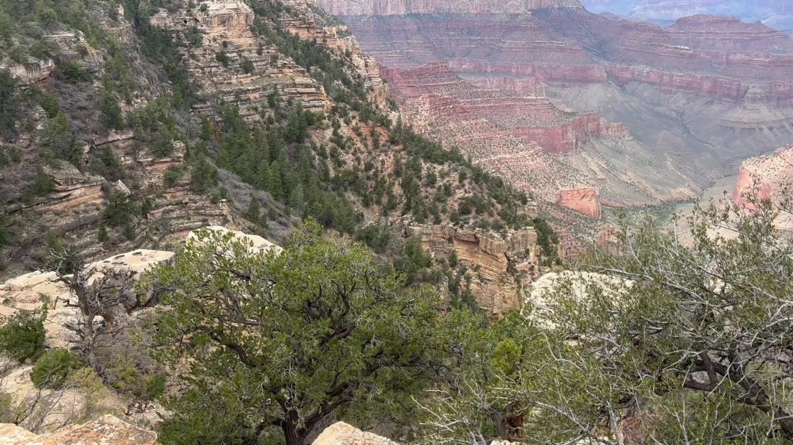<figcaption>canyon_slope, frame 9</figcaption></figure>
  <figure>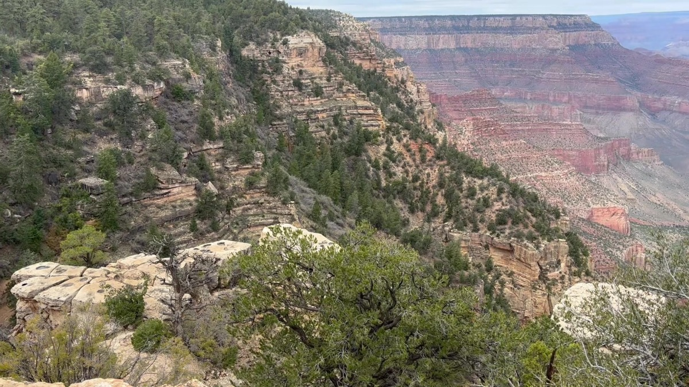<figcaption>canyon_slope, frame 10</figcaption></figure>
  <figure>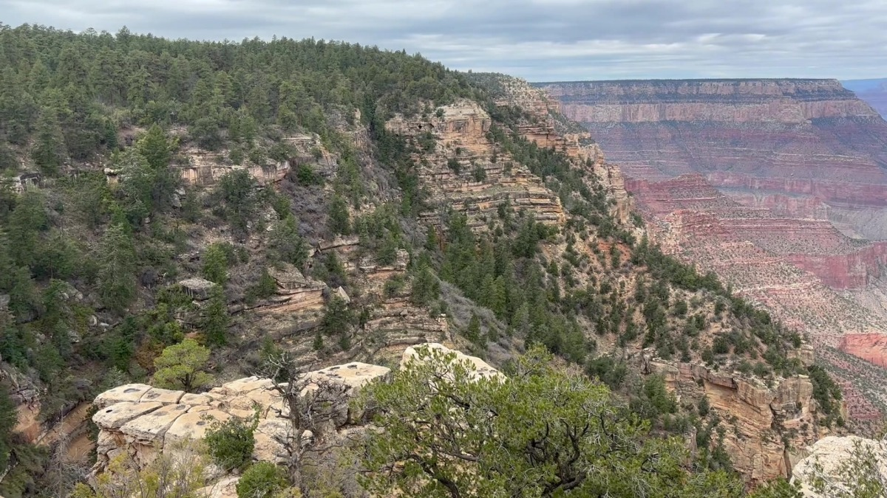<figcaption>canyon_slope, frame 11</figcaption></figure>
</div>
<div class="media-grid">
  <figure><figcaption>canyon_ridge, frame 40</figcaption></figure>
  <figure>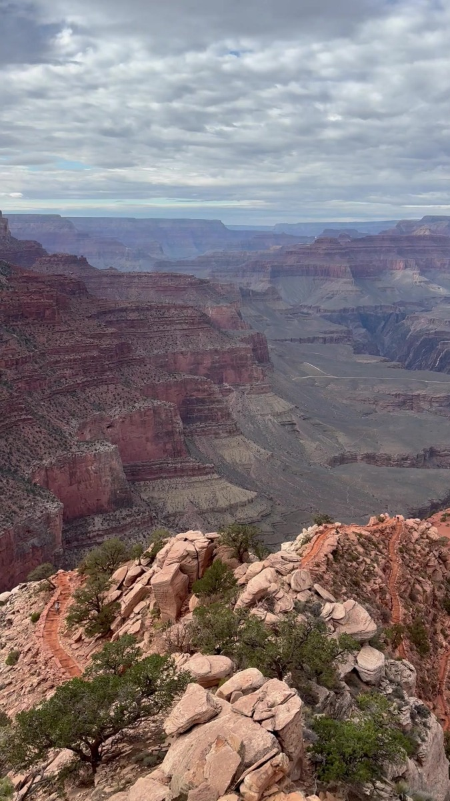<figcaption>canyon_ridge, frame 44</figcaption></figure>
  <figure>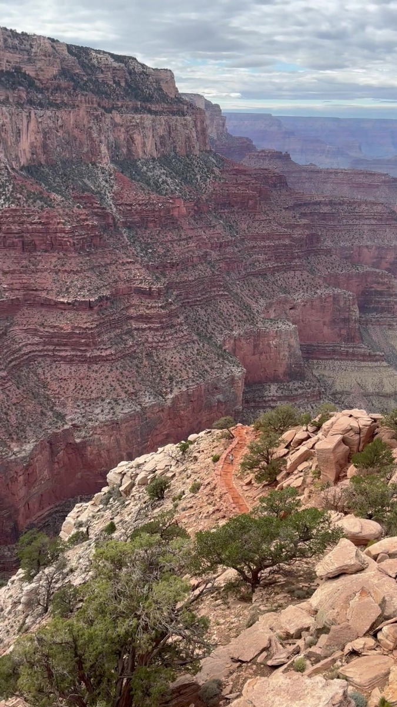<figcaption>canyon_ridge, frame 48</figcaption></figure>
</div>
<div class="media-grid">
  <figure>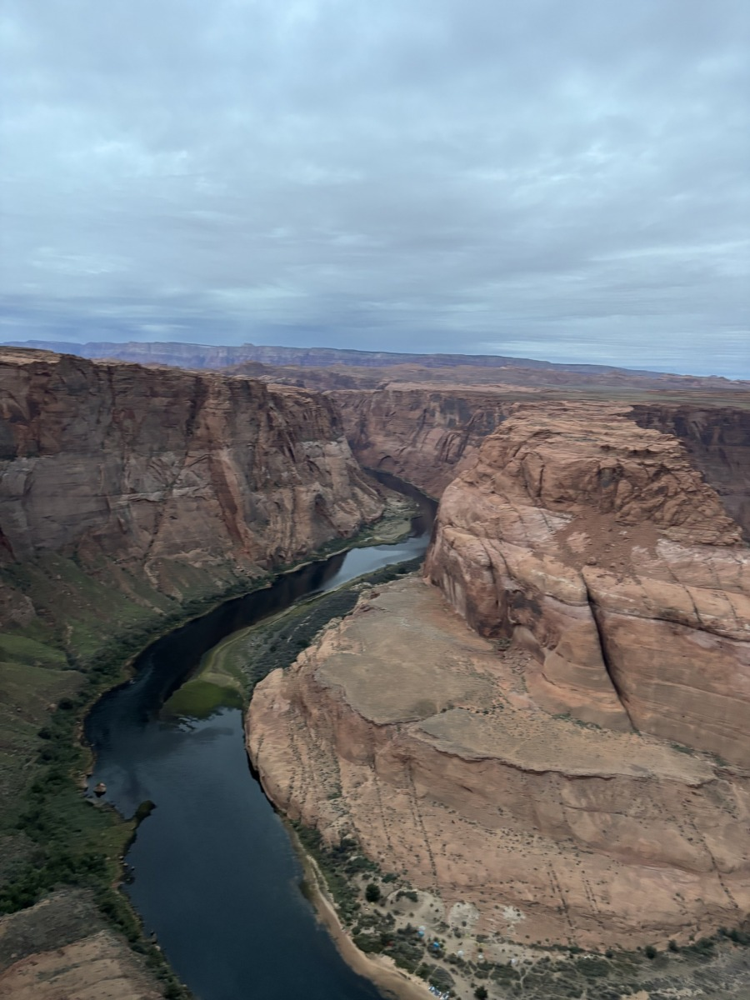<figcaption>horseshoe, IMG_0837</figcaption></figure>
  <figure>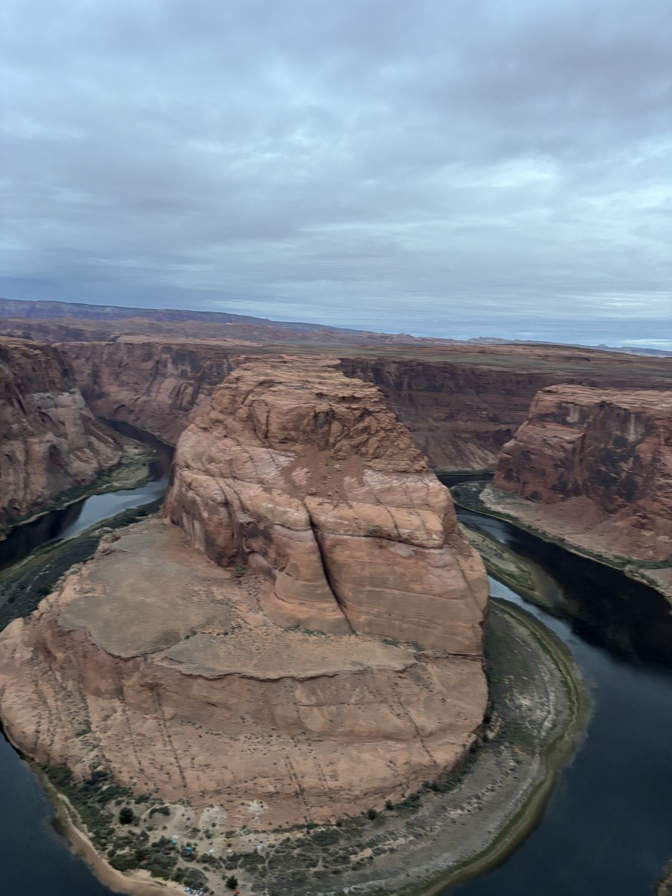<figcaption>horseshoe, IMG_0839</figcaption></figure>
  <figure>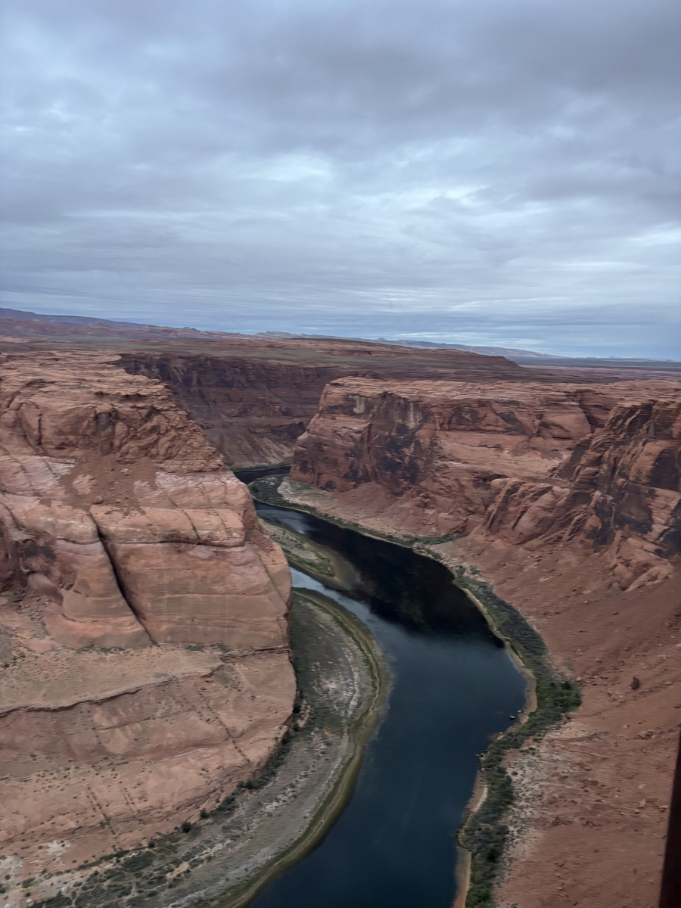<figcaption>horseshoe, IMG_0841</figcaption></figure>
</div>

### A.2 Recovering Homographies

Twelve correspondences were clicked by hand for each neighbouring pair of frames (`Assignment 3/src/click_points.py`).

<div class="media-grid media-grid--2x2">
  <figure>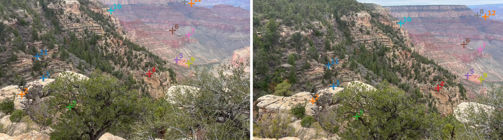<figcaption>canyon_slope, frames 9 and 10</figcaption></figure>
  <figure>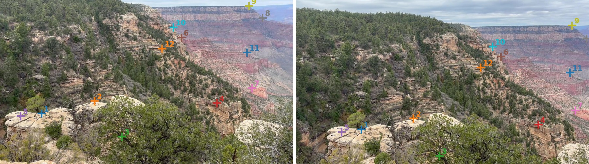<figcaption>canyon_slope, frames 10 and 11</figcaption></figure>
  <figure>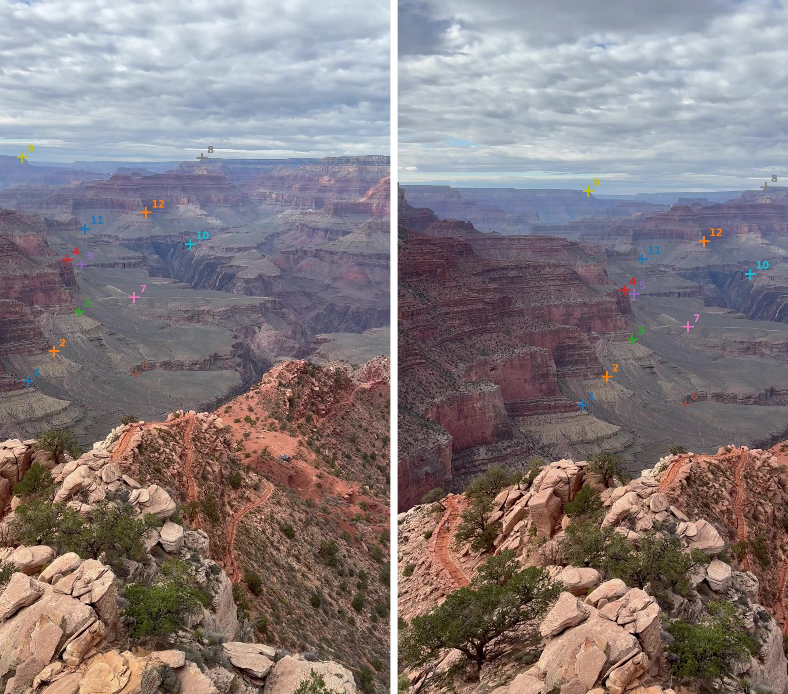<figcaption>canyon_ridge, frames 40 and 44</figcaption></figure>
  <figure>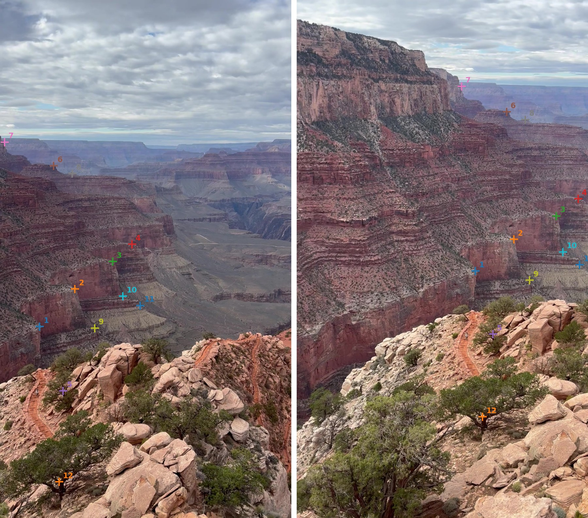<figcaption>canyon_ridge, frames 44 and 48</figcaption></figure>
  <figure>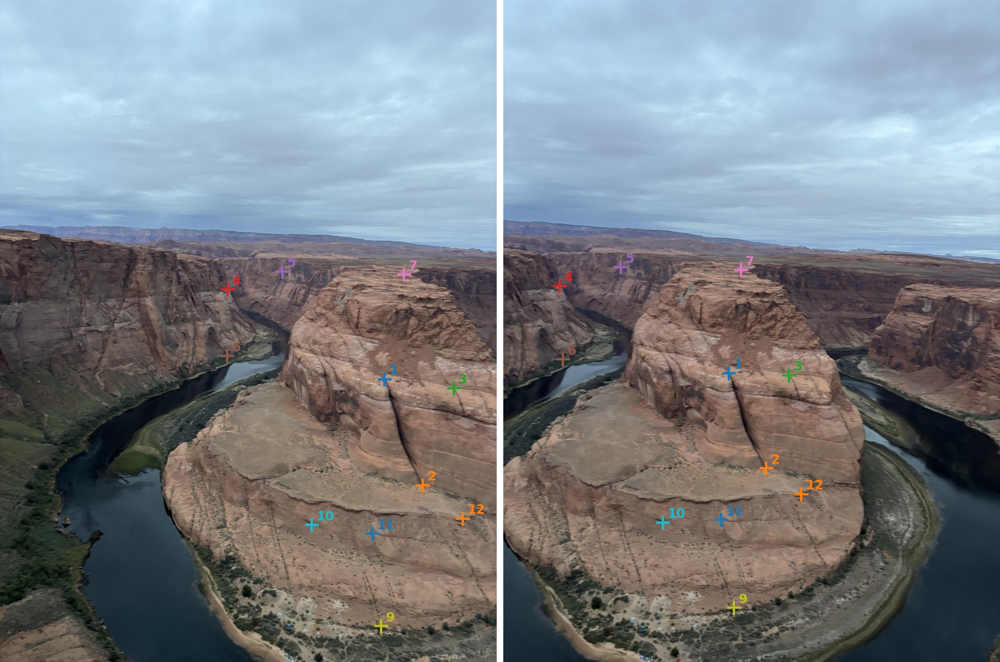<figcaption>horseshoe, photos 837 and 839</figcaption></figure>
  <figure>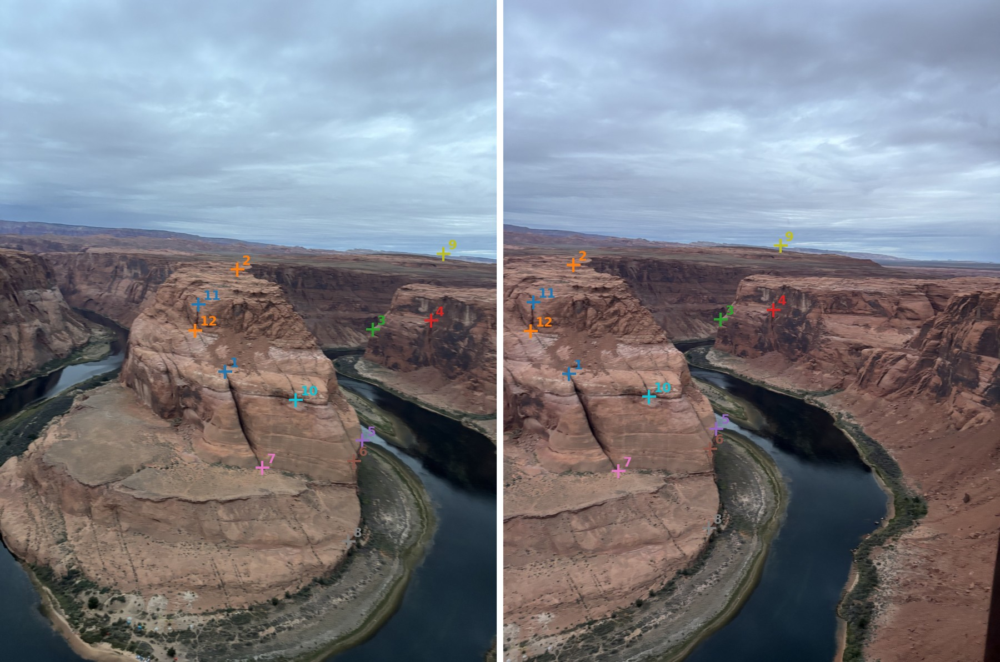<figcaption>horseshoe, photos 839 and 841</figcaption></figure>
</div>

The clicked coordinates, numbered as in the figures above:

#### canyon_slope clicked points (pixels)

| # | Pair 1: frame 9 | Pair 1: frame 10 | Pair 2: frame 10 | Pair 2: frame 11 |
|---|---|---|---|---|
| 1 | (333, 601) | (620, 666) | (272, 747) | (428, 852) |
| 2 | (166, 727) | (458, 779) | (619, 666) | (768, 780) |
| 3 | (536, 825) | (797, 898) | (799, 900) | (940, 1026) |
| 4 | (1148, 569) | (1421, 678) | (1421, 679) | (1586, 820) |
| 5 | (1357, 462) | (1649, 582) | (134, 765) | (299, 869) |
| 6 | (1322, 238) | (1618, 343) | (1189, 248) | (1343, 374) |
| 7 | (1447, 270) | (1744, 381) | (1650, 580) | (1829, 725) |
| 8 | (1417, 16) | (1724, 120) | (1721, 118) | (1904, 253) |
| 9 | (1449, 490) | (1753, 612) | (1632, 39) | (1808, 169) |
| 10 | (851, 82) | (1135, 181) | (1135, 181) | (1288, 308) |
| 11 | (287, 435) | (582, 505) | (1618, 346) | (1794, 479) |
| 12 | (1469, 27) | (1783, 131) | (1062, 320) | (1210, 445) |

#### canyon_ridge clicked points (pixels)

| # | Pair 1: frame 40 | Pair 1: frame 44 | Pair 2: frame 44 | Pair 2: frame 48 |
|---|---|---|---|---|
| 1 | (77, 1054) | (511, 1119) | (147, 1210) | (662, 1004) |
| 2 | (148, 972) | (578, 1041) | (277, 1071) | (805, 886) |
| 3 | (219, 862) | (649, 939) | (417, 969) | (962, 800) |
| 4 | (186, 718) | (628, 801) | (488, 905) | (1043, 736) |
| 5 | (225, 732) | (653, 813) | (233, 1448) | (727, 1238) |
| 6 | (376, 1035) | (796, 1119) | (198, 614) | (778, 414) |
| 7 | (371, 823) | (803, 904) | (16, 526) | (611, 319) |
| 8 | (558, 437) | (1017, 518) | (267, 643) | (847, 443) |
| 9 | (62, 434) | (527, 528) | (351, 1215) | (863, 1038) |
| 10 | (527, 675) | (975, 757) | (454, 1098) | (986, 933) |
| 11 | (235, 633) | (676, 716) | (520, 1132) | (1049, 981) |
| 12 | (403, 587) | (847, 667) | (219, 1785) | (689, 1544) |

#### horseshoe clicked points (pixels)

| # | Pair 1: IMG_0837 | Pair 1: IMG_0839 | Pair 2: IMG_0839 | Pair 2: IMG_0841 |
|---|---|---|---|---|
| 1 | (1169, 1154) | (686, 1136) | (684, 1132) | (199, 1138) |
| 2 | (1287, 1477) | (799, 1425) | (721, 821) | (212, 806) |
| 3 | (1381, 1182) | (869, 1142) | (1133, 1002) | (660, 973) |
| 4 | (693, 880) | (171, 871) | (1312, 975) | (821, 943) |
| 5 | (858, 827) | (357, 813) | (1102, 1340) | (647, 1304) |
| 6 | (691, 1084) | (181, 1095) | (1077, 1403) | (629, 1366) |
| 7 | (1229, 836) | (723, 822) | (798, 1424) | (349, 1434) |
| 8 | (1034, 919) | (543, 907) | (1060, 1648) | (625, 1608) |
| 9 | (1160, 1906) | (702, 1849) | (1349, 773) | (844, 748) |
| 10 | (949, 1598) | (485, 1590) | (900, 1218) | (443, 1208) |
| 11 | (1132, 1625) | (662, 1583) | (603, 926) | (90, 920) |
| 12 | (1409, 1578) | (906, 1504) | (593, 1005) | (83, 1008) |

A homography maps a point $$ (x, y) $$ in the first image to $$ (u, v) $$ in the second, up to scale. Fixing $$ h_{33} = 1 $$ leaves 8 unknowns:

$$ u = \frac{h_{11} x + h_{12} y + h_{13}}{h_{31} x + h_{32} y + 1}, \qquad v = \frac{h_{21} x + h_{22} y + h_{23}}{h_{31} x + h_{32} y + 1} $$

Multiplying out the denominators gives two equations per correspondence that are linear in the unknowns. Stacking all $$ n $$ correspondences gives a $$ 2n \times 8 $$ system $$ A h = b $$:

$$ \begin{bmatrix} x_1 & y_1 & 1 & 0 & 0 & 0 & -x_1 u_1 & -y_1 u_1 \\ 0 & 0 & 0 & x_1 & y_1 & 1 & -x_1 v_1 & -y_1 v_1 \\ \vdots & & & & & & & \vdots \\ x_n & y_n & 1 & 0 & 0 & 0 & -x_n u_n & -y_n u_n \\ 0 & 0 & 0 & x_n & y_n & 1 & -x_n v_n & -y_n v_n \end{bmatrix} \begin{bmatrix} h_{11} \\ h_{12} \\ h_{13} \\ h_{21} \\ h_{22} \\ h_{23} \\ h_{31} \\ h_{32} \end{bmatrix} = \begin{bmatrix} u_1 \\ v_1 \\ \vdots \\ u_n \\ v_n \end{bmatrix} $$

With 12 correspondences there are 24 equations for 8 unknowns, so the system is solved with least squares.

```python
def system(im1_pts, im2_pts):
    A, b = [], []
    for (x, y), (u, v) in zip(im1_pts, im2_pts):
        A.append([x, y, 1, 0, 0, 0, -x * u, -y * u])
        A.append([0, 0, 0, x, y, 1, -x * v, -y * v])
        b += [u, v]
    return np.array(A, dtype=float), np.array(b, dtype=float)


def computeH(im1_pts, im2_pts):
    A, b = system(im1_pts, im2_pts)
    h = np.linalg.lstsq(A, b, rcond=None)[0]
    return np.append(h, 1).reshape(3, 3)
```

The full system for canyon_slope, frames 9 and 10 ($$ A $$, then $$ b $$ after the bar):

```
  332.75   601.41  1.00     0.00     0.00  0.00   -206349.58  -372957.07 |  620.14
    0.00     0.00  0.00   332.75   601.41  1.00   -221482.21  -400307.86 |  665.61
  166.12   726.76  1.00     0.00     0.00  0.00    -76101.29  -332928.36 |  458.10
    0.00     0.00  0.00   166.12   726.76  1.00   -129366.84  -565954.83 |  778.74
  536.06   824.60  1.00     0.00     0.00  0.00   -427487.77  -657583.43 |  797.46
    0.00     0.00  0.00   536.06   824.60  1.00   -481366.97  -740463.16 |  897.97
 1147.53   569.31  1.00     0.00     0.00  0.00  -1630812.78  -809076.81 | 1421.16
    0.00     0.00  0.00  1147.53   569.31  1.00   -777843.20  -385902.60 |  677.84
 1356.95   462.30  1.00     0.00     0.00  0.00  -2237514.83  -762303.04 | 1648.93
    0.00     0.00  0.00  1356.95   462.30  1.00   -789119.58  -268846.60 |  581.54
 1321.79   237.59  1.00     0.00     0.00  0.00  -2139128.32  -384503.27 | 1618.35
    0.00     0.00  0.00  1321.79   237.59  1.00   -453463.40   -81508.98 |  343.07
 1447.14   269.69  1.00     0.00     0.00  0.00  -2523389.32  -470261.37 | 1743.70
    0.00     0.00  0.00  1447.14   269.69  1.00   -551771.78  -102828.74 |  381.28
 1416.57    15.93  1.00     0.00     0.00  0.00  -2441927.69   -27466.01 | 1723.83
    0.00     0.00  0.00  1416.57    15.93  1.00   -169821.49    -1910.10 |  119.88
 1448.67   489.82  1.00     0.00     0.00  0.00  -2539342.04  -858590.94 | 1752.88
    0.00     0.00  0.00  1448.67   489.82  1.00   -886748.72  -299823.50 |  612.11
  850.96    81.67  1.00     0.00     0.00  0.00   -966097.28   -92714.65 | 1135.30
    0.00     0.00  0.00   850.96    81.67  1.00   -154049.05   -14783.82 |  181.03
  286.89   434.79  1.00     0.00     0.00  0.00   -166946.29  -253011.20 |  581.92
    0.00     0.00  0.00   286.89   434.79  1.00   -144908.86  -219612.94 |  505.11
 1468.54    26.63  1.00     0.00     0.00  0.00  -2619074.44   -47499.95 | 1783.45
    0.00     0.00  0.00  1468.54    26.63  1.00   -191766.67    -3477.91 |  130.58
```

Recovered homographies (first frame mapped into the second), with the RMS distance between the mapped clicked points and their clicked partners:

canyon_slope, 9 to 10 (RMS error 3.24 px):

$$ H = \begin{bmatrix} 0.834967 & -0.0652111 & 352.782 \\ -0.00206532 & 0.905444 & 95.082 \\ -7.72146 \times 10^{-5} & -2.70661 \times 10^{-5} & 1 \end{bmatrix} $$

canyon_slope, 10 to 11 (RMS error 2.67 px):

$$ H = \begin{bmatrix} 0.901914 & -0.039196 & 199.319 \\ -0.00801003 & 0.932446 & 131.516 \\ -4.58217 \times 10^{-5} & -2.54684 \times 10^{-5} & 1 \end{bmatrix} $$

canyon_ridge, 40 to 44 (RMS error 3.78 px):

$$ H = \begin{bmatrix} 0.801391 & -0.0582999 & 491.428 \\ -0.124356 & 0.910297 & 132.916 \\ -1.70132 \times 10^{-4} & -1.67338 \times 10^{-5} & 1 \end{bmatrix} $$

canyon_ridge, 44 to 48 (RMS error 3.65 px):

$$ H = \begin{bmatrix} 0.841398 & -0.0425021 & 642.385 \\ -0.0626364 & 1.09375 & -242.963 \\ -2.10217 \times 10^{-4} & 8.11999 \times 10^{-5} & 1 \end{bmatrix} $$

horseshoe, 837 to 839 (RMS error 2.82 px):

$$ H = \begin{bmatrix} 1.48866 & 0.0691509 & -879.87 \\ 0.245955 & 1.35872 & -293.446 \\ 0.00029951 & 2.61374 \times 10^{-5} & 1 \end{bmatrix} $$

horseshoe, 839 to 841 (RMS error 2.98 px):

$$ H = \begin{bmatrix} 1.47741 & 0.102727 & -880.245 \\ 0.20722 & 1.36624 & -277.746 \\ 0.000285376 & 3.77553 \times 10^{-5} & 1 \end{bmatrix} $$

I looked for sharp, distinctive corners. The rock layers of the canyon are different shades, so the places where the canyon juts out make good edges. I also clicked points on nearby trees, because they give sharp, distinct edges. Soft, rounded ridgelines, areas of uniform rock texture, and blurry regions are hard to click precisely, so I avoided placing points on them. I used 12 points so that the system is overdetermined, which reduces the effect of points that were not clicked exactly right. Most points were far from the camera, hundreds to thousands of metres away. Those were easier to find again in the next frame and have less parallax. Some points were on trees 10 to 50 m from the camera. By comparing the frames, I found that the trees were far enough away that parallax did not affect them much.

### A.3 Warping and Rectification

Both warps use inverse warping. The four corners of the input are pushed through $$ H $$ to find the output bounding box, then every output pixel is mapped back through $$ H^{-1} $$ and sampled from the input. Output pixels that land outside the input get alpha 0. Nearest neighbour rounds the source position to the closest pixel; bilinear weights the four surrounding pixels by their distance to it. Code: `Assignment 3/src/homography.py` and `Assignment 3/src/rectify.py`.

```python
def sample_nn(im, xs, ys):
    h, w = im.shape[:2]
    xi, yi = np.floor(xs + 0.5).astype(int), np.floor(ys + 0.5).astype(int)
    valid = (xi >= 0) & (xi < w) & (yi >= 0) & (yi < h)
    out = im[np.clip(yi, 0, h - 1), np.clip(xi, 0, w - 1)]
    return out, valid


def sample_bilinear(im, xs, ys):
    h, w = im.shape[:2]
    valid = (xs >= 0) & (xs <= w - 1) & (ys >= 0) & (ys <= h - 1)
    x0 = np.clip(np.floor(xs).astype(int), 0, w - 2)
    y0 = np.clip(np.floor(ys).astype(int), 0, h - 2)
    fx, fy = xs - x0, ys - y0
    if im.ndim == 3:
        fx, fy = fx[..., None], fy[..., None]
    out = ((1 - fx) * (1 - fy) * im[y0, x0] + fx * (1 - fy) * im[y0, x0 + 1]
           + (1 - fx) * fy * im[y0 + 1, x0] + fx * fy * im[y0 + 1, x0 + 1])
    return out, valid


def warp(im, H, box=None, sampler=sample_bilinear):
    x0, y0, x1, y1 = box or warp_box(H, im.shape)
    xs, ys = np.meshgrid(np.arange(x0, x1, dtype=float), np.arange(y0, y1, dtype=float))
    src = apply_h(np.linalg.inv(H), np.c_[xs.ravel(), ys.ravel()])
    out, valid = sampler(im, src[:, 0].reshape(xs.shape), src[:, 1].reshape(xs.shape))
    if out.ndim == 2:
        out = out[..., None]
    out = out * valid[..., None]
    return np.dstack([out, valid]).astype(np.float32)
```

For rectification, the four corners of each book cover are clicked and mapped to a rectangle with the cover's measured aspect ratio, so $$ H $$ comes from `computeH` with exactly 4 correspondences. The output is limited to one cover width and height around the cover, since the table far from the book stretches out without bound.

Clicked cover corners (pixels):

| Corner | Feedback and Control Systems | Transducer Interfacing Handbook |
|---|---|---|
| Top-left | (405, 222) | (279, 220) |
| Top-right | (1094, 226) | (1239, 226) |
| Bottom-right | (1273, 1268) | (1408, 759) |
| Bottom-left | (139, 1243) | (88, 744) |

#### Feedback and Control Systems (15.5 x 23.5 cm)

<div class="media-grid">
  <figure>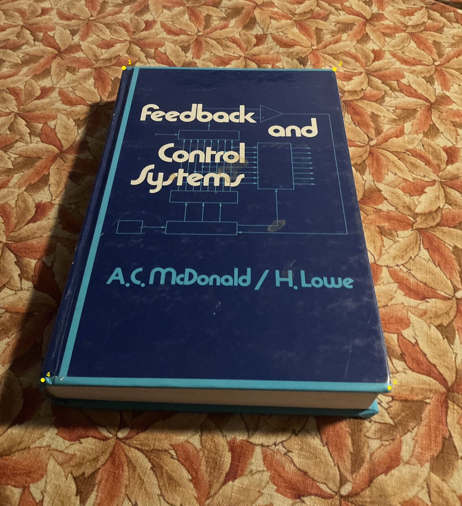<figcaption>Input with clicked corners</figcaption></figure>
  <figure>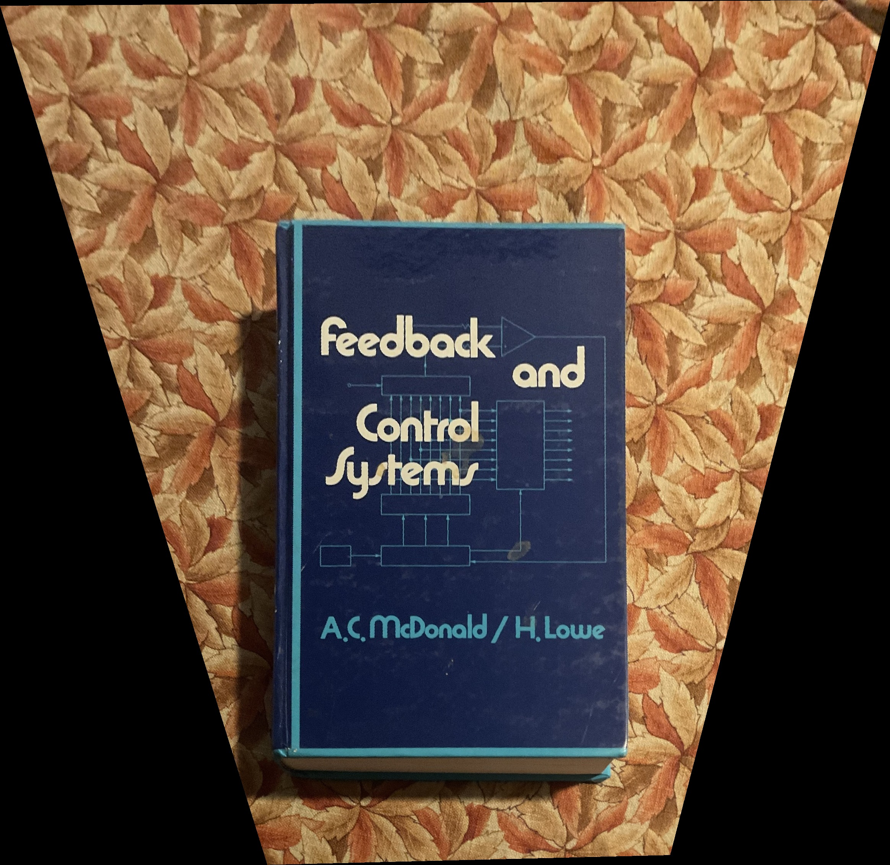<figcaption>Nearest neighbour</figcaption></figure>
  <figure><figcaption>Bilinear</figcaption></figure>
</div>
<div class="media-grid">
  <figure><figcaption>Nearest neighbour, centre of the cover at 4x</figcaption></figure>
  <figure>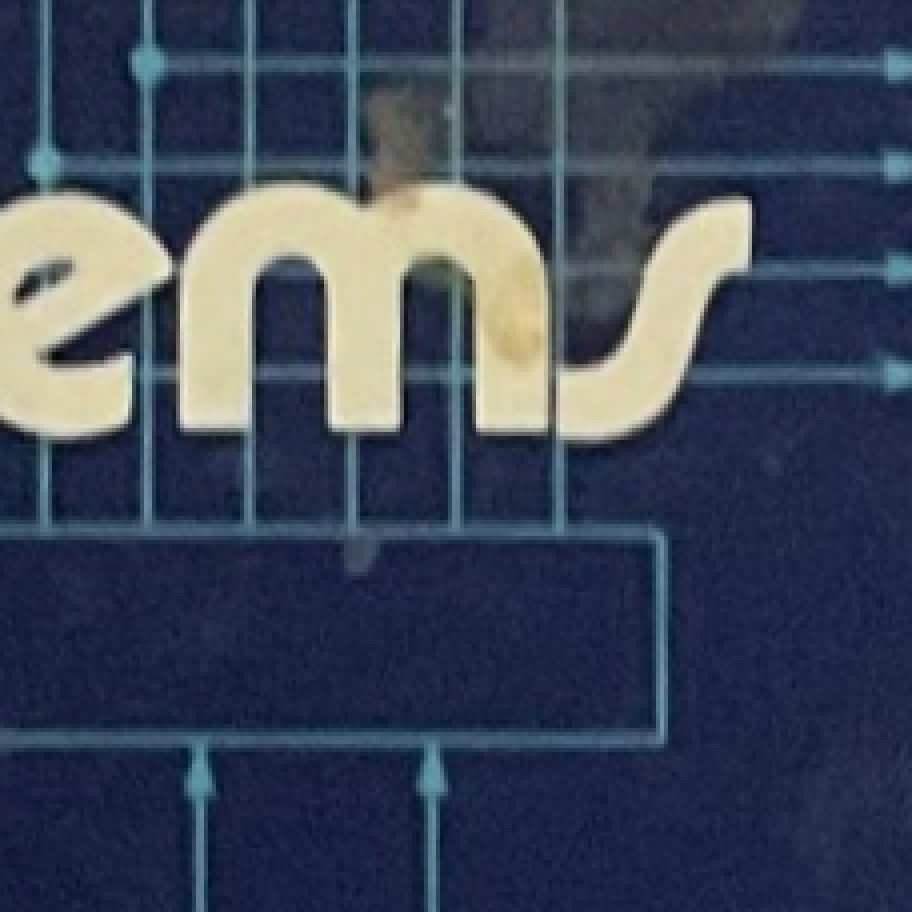<figcaption>Bilinear, centre of the cover at 4x</figcaption></figure>
</div>

#### Transducer Interfacing Handbook (21.5 x 15.5 cm)

<div class="media-grid">
  <figure>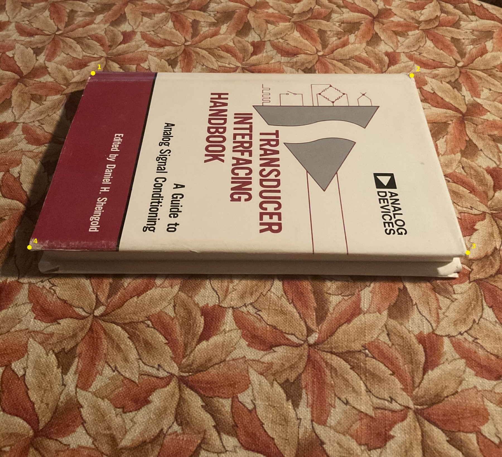<figcaption>Input with clicked corners</figcaption></figure>
  <figure>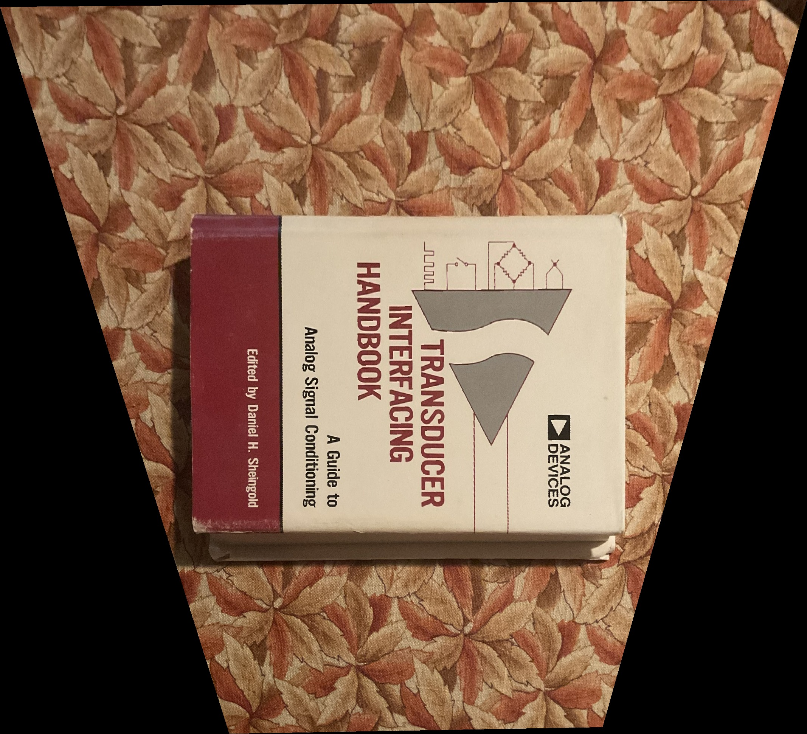<figcaption>Nearest neighbour</figcaption></figure>
  <figure><figcaption>Bilinear</figcaption></figure>
</div>
<div class="media-grid">
  <figure>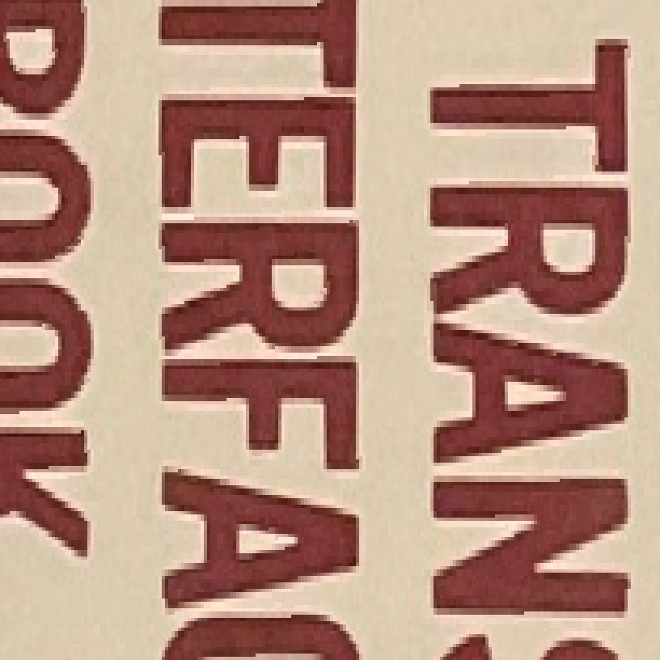<figcaption>Nearest neighbour, centre of the cover at 4x</figcaption></figure>
  <figure><figcaption>Bilinear, centre of the cover at 4x</figcaption></figure>
</div>

The main difference I saw between nearest neighbour and bilinear is how well they reproduce straight lines and sharp edges. In the 4x zoomed crops, nearest neighbour produced a lot of artifacts around high-contrast edges, such as the text on the book covers. These artifacts are aliasing: jagged lines where there should be clean, straight edges. In the full rectified images (not zoomed), the nearest neighbour artifacts were worse on the far side of each book than on the near side. The far side of the book was smaller in the original photo, so rectification stretches it more, and that produces more artifacts.

| Image | Output size | Nearest neighbour | Bilinear |
|---|---|---|---|
| Feedback and Control Systems | 2327 x 2261 | 0.48 s | 1.25 s |
| Transducer Interfacing Handbook | 2134 x 1941 | 0.38 s | 0.96 s |

Bilinear is slower than nearest neighbour because of how each one works. Nearest neighbour finds the input pixel closest to the source position and copies its value. Bilinear reads the 4 surrounding pixels and takes a weighted average of them. Whether the extra cost is worth it depends on the application. In real-time applications where image quality matters less, nearest neighbour may be the better choice. However, when rectifying a high-quality image to produce another high-quality image, I would argue that the time cost of bilinear is acceptable because it produces a better final result.

### A.4 Blending into a Mosaic

The middle frame of each set is the reference. The pairwise homographies are chained so every frame maps into it: the first frame through $$ H_{1 \to 2} $$ and the third through $$ H_{2 \to 3}^{-1} $$. Each frame is inverse warped (bilinear) onto a shared canvas sized to fit all of them, and carries a weight that is 1 at its centre and falls linearly to 0 at its nearest edge. Code: `Assignment 3/src/blend.py`.

Three ways of combining the warped frames are compared:

- **Overwrite**: each frame is pasted over the previous one.
- **Feather**: every pixel is the weighted average of the frames covering it.
- **Two-band**: each frame is split into a low band (Gaussian blur, $$ \sigma = 6 $$) and a high band (the frame minus its low band). The low bands are feathered as above, and the high band at each pixel is taken from the one frame with the largest weight there.

```python
def chain_to_ref(pair_Hs):
    n, m = len(pair_Hs) + 1, (len(pair_Hs) + 1) // 2
    Hs = [np.eye(3) for _ in range(n)]
    for i in range(m - 1, -1, -1):
        Hs[i] = Hs[i + 1] @ pair_Hs[i]
    for i in range(m + 1, n):
        Hs[i] = Hs[i - 1] @ np.linalg.inv(pair_Hs[i - 1])
    return [H / H[2, 2] for H in Hs]


def edge_weight(shape):
    h, w = shape[:2]
    y, x = np.mgrid[:h, :w]
    d = np.minimum.reduce([x + 1, w - x, y + 1, h - y]).astype(np.float32)
    return d / d.max()
```

```python
    # Two-band: feather the low band, take the high band from the highest-weight image
    lows = [masked_blur(rgb, a, sigma) for rgb, _, a in layers]
    low = sum(lo * w[..., None] for lo, (_, w, _) in zip(lows, layers)) / total
    best = np.argmax(np.stack([w for _, w, _ in layers]), axis=0)
    high = np.zeros_like(low)
    for i, (lo, (rgb, _, a)) in enumerate(zip(lows, layers)):
        pick = (best == i) & (a > 0)
        high[pick] = (rgb - lo)[pick]
    return crop(np.clip(low + high, 0, 1) * covered[..., None], covered)
```

#### canyon_slope

<figure>
  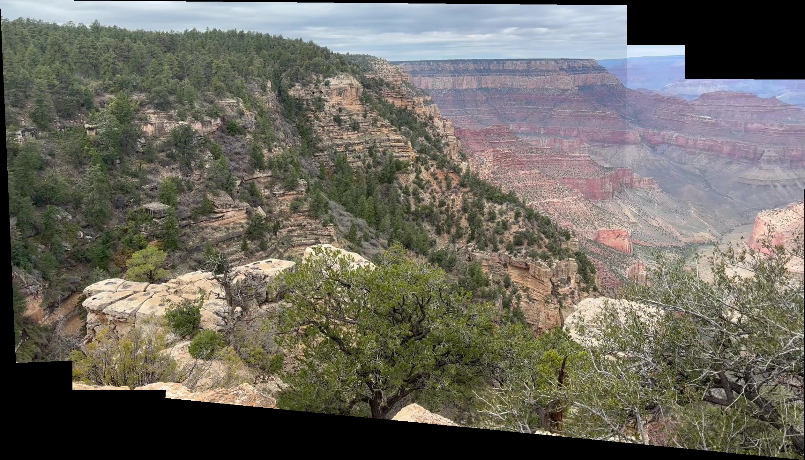
  <figcaption>Overwrite</figcaption>
</figure>
<figure>
  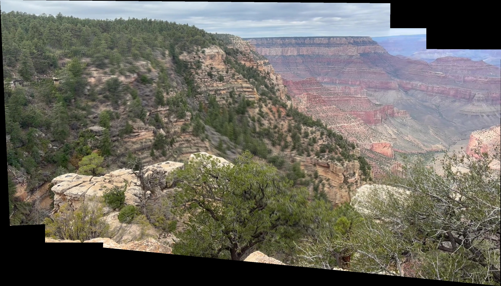
  <figcaption>Feather</figcaption>
</figure>
<figure>
  
  <figcaption>Two-band</figcaption>
</figure>

#### canyon_ridge

<div class="media-grid">
  <figure>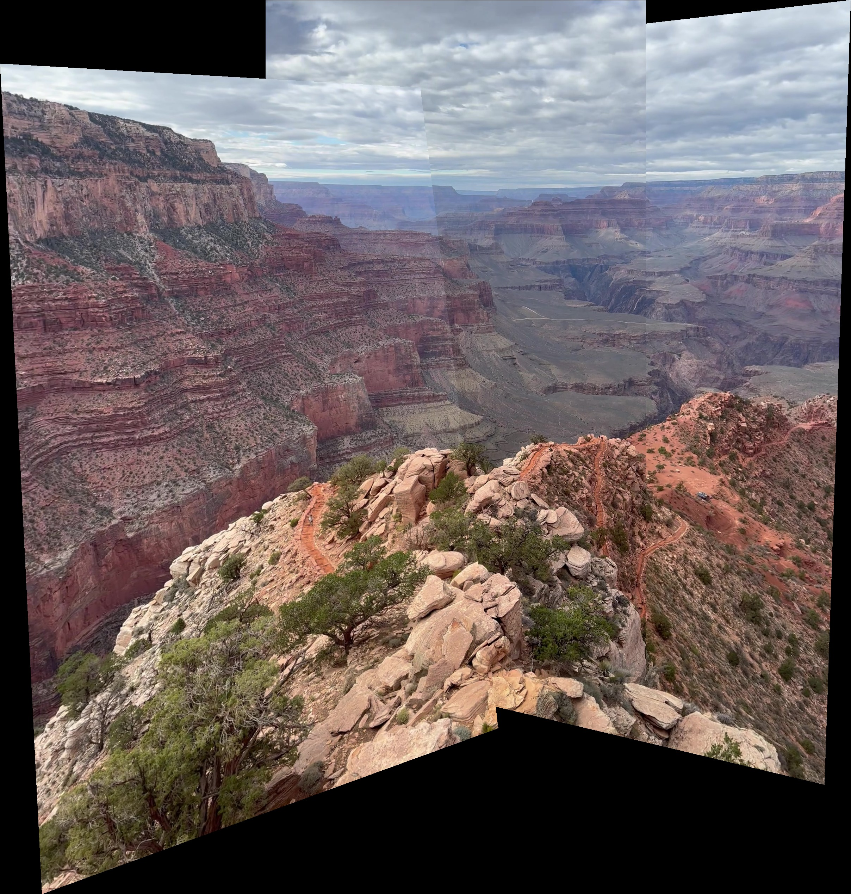<figcaption>Overwrite</figcaption></figure>
  <figure>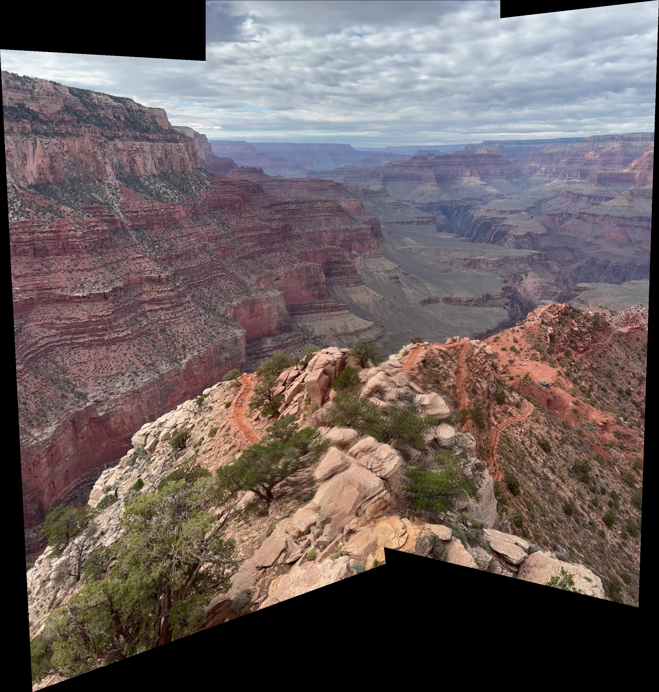<figcaption>Feather</figcaption></figure>
  <figure><figcaption>Two-band</figcaption></figure>
</div>

#### horseshoe

<div class="media-grid">
  <figure>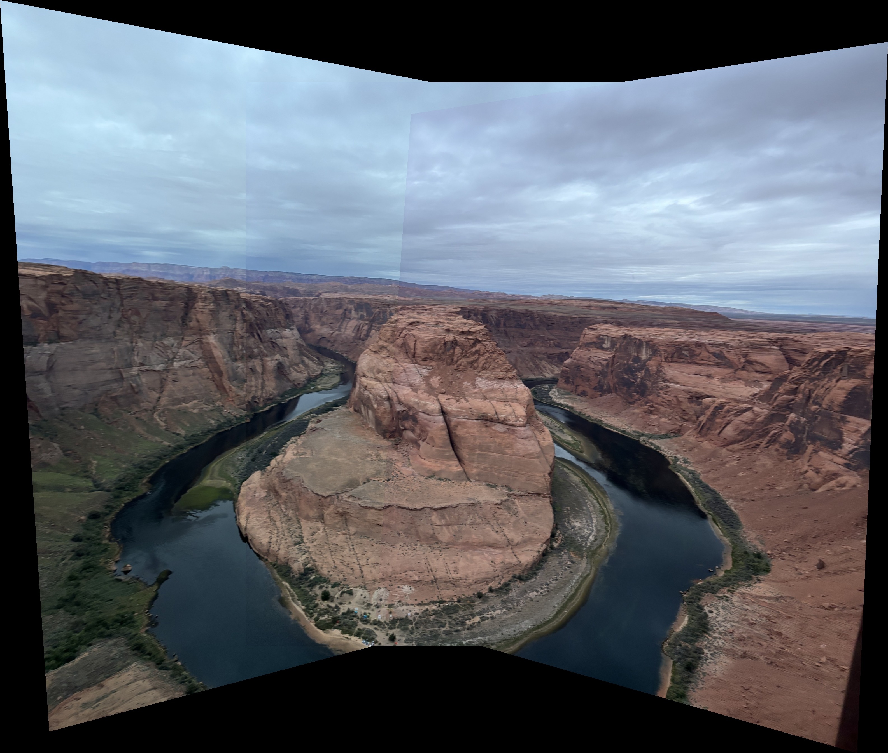<figcaption>Overwrite</figcaption></figure>
  <figure>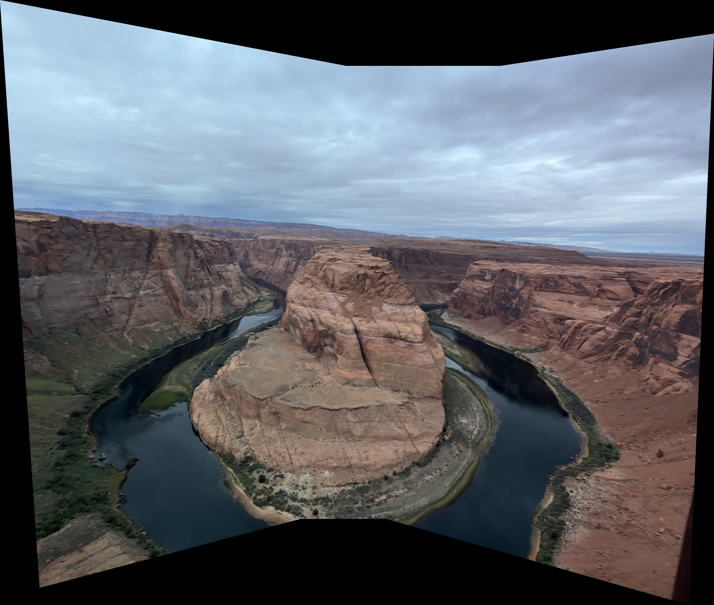<figcaption>Feather</figcaption></figure>
  <figure><figcaption>Two-band</figcaption></figure>
</div>

The central frame is chosen as the reference to reduce the stretching that projecting onto one of the edge frames would cause. Stretch grows quickly as a frame is rotated further from the reference plane, and the middle frame roughly halves the largest angle. H₁→₂ maps the first frame onto the second, the reference, so it can be used directly. H₂→₃ maps frame 2 onto frame 3, which is the wrong direction, so its inverse is used to map frame 3 onto frame 2. With more frames, homographies are multiplied together to chain frames that are further from the reference. Each frame is then inverse warped through its homography onto one shared canvas that is large enough to hold all of them. The centre of each frame gets the highest weight because it is the most reliable part of the image. Lens distortion and vignetting are strongest near the edges, so the weight falls gradually to 0 toward the edge of the frame. This lets the frames fade into each other, which produces soft seams. Pixels outside the overlap are unchanged, because there are no other values to blend with.

With overwrite, poorly managed exposure produces very distinct seams between images. As the camera turned toward the sun, the auto-exposure changed, so the same patch of sky has different brightness in neighbouring frames. Overwrite places those values side by side, which creates a hard seam. Feathering reduces these seams, but objects in the foreground come out blurred or distorted. Feathering averages the frames in the overlap, and nearby objects are where small misalignments from parallax are largest, so averaging produces two offset copies. These artifacts are largely absent in the two-band result, because it takes high-frequency detail from only one frame and only blends the low band. In canyon_slope, the brightness change from the sun is still visible in the feather and two-band mosaics, although it is much weaker than with overwrite. Blending spreads the exposure difference into a gradual gradient but does not correct it. The most difficult mosaics were canyon_slope and canyon_ridge, because their foreground objects were distorted by feathering. For horseshoe, feathering and two-band produced nearly identical mosaics. The only difference is that the centre of the horseshoe is less sharp in the feathered version. The horseshoe scene has no foreground, so everything is far away, alignment is good, and feathering has little to blur.

## Part B: Feature Matching for Autostitching

Part B follows Brown, Szeliski and Winder, "Multi-Image Matching using Multi-Scale Oriented Patches" (MOPS), single scale and axis aligned unless noted. Code: `Assignment 3/src/features.py` (detection, descriptors, matching, RANSAC) and `Assignment 3/src/part_b.py` (figures and mosaics).

The mosaics are the same as in Part A.

### B.1 Harris Corners and Adaptive Non-Maximal Suppression

Corners come from the provided `harris.py`: the Harris corner strength (harmonic mean of the eigenvalues of the structure tensor, $$ \det H / \operatorname{tr} H $$), every local maximum kept, and corners within 20 pixels of the border discarded. On a 1920x1080 frame this gives over 50,000 corners.

Adaptive non-maximal suppression gives each corner a suppression radius: the distance to the nearest corner that is sufficiently stronger.

$$ r_i = \min_j \lVert x_i - x_j \rVert \quad \text{s.t.} \quad f(x_i) < c_{\text{robust}} \, f(x_j), \qquad c_{\text{robust}} = 0.9 $$

The 500 corners with the largest radii are kept. Sorting the corners by strength means the corners that can suppress corner $$ i $$ are always a prefix of the sorted list, so the radii are computed in chunks with one distance matrix per chunk. Only the 10,000 strongest corners are considered, which keeps that matrix a manageable size.

```python
def anms(pts, f, n=500, c=0.9, max_pts=10000, chunk=2000):
    order = np.argsort(-f)[:max_pts]
    pts, f = pts[order], f[order]
    r = np.full(len(pts), np.inf)
    stronger = np.searchsorted(-c * f, -f, side="left")
    for s in range(0, len(pts), chunk):
        e = min(s + chunk, len(pts))
        k = stronger[s:e].max()
        if k == 0:
            continue
        d = dist2(pts[s:e], pts[:k])
        d[np.arange(k)[None, :] >= stronger[s:e, None]] = np.inf
        r[s:e] = d.min(1)
    keep = np.argsort(-r)[:n]
    return pts[keep], np.sqrt(r[keep])
```

#### canyon_slope, first frame

<figure>
  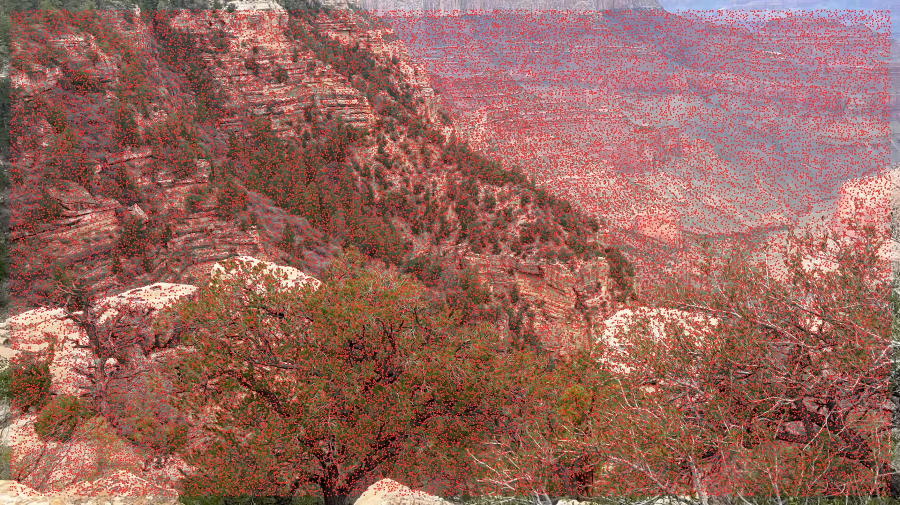
  <figcaption>All Harris corners (57,108)</figcaption>
</figure>
<div class="media-grid">
  <figure>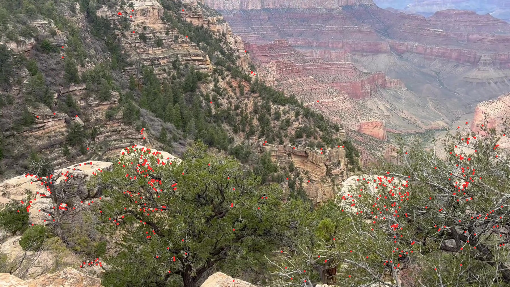<figcaption>Strongest 500 corners</figcaption></figure>
  <figure>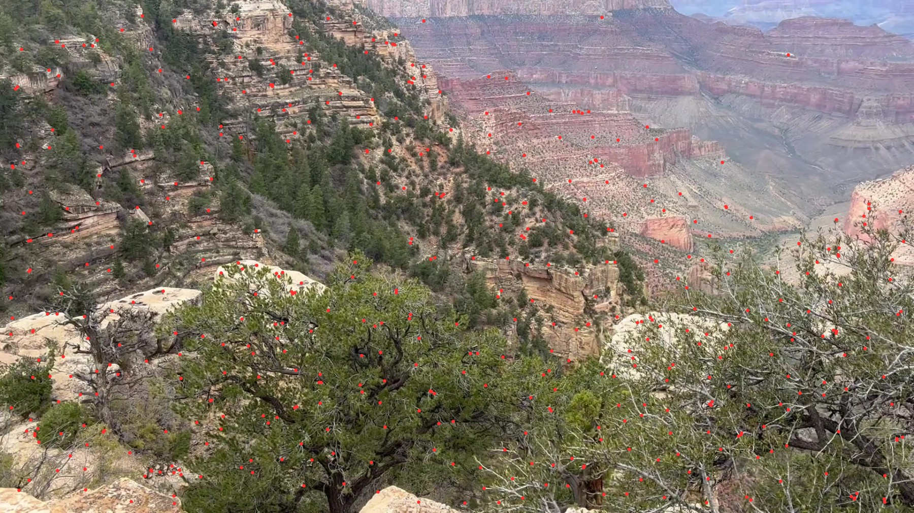<figcaption>ANMS 500 corners, r = 41.3</figcaption></figure>
</div>

#### canyon_ridge, first frame

<div class="media-grid">
  <figure>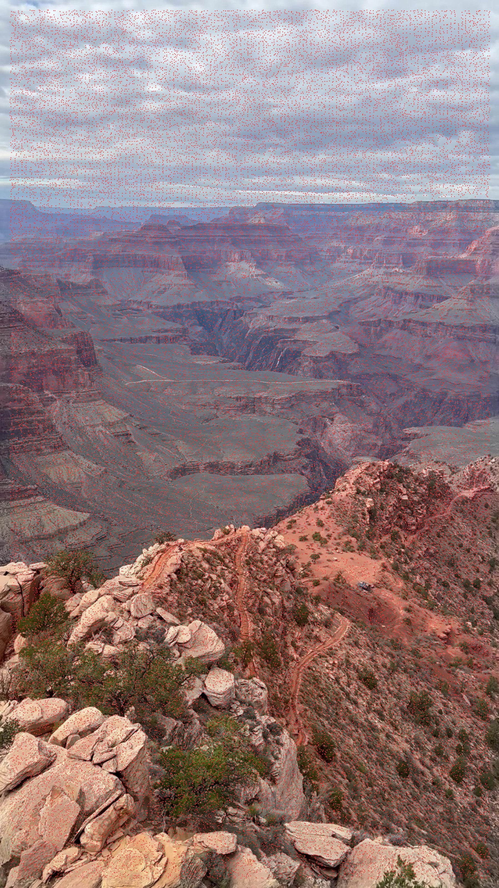<figcaption>All Harris corners (53,523)</figcaption></figure>
  <figure><figcaption>Strongest 500</figcaption></figure>
  <figure>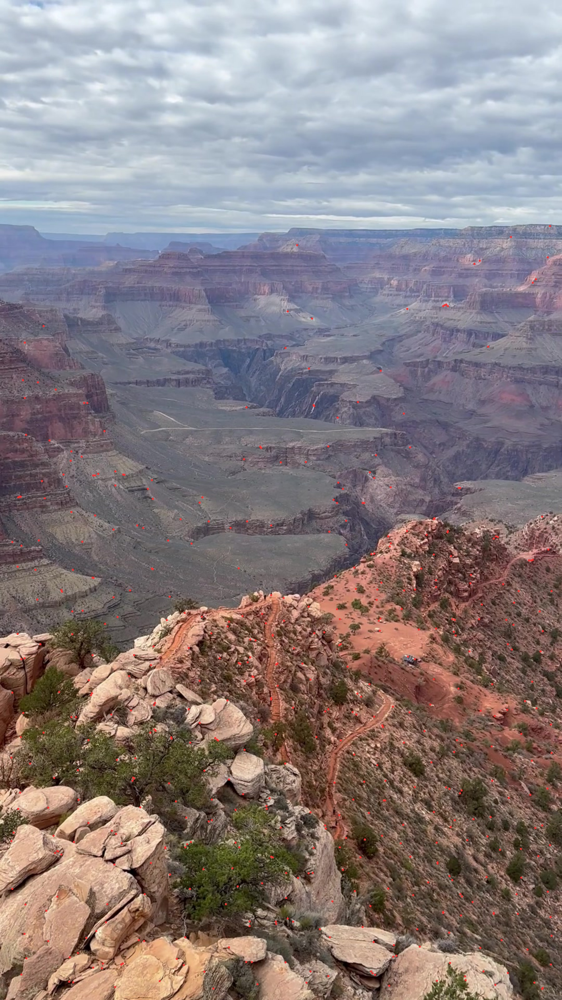<figcaption>ANMS 500, r = 33.1</figcaption></figure>
</div>

In canyon_slope, the strongest 500 corners cluster on the highest-frequency parts of the image, which have many strong corners. Here that is mostly the trees in the foreground, plus a few points in the distance. canyon_ridge shows the same pattern: the strongest corners are packed onto the nearby rocks in the bottom half of the frame. ANMS spreads the points across the scene. Each corner gets a radius equal to the distance to the nearest corner that is noticeably stronger, and the 500 corners with the largest radii are kept, so most corners inside a dense cluster are dropped while isolated corners elsewhere survive. Choosing the strongest 500 is a problem for three reasons. First, the corners are densely packed at the bottom and left of the frame, so there may be little or no overlap with the next image. With ANMS the corners are spread out, so overlapping corners between frames are more likely. Second, the clusters are on foreground objects, where parallax is worst, so those matches may not follow the same homography as the distant canyon. Third, a homography fit from points in one small region is poorly constrained across the rest of the image.

### B.2 Feature Descriptors

Each descriptor is an 8x8 grid of samples spaced 5 pixels apart, so it covers a 40x40 window around the corner. The image is first blurred with a Gaussian ($$ \sigma = 2.5 $$, half the sample spacing) so each sample summarizes its neighbourhood instead of aliasing, and the samples are read with bilinear interpolation. Each descriptor is then bias/gain normalized to zero mean and unit standard deviation.

```python
def descriptors(g, pts, angles=None, size=8, spacing=5):
    blurred = cv2.GaussianBlur(g, (0, 0), spacing / 2)
    k = (np.arange(size) - (size - 1) / 2) * spacing
    ox, oy = [a.ravel() for a in np.meshgrid(k, k)]
    if angles is None:
        angles = np.zeros(len(pts))
    c, s = np.cos(angles)[:, None], np.sin(angles)[:, None]
    xs = pts[:, :1] + c * ox - s * oy
    ys = pts[:, 1:] + s * ox + c * oy
    d, _ = sample_bilinear(blurred, xs, ys)
    return (d - d.mean(1, keepdims=True)) / (d.std(1, keepdims=True) + 1e-8)
```

<figure>
  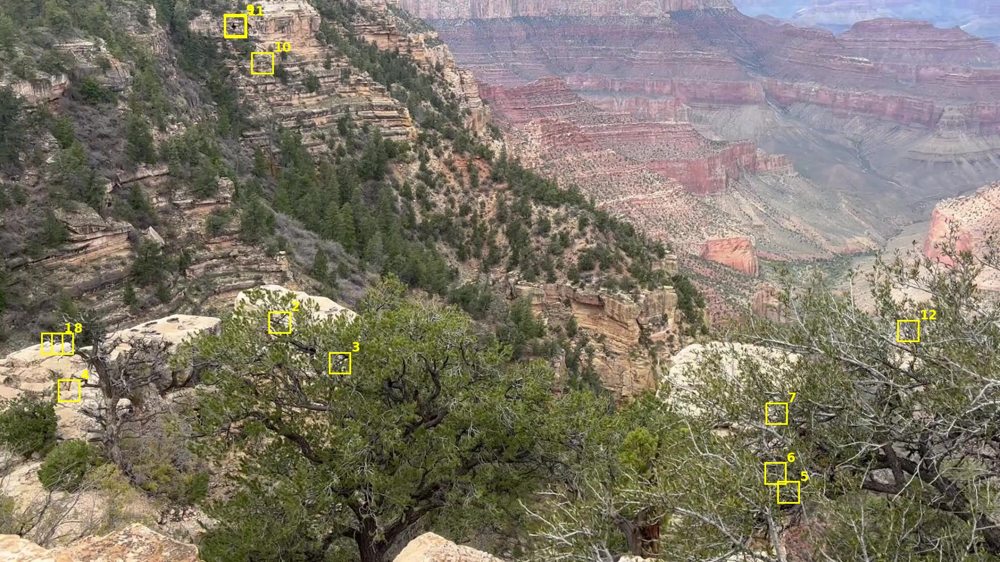
  <figcaption>Twelve features and their 40x40 windows</figcaption>
</figure>
<div class="media-grid">
  <figure>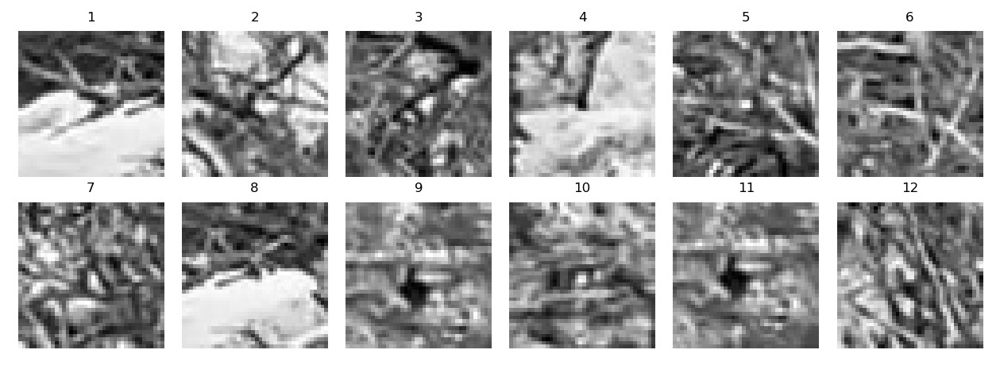<figcaption>40x40 windows (grayscale)</figcaption></figure>
  <figure>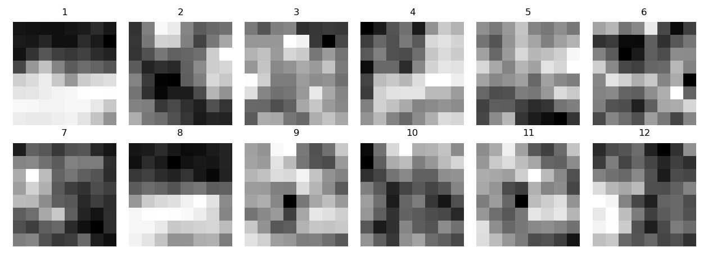<figcaption>Normalized 8x8 descriptors</figcaption></figure>
</div>

### B.3 Feature Matching

Every descriptor in one image is compared with every descriptor in the other using squared Euclidean distance. A match is kept only when the ratio of the nearest to the second-nearest squared distance (1-NN/2-NN, Figure 6b of the paper) is below 0.5.

```python
def match(d1, d2, ratio=0.5):
    d = dist2(d1, d2)
    nn = np.argsort(d, axis=1)[:, :2]
    rows = np.arange(len(d1))
    e1, e2 = d[rows, nn[:, 0]], d[rows, nn[:, 1]]
    r = e1 / np.maximum(e2, 1e-12)
    keep = r < ratio
    return np.c_[rows[keep], nn[keep, 0]], r[keep]
```

<div class="media-grid media-grid--2x2">
  <figure>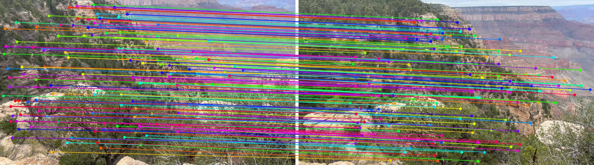<figcaption>canyon_slope, frames 9 and 10: 146 matches</figcaption></figure>
  <figure>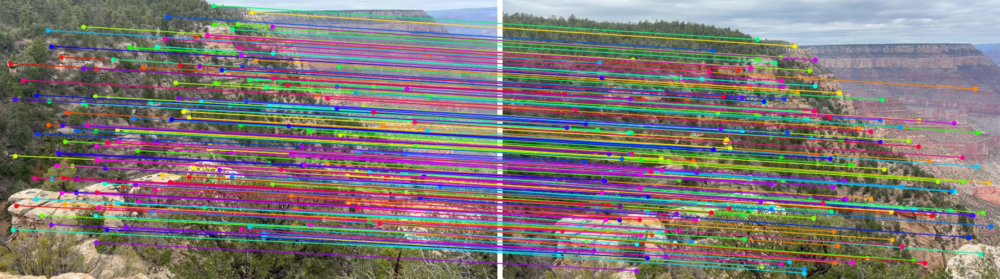<figcaption>canyon_slope, frames 10 and 11: 194 matches</figcaption></figure>
  <figure>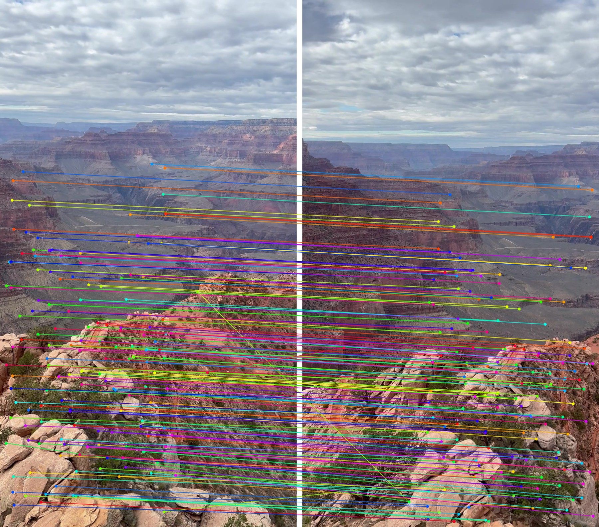<figcaption>canyon_ridge, frames 40 and 44: 161 matches</figcaption></figure>
  <figure>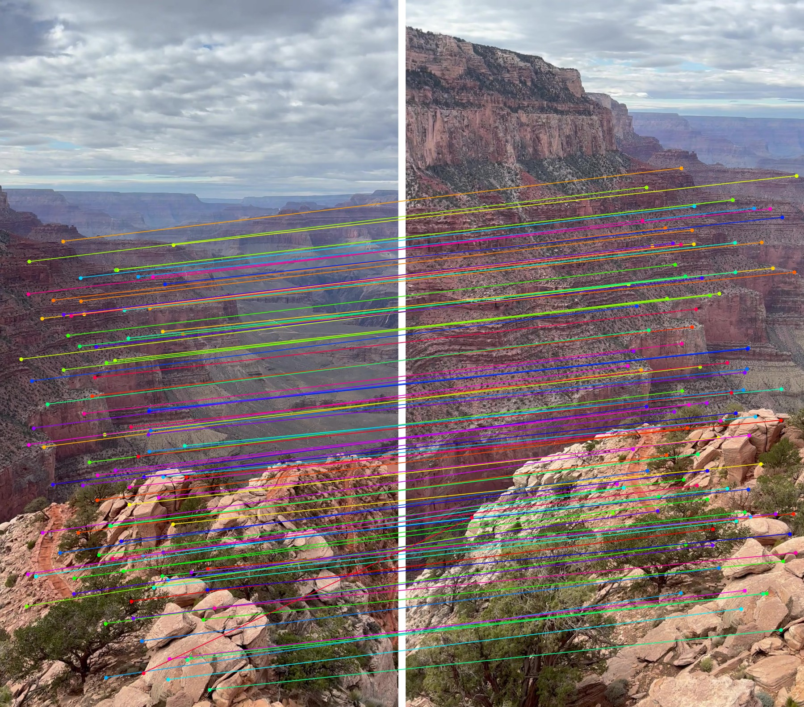<figcaption>canyon_ridge, frames 44 and 48: 93 matches</figcaption></figure>
  <figure>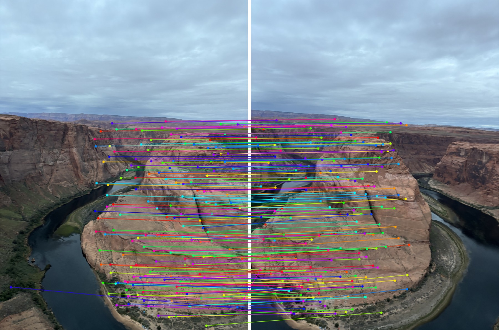<figcaption>horseshoe, photos 837 and 839: 161 matches</figcaption></figure>
  <figure>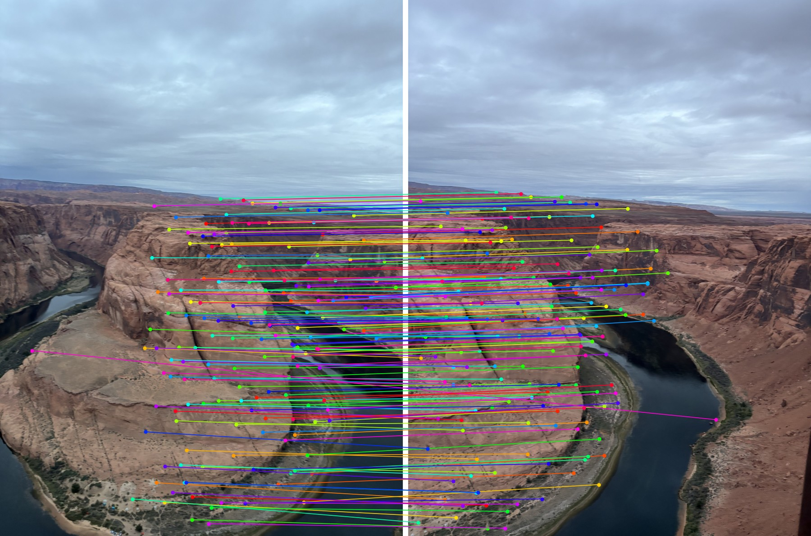<figcaption>horseshoe, photos 839 and 841: 158 matches</figcaption></figure>
</div>

In Figure 6b, the correct and incorrect match curves cross at a 1-NN/2-NN ratio of about 0.68. Choosing a threshold below the crossover keeps the number of incorrect matches low while still capturing enough matches. For my image sets, a threshold of 0.5 gave 93 or more matches per pair, far more than the 4 needed to compute a homography. Fewer incorrect matches means fewer outliers and a higher fraction of inliers. With too many outliers, RANSAC needs more iterations and could settle on the wrong homography.

### B.4 RANSAC and Automatic Mosaics

Each RANSAC iteration picks 4 random matches, solves the exact homography through them with `computeH` from Part A, and counts the matches that land within 3 pixels of where that homography predicts. After 2000 iterations the largest inlier set is kept and the homography is refit to all of its inliers with least squares. The mosaics are then built with the same warping and blending code as Part A.

```python
def ransac(p1, p2, iters=2000, eps=3.0, seed=0):
    rng = np.random.default_rng(seed)
    best = np.zeros(len(p1), bool)
    for _ in range(iters):
        idx = rng.choice(len(p1), 4, replace=False)
        try:
            H = computeH(p1[idx], p2[idx])
        except np.linalg.LinAlgError:
            continue
        err = np.linalg.norm(apply_h(H, p1) - p2, axis=1)
        inliers = err < eps
        if inliers.sum() > best.sum():
            best = inliers
    return computeH(p1[best], p2[best]), best
```

| Pair | Matches | RANSAC inliers |
|---|---|---|
| canyon_slope, frames 9 and 10 | 146 | 112 |
| canyon_slope, frames 10 and 11 | 194 | 179 |
| canyon_ridge, frames 40 and 44 | 161 | 129 |
| canyon_ridge, frames 44 and 48 | 93 | 60 |
| horseshoe, photos 837 and 839 | 161 | 145 |
| horseshoe, photos 839 and 841 | 158 | 137 |

<div class="media-grid media-grid--2x2">
  <figure>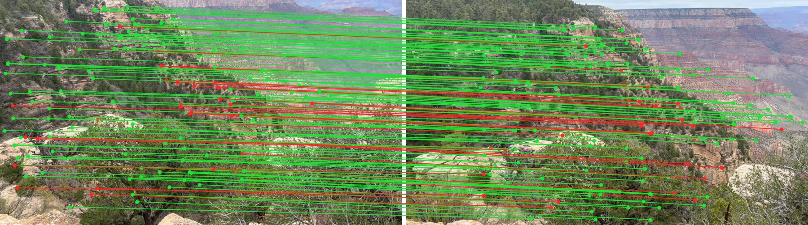<figcaption>canyon_slope, frames 9 and 10</figcaption></figure>
  <figure>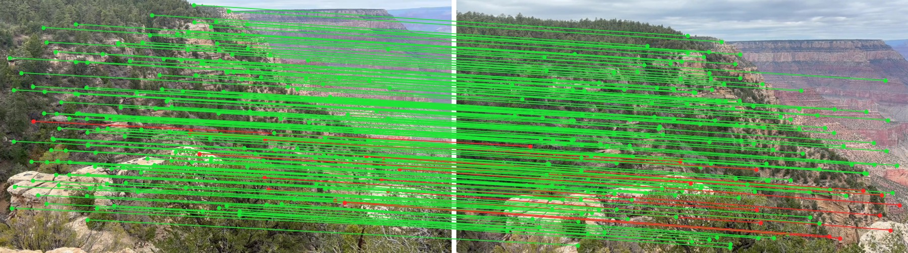<figcaption>canyon_slope, frames 10 and 11</figcaption></figure>
  <figure>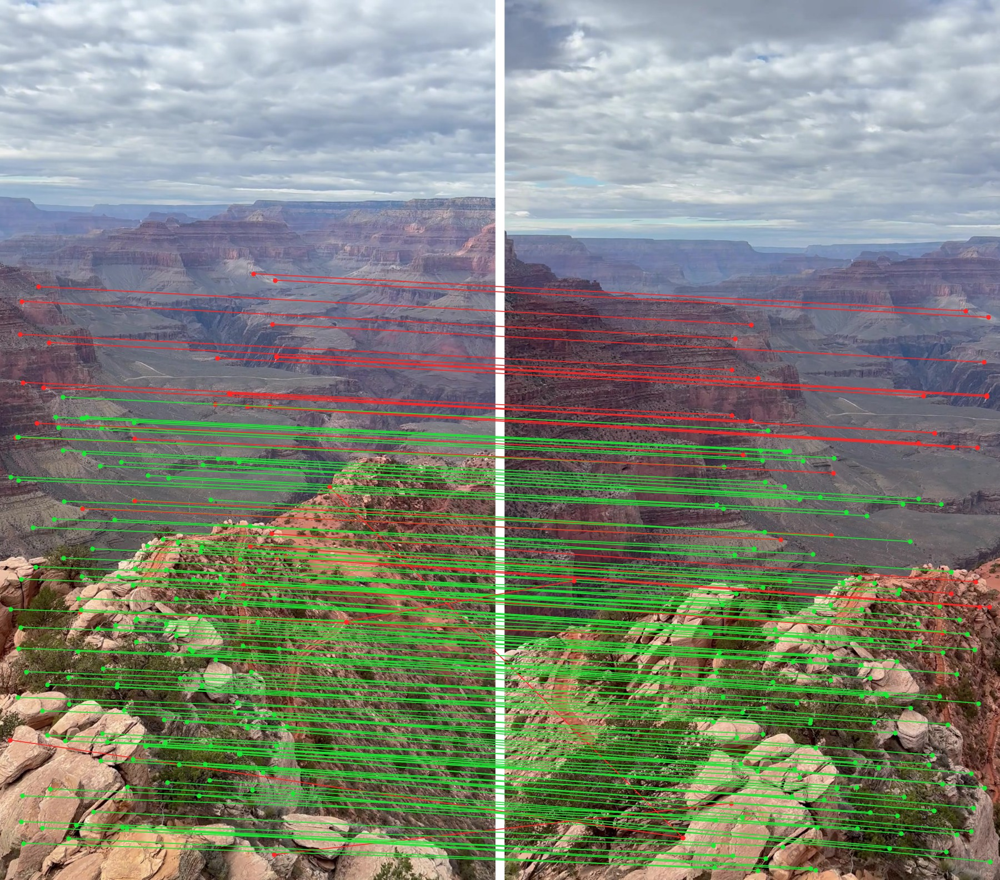<figcaption>canyon_ridge, frames 40 and 44</figcaption></figure>
  <figure>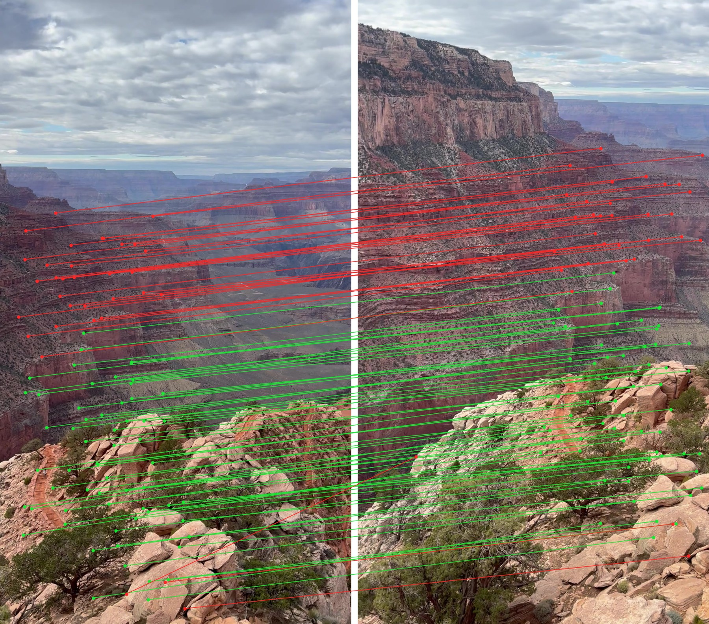<figcaption>canyon_ridge, frames 44 and 48</figcaption></figure>
  <figure>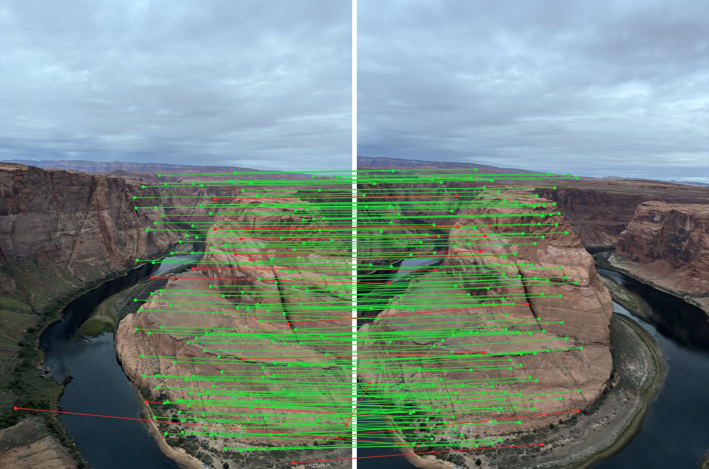<figcaption>horseshoe, photos 837 and 839</figcaption></figure>
  <figure>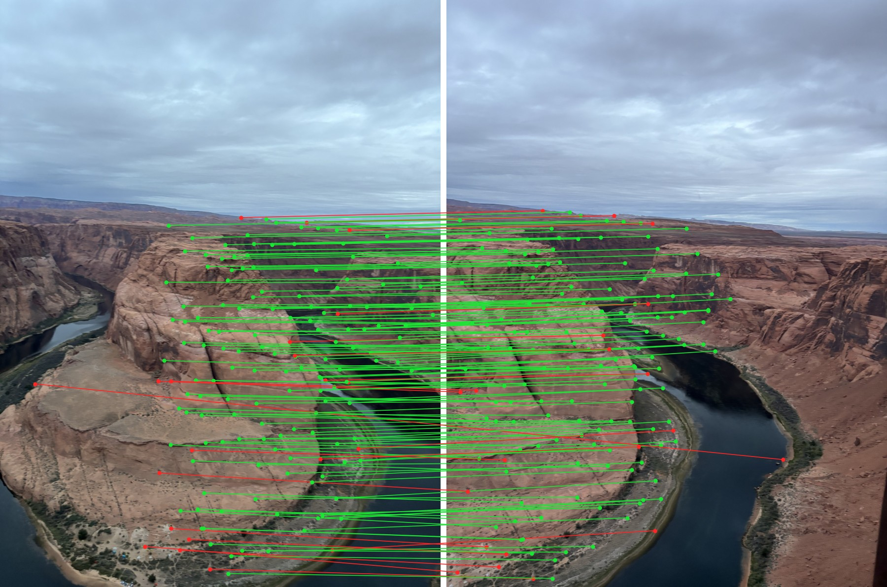<figcaption>horseshoe, photos 839 and 841</figcaption></figure>
</div>

Inliers are green and outliers red.

In canyon_ridge frames 44 and 48, the inliers are on the nearby rocks and trees at the bottom of the frame and in the mid-ground. The outliers are mostly on the distant canyon walls in the top half. Most of the red lines are parallel and consistent with each other, so they are likely correct matches, not random mismatches. They follow a different motion from the green ones. A homography is only exact when the camera purely rotates, or when the scene is a single plane. Because the phone was handheld, it turned around my body rather than around the lens, so the camera also moved slightly sideways. With sideways motion, nearby points shift more between frames than distant points (parallax). The foreground rocks and the distant walls therefore move by different amounts, and one homography cannot map both correctly. RANSAC keeps the largest consistent set of matches. The foreground had more matches, so its motion was chosen and the distant wall matches were rejected as outliers. The 4-frame gap between frames 44 and 48 makes this worse, because more camera motion builds up between the two frames.

Manual (Part A, clicked points) and automatic mosaics, both with two-band blending:

<div class="media-grid">
  <figure><figcaption>canyon_slope, manual</figcaption></figure>
  <figure>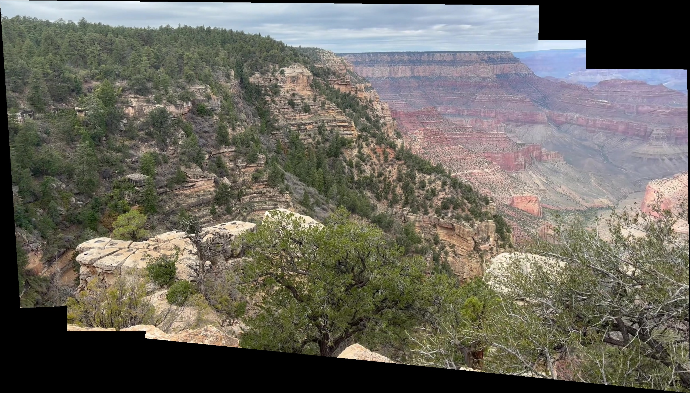<figcaption>canyon_slope, automatic</figcaption></figure>
</div>
<div class="media-grid">
  <figure><figcaption>canyon_ridge, manual</figcaption></figure>
  <figure>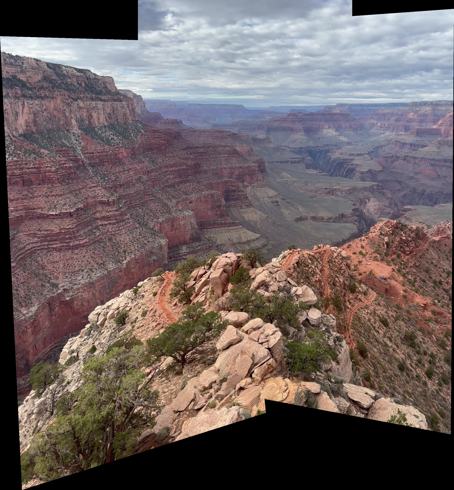<figcaption>canyon_ridge, automatic</figcaption></figure>
</div>
<div class="media-grid">
  <figure><figcaption>horseshoe, manual</figcaption></figure>
  <figure>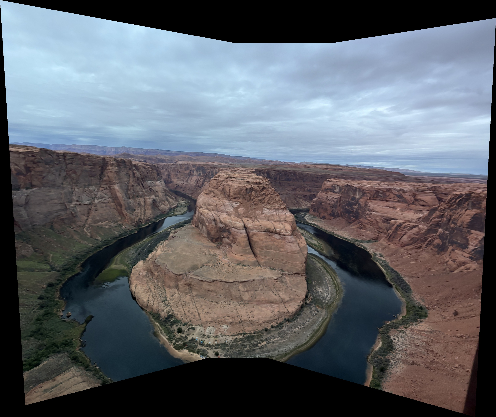<figcaption>horseshoe, automatic</figcaption></figure>
</div>

In canyon_ridge, the manual mosaic outperformed the automatic one, and the automatic version has clear misalignment in the background. In general I would expect the automatic method to be more accurate. Its points are placed more precisely than manual clicks, which always carry some click error, and it uses many more points (around 100 inliers compared with 12 clicks), so least squares averages out the errors better. The misalignment in canyon_ridge happens because RANSAC chose a homography that favours the objects in the foreground, so the objects in the distance are sacrificed and visibly misaligned. In the horseshoe mosaic, the manual and automatic versions are nearly identical: there is no foreground, so RANSAC found a homography that aligned the images well. canyon_slope is also very similar between manual and automatic. I suspect this is because RANSAC chose a set of matches that was well distributed across the frame, as in the horseshoe mosaic.

### B.5 Bells & Whistles

Code: `Assignment 3/src/bells.py`. All three options were implemented.

#### Rotation invariance

Each feature gets an orientation from the image gradient after a wide Gaussian blur ($$ \sigma = 4.5 $$, as in the paper), and the 8x8 sampling grid is rotated to that angle before sampling. To test it, the second canyon_slope frame was rotated 45 degrees with the Part A warp and matched against the first frame, with and without orientation.

| Descriptors | Matches | RANSAC inliers |
|---|---|---|
| Axis aligned | 0 | 0 |
| Oriented | 104 | 87 |

<div class="media-grid">
  <figure>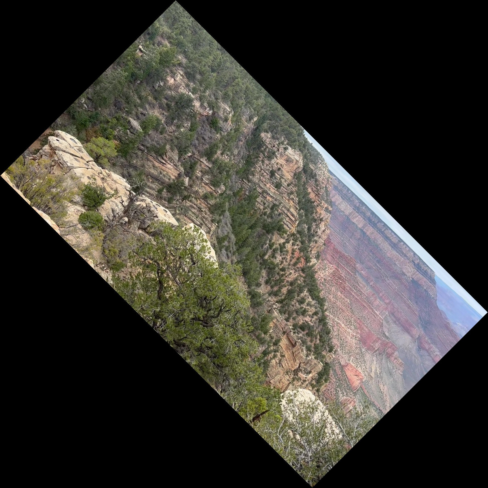<figcaption>Second frame rotated 45 degrees</figcaption></figure>
  <figure><figcaption>Oriented 40x40 windows</figcaption></figure>
</div>
<div class="media-grid">
  <figure><figcaption>Axis aligned</figcaption></figure>
  <figure><figcaption>Oriented</figcaption></figure>
</div>
<figure>
  
  <figcaption>Mosaic of the first frame and the rotated second frame</figcaption>
</figure>

The axis-aligned method found 0 matches because its descriptors are sampled along the image's x and y axes. When the image is rotated, the descriptors sampled at the same features are very different. There are exactly 0 matches because a feature's true match is no closer than any other descriptor, so the 1-NN and 2-NN distances are about equal and the ratio is close to 1, far above the 0.5 threshold. With oriented descriptors, matches can be made because the sampling grid is rotated to each feature's dominant gradient direction, which rotates with the image. This makes the descriptor invariant to image rotation, so each feature's descriptor is nearly the same in both images and passes the ratio test.

#### Multiscale processing

A Gaussian pyramid ($$ \sigma = 1 $$ blur, then subsample by 2) is built with 3 levels. Harris, ANMS, and descriptors run on every level, so a descriptor from level $$ l $$ covers a $$ 40 \cdot 2^l $$ pixel window in the original image. Points are mapped back to full resolution, and descriptors from all levels are matched together. To test it, the second canyon_ridge frame was shrunk to half size and matched against the first frame.

| Detection | Matches | RANSAC inliers |
|---|---|---|
| Single scale | 0 | 0 |
| 3-level pyramid | 351 | 263 |

<figure>
  
  <figcaption>Features from the pyramid; window size and colour show the level</figcaption>
</figure>
<div class="media-grid">
  <figure><figcaption>Single scale</figcaption></figure>
  <figure><figcaption>3-level pyramid</figcaption></figure>
</div>
<figure>
  
  <figcaption>Mosaic of the full-size first frame and the half-size second frame</figcaption>
</figure>

The single-scale method finds zero matches even though corners are still detected in the half-size frame. The problem is the descriptors. A 40x40 window in the half-size frame covers twice as much of the scene in each direction as the same window in the full-size frame, so the same corner produces a very different descriptor. As with rotation, a feature's true match is no closer than any other descriptor, the 1-NN/2-NN ratio is close to 1, and every match fails the 0.5 threshold. With the pyramid, features are detected and described at several scales, so features can be matched across the scale changes the pyramid covers (factors of 1, 2 and 4). Level 1 of the full-size frame should match level 0 of the half-size frame. Level 1 has been halved once, so a 40x40 window there covers the same 80x80 pixel area of the original image as a 40x40 window at level 0 of the half-size frame.

#### Panorama recognition

Thirteen frames, six from IMG_0852, five from IMG_0861, and two unrelated frames, are shuffled and given to the program with no ordering. Every pair is matched and run through RANSAC. Following Brown and Lowe, a pair is accepted as overlapping when the inlier count exceeds $$ 8 + 0.3 \times $$ the number of matches. The connected groups of accepted pairs are the panoramas. In each group, the image with the most total inliers becomes the reference, and the other images are linked to it along the strongest accepted pairs (a maximum spanning tree), multiplying homographies along the way.

<figure>
  
  <figcaption>The shuffled input set</figcaption>
</figure>
<figure>
  
  <figcaption>RANSAC inliers for every pair; * marks accepted pairs</figcaption>
</figure>

| Group | Images | Source |
|---|---|---|
| 1 | 1, 8, 9, 10, 13 | IMG_0861 frames 36 to 52 |
| 2 | 3, 5, 6, 7, 11, 12 | IMG_0852 frames 7 to 12 |
| none | 2 | IMG_0861 frame 1 |
| none | 4 | IMG_0852 frame 3 |

Images 2 and 4 were left out because they share very little of the scene with any other frame. Image 2, the first frame of IMG_0861, shows a rock outcrop that does not appear in any of the group 1 frames, and image 4, frame 3 of IMG_0852, shows a part of the canyon that does not appear in the group 2 frames. With little or no overlap, they have very few RANSAC inliers with any other image. A pair is accepted only when its inlier count exceeds 8 + 0.3 × the number of matches. Image 2 has a few chance inliers with images 3 and 6, but not enough to pass this test, and image 4 has essentially none. Neither image has an accepted pair, so each one is left on its own. These two frames act as distractors, and leaving them out shows that the recognition step correctly rejects images that do not belong instead of forcing every input into a panorama.

<figure>
  
  <figcaption>Recognized panorama 1</figcaption>
</figure>
<figure>
  
  <figcaption>Recognized panorama 2</figcaption>
</figure>

Panorama 2 appears stretched because the images to the right of the reference are furthest from the reference frame, which means they have the largest rotation away from the reference plane. When projected onto a flat plane, stretch grows faster and faster with that angle, so these images are stretched and warped more and more toward the edge of the panorama. In recognition, the reference is the image with the most total inliers, not a central frame as in A.4. Here that is image 7 (IMG_0852 frame 11), with 480 inliers, because frames 10, 11 and 12 overlap heavily with each other. Frame 11 is second from the end of the sequence (frames 7 to 12), so frames 7 and 8, on the right of the panorama, are at the largest angle from it. Those frames are also linked to the reference through several homographies multiplied together, so small errors build up along the chain. This could be fixed by choosing the image at the centre of the spanning tree as the reference, the one with the fewest links to the furthest image, instead of the one with the most inliers. Alternatively, a spherical or cylindrical projection is better suited to wide panoramas.

## What I learned

The most important thing I learned from this assignment is how parallax affects homographies. In my image sets, the camera did not purely rotate, and there were objects in the foreground, which made it difficult to stitch the mosaics together automatically. I also learned that automatic methods are not always better than manual ones. In canyon_ridge, RANSAC chose a homography that favoured the foreground, which left the background misaligned. Finally, I learned the importance of the reference frame. As the recognized panorama 2 shows, choosing a reference that is not central leaves the frames at the far end at a large angle from the reference plane, and they come out heavily stretched. For similar shots in the future, I would use a tripod or monopod, ideally with a panoramic head that rotates the camera about its lens, to reduce the translation of the camera and get as close to pure rotation as possible.

## Panorama 2 with a central reference

Panorama 2 rebuilt with a different reference image. Instead of the image with the most inliers, the reference is the image whose plane gives the smallest canvas (`central_reference` in `Assignment 3/src/bells.py`). This picks image 3 (IMG_0852 frame 9), the middle of frames 7 to 12, instead of image 7 (frame 11). The matches, homographies, spanning tree, and blending are unchanged; only the reference differs.

<figure>
  
  <figcaption>Reference with the most inliers: image 7, frame 11</figcaption>
</figure>
<figure>
  
  <figcaption>Central reference: image 3, frame 9</figcaption>
</figure>
