<!-- ANSWER: Summary (write after the analysis is done) -->

All code is in `Assignment 4/src/` (`p1.py` to `p4.py`, with the provided `epipolar_utils.py` and `sfm_utils.py`). Each script is run from `Assignment 4/`, for example `python src/p1.py`. The full printed output of each script is saved next to its figures in `images/assignment-4/` (`p1_output.txt` to `p4_output.txt`).

## 1. Fundamental Matrix Estimation

The fundamental matrix $$ F $$ relates corresponding points $$ p = (u, v, 1) $$ in image 1 and $$ p' = (u', v', 1) $$ in image 2 by $$ p'^T F p = 0 $$. Each correspondence gives one equation that is linear in the 9 entries of $$ F $$:

$$ \begin{bmatrix} u'u & u'v & u' & v'u & v'v & v' & u & v & 1 \end{bmatrix} \mathbf{f} = 0 $$

### (a, b) Linear least squares eight-point algorithm

```python
def lls_eight_point_alg(points1, points2):
    x1, y1 = points1[:, 0], points1[:, 1]
    x2, y2 = points2[:, 0], points2[:, 1]
    A = np.stack([x2*x1, x2*y1, x2, y2*x1, y2*y1, y2, x1, y1, np.ones(len(x1))], axis=1)
    _, _, Vt = np.linalg.svd(A)
    F = Vt[-1].reshape(3, 3)

    U, S, Vt = np.linalg.svd(F)
    S[2] = 0
    return U @ np.diag(S) @ Vt
```

<!-- ANSWER 1(b): description of the LLS implementation -->

**set1**

$$ F_{\text{LLS}} = \begin{bmatrix} 1.5522 \times 10^{-6} & -8.1816 \times 10^{-6} & -1.5044 \times 10^{-3} \\ -5.8700 \times 10^{-6} & -3.0289 \times 10^{-7} & -1.1361 \times 10^{-2} \\ -3.5231 \times 10^{-3} & 1.4145 \times 10^{-2} & 9.9983 \times 10^{-1} \end{bmatrix} $$

**set2**

$$ F_{\text{LLS}} = \begin{bmatrix} -5.6309 \times 10^{-6} & 2.7498 \times 10^{-5} & -6.4265 \times 10^{-3} \\ -2.7762 \times 10^{-5} & -6.7475 \times 10^{-6} & 1.5218 \times 10^{-2} \\ 1.0762 \times 10^{-2} & -1.2252 \times 10^{-2} & -9.9973 \times 10^{-1} \end{bmatrix} $$

Most entries are much smaller than $$ 10^{-4} $$, so they are written in scientific notation with 4 decimal places.

### (c, d) Normalized eight-point algorithm

Each image's points are translated so their centroid is at the origin and scaled so their mean distance from it is $$ \sqrt{2} $$. The LLS algorithm runs on the normalized points, and the result is mapped back with $$ F = T'^T F_q T $$.

```python
def normalization_matrix(points):
    c = points[:, :2].mean(axis=0)
    s = np.sqrt(2) / np.mean(np.linalg.norm(points[:, :2] - c, axis=1))
    return np.array([[s, 0, -s*c[0]], [0, s, -s*c[1]], [0, 0, 1]])

def normalized_eight_point_alg(points1, points2):
    T1 = normalization_matrix(points1)
    T2 = normalization_matrix(points2)
    Fq = lls_eight_point_alg((T1 @ points1.T).T, (T2 @ points2.T).T)
    return T2.T @ Fq @ T1
```

**set1**

$$ F_{\text{norm}} = \begin{bmatrix} 7.6956 \times 10^{-7} & -6.2866 \times 10^{-6} & 1.0418 \times 10^{-4} \\ -5.7877 \times 10^{-6} & -4.0113 \times 10^{-7} & -7.5858 \times 10^{-3} \\ -1.0101 \times 10^{-3} & 1.0418 \times 10^{-2} & 1.7226 \times 10^{-1} \end{bmatrix} $$

**set2**

$$ F_{\text{norm}} = \begin{bmatrix} -1.7626 \times 10^{-7} & 2.9350 \times 10^{-6} & -1.8214 \times 10^{-4} \\ 4.2339 \times 10^{-6} & 3.7503 \times 10^{-7} & 8.1899 \times 10^{-3} \\ 2.7582 \times 10^{-4} & -9.9428 \times 10^{-3} & -2.9430 \times 10^{-3} \end{bmatrix} $$

### (e, f) Distance to epipolar lines

```python
def compute_distance_to_epipolar_lines(points1, points2, F):
    lines = (F.T @ points2.T).T
    d = np.abs(np.sum(lines * points1, axis=1)) / np.linalg.norm(lines[:, :2], axis=1)
    return d.mean()
```

<!-- ANSWER 1(f): description of compute_distance_to_epipolar_lines -->

Average point-to-epipolar-line distance in pixels:

| Set | Method | Image 1 | Image 2 |
|---|---|---|---|
| set1 | LLS | 28.0257 | 25.1629 |
| set1 | Normalized | 0.8906 | 0.8287 |
| set2 | LLS | 9.7014 | 14.5682 |
| set2 | Normalized | 0.8895 | 0.8917 |

<!-- ANSWER 1: comparison of LLS and normalized -->

<div class="media-grid media-grid--2x2">
  <figure>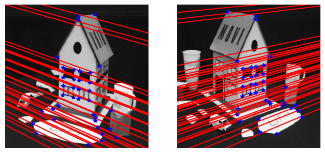<figcaption>set1, LLS</figcaption></figure>
  <figure>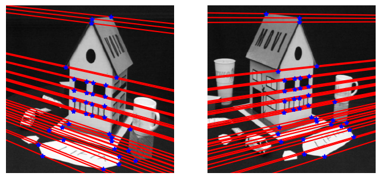<figcaption>set1, normalized</figcaption></figure>
  <figure>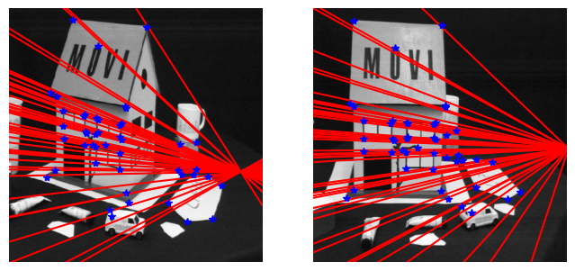<figcaption>set2, LLS</figcaption></figure>
  <figure>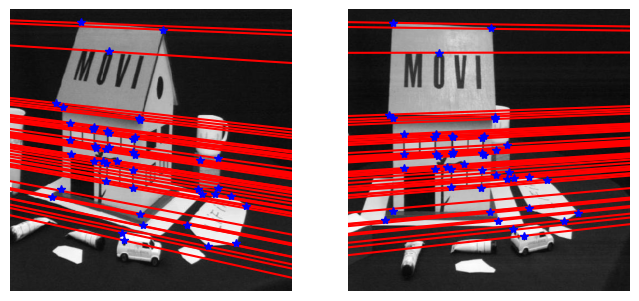<figcaption>set2, normalized</figcaption></figure>
</div>

## 2. Image Rectification

Rectification uses set1 and the normalized $$ F $$ from Part 1.

### (a) Epipoles

The epipole $$ e' $$ in image 2 satisfies $$ F^T e' = 0 $$, so it is the last right singular vector of $$ F^T $$. The epipole in image 1 comes from the same function applied to $$ F^T $$.

```python
def compute_epipole(F):
    _, _, Vt = np.linalg.svd(F.T)
    e = Vt[-1]
    return e / e[2]
```

$$ e = (-1300.79,\ -142.66,\ 1), \qquad e' = (1654.22,\ 45.43,\ 1) $$

### (b) Homography that sends the epipole to infinity

$$ H_2 = T^{-1} G R T $$, where $$ T $$ moves the image centre to the origin, $$ R $$ rotates the epipole onto the $$ x $$ axis at $$ (f, 0, 1) $$, and $$ G $$ sends it to $$ (f, 0, 0) $$.

```python
def compute_H(e, im):
    h, w = im.shape[:2]
    T = np.array([[1, 0, -w/2], [0, 1, -h/2], [0, 0, 1]])

    e_t = T @ e
    e_t = e_t / e_t[2]
    e1, e2 = e_t[0], e_t[1]
    r = np.sqrt(e1**2 + e2**2)
    a = 1 if e1 >= 0 else -1
    R = np.array([[a*e1/r, a*e2/r, 0], [-a*e2/r, a*e1/r, 0], [0, 0, 1]])

    f = (R @ e_t)[0]
    G = np.array([[1, 0, 0], [0, 1, 0], [-1/f, 0, 1]])
    return np.linalg.inv(T) @ G @ R @ T
```

### (c) Matching homographies

$$ H_1 = H_A H_2 M $$ with $$ M = [e']_\times F + e' v^T $$, $$ v = (1, 1, 1) $$. The first row $$ (a_1, a_2, a_3) $$ of $$ H_A $$ is the least squares solution of $$ W a = b $$, where the rows of $$ W $$ are the points $$ \hat{p}_i = H_2 M p_i $$ and $$ b_i $$ is the $$ x $$ coordinate of $$ \hat{p}'_i = H_2 p'_i $$.

```python
def compute_matching_homographies(e2, F, im2, points1, points2):
    H2 = compute_H(e2, im2)

    ex = np.array([[0, -e2[2], e2[1]], [e2[2], 0, -e2[0]], [-e2[1], e2[0], 0]])
    M = ex @ F + np.outer(e2, np.ones(3))

    p_hat = (H2 @ M @ points1.T).T
    p_hat /= p_hat[:, 2:]
    p_hat2 = (H2 @ points2.T).T
    p_hat2 /= p_hat2[:, 2:]

    a, *_ = np.linalg.lstsq(p_hat, p_hat2[:, 0], rcond=None)
    HA = np.array([a, [0, 1, 0], [0, 0, 1]])
    H1 = HA @ H2 @ M
    return H1, H2
```

$$ H_1 = \begin{bmatrix} -14.1400 & -4.8973 & -145.3027 \\ 1.6636 & -17.5213 & -335.6340 \\ -0.0109 & -0.0026 & -14.4979 \end{bmatrix}, \qquad H_2 = \begin{bmatrix} 0.8098 & -0.1220 & 79.9077 \\ -0.0301 & 1.0158 & 3.6599 \\ -0.0007 & 0.0001 & 1.1521 \end{bmatrix} $$

### (d) Rectified images

<figure>
  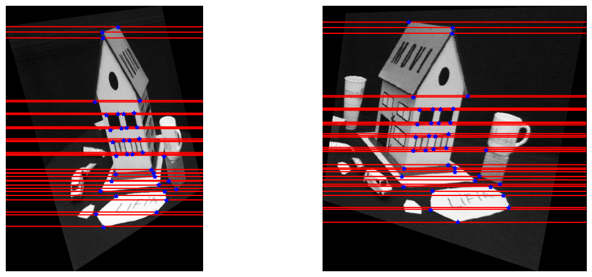
  <figcaption>set1 after rectification, with epipolar lines recomputed from the rectified points</figcaption>
</figure>

<!-- ANSWER 2(d): why rectification makes correspondence search easier -->

## 3. The Factorization Method

### (a, b) Implementation

```python
def factorization_method(points_im1, points_im2):
    x1 = points_im1[:, :2] - points_im1[:, :2].mean(axis=0)
    x2 = points_im2[:, :2] - points_im2[:, :2].mean(axis=0)

    D = np.vstack((x1.T, x2.T))
    U, S, Vt = np.linalg.svd(D)

    S3 = np.diag(np.sqrt(S[:3]))
    motion = U[:, :3] @ S3
    structure = S3 @ Vt[:3]
    return structure, motion
```

<!-- ANSWER 3(b): description of the implementation -->

### (c, d) Full set of correspondences (set1)

<figure>
  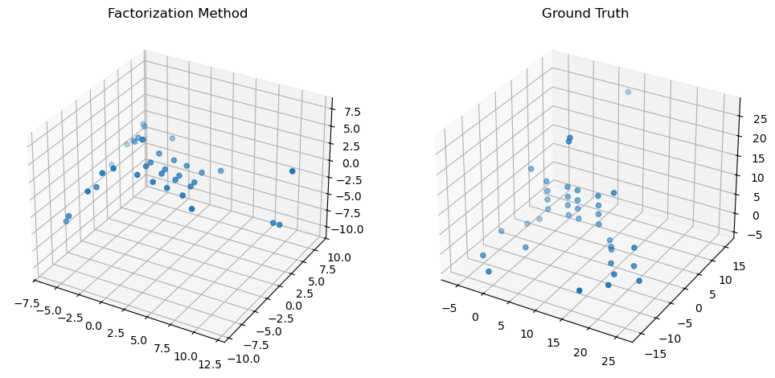
  <figcaption>set1: factorization reconstruction (left) and ground truth (right)</figcaption>
</figure>

<!-- ANSWER 3(c): why they match up to scale and rotation -->

Singular values of $$ D $$:

$$ \sigma = (959.5852,\ 540.4761,\ 184.4317,\ 27.9152) $$

<!-- ANSWER 3(d): why 4 non-zero, how many in the ideal case -->

### (e, f) Subset of correspondences (set1_subset)

<figure>
  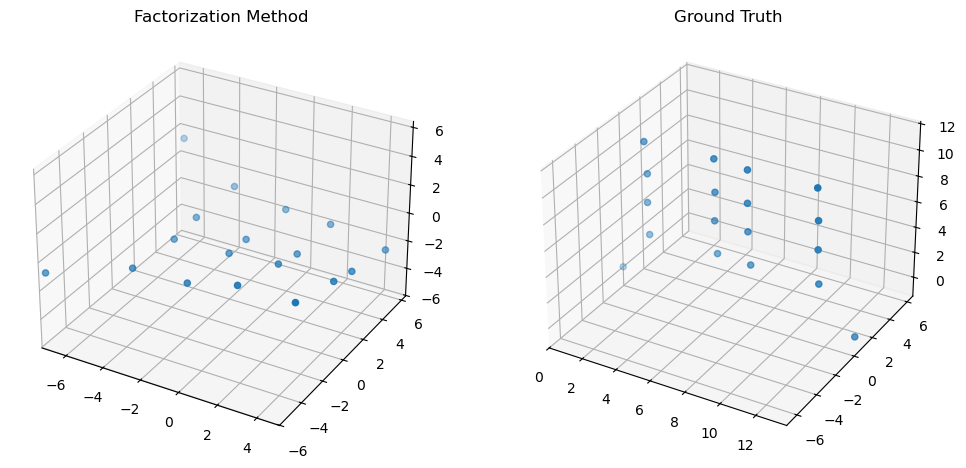
  <figcaption>set1_subset: factorization reconstruction (left) and ground truth (right)</figcaption>
</figure>

<!-- ANSWER 3(e): why the subset no longer matches as well -->

Singular values of $$ D $$:

$$ \sigma = (264.5440,\ 210.0607,\ 7.2192,\ 5.1286) $$

<!-- ANSWER 3(f): comparison with the previous singular values -->

## 4. Triangulation in Structure from Motion

<div class="media-grid">
  <figure>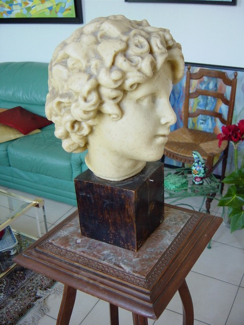<figcaption>B21</figcaption></figure>
  <figure>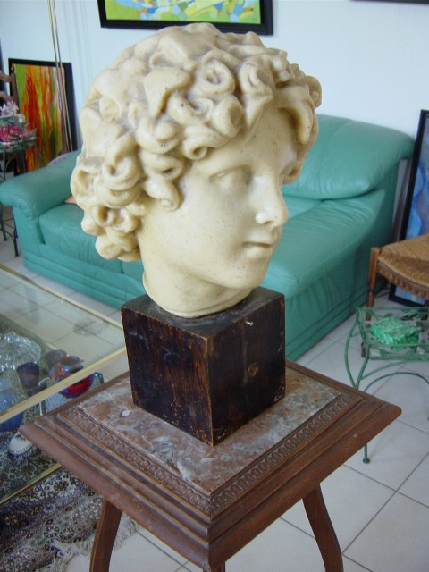<figcaption>B22</figcaption></figure>
  <figure>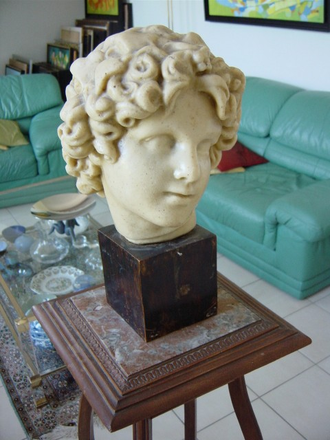<figcaption>B23</figcaption></figure>
  <figure>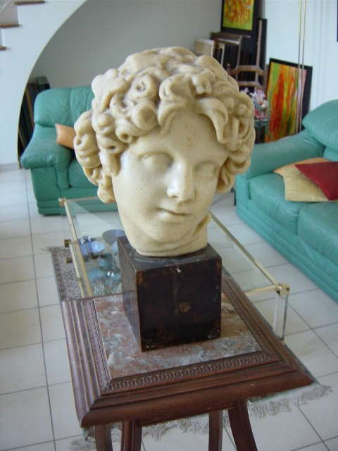<figcaption>B24</figcaption></figure>
  <figure>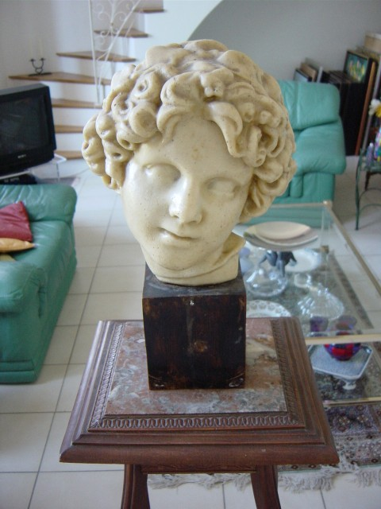<figcaption>B25</figcaption></figure>
</div>

### (a) Four candidate (R, T) from the essential matrix

With $$ E = U D V^T $$, $$ Q = U W V^T $$ or $$ U W^T V^T $$, $$ R = \det(Q)\, Q $$, and $$ T = \pm u_3 $$:

```python
def estimate_initial_RT(E):
    U, _, Vt = np.linalg.svd(E)
    W = np.array([[0, -1, 0], [1, 0, 0], [0, 0, 1]])
    Rs = []
    for Q in (U @ W @ Vt, U @ W.T @ Vt):
        Rs.append(np.linalg.det(Q) * Q)
    T = U[:, 2]
    return np.array([np.column_stack((R, t)) for R in Rs for t in (T, -T)])
```

```
Example RT:
 [[ 0.9736 -0.0988 -0.2056  0.9994]
 [ 0.1019  0.9948  0.0045 -0.0089]
 [ 0.2041 -0.0254  0.9786  0.0331]]

Estimated RT:
 [[[ 0.98305251 -0.11787055 -0.14040758  0.99941228]
  [-0.11925737 -0.99286228 -0.00147453 -0.00886961]
  [-0.13923158  0.01819418 -0.99009269  0.03311219]]

 [[ 0.98305251 -0.11787055 -0.14040758 -0.99941228]
  [-0.11925737 -0.99286228 -0.00147453  0.00886961]
  [-0.13923158  0.01819418 -0.99009269 -0.03311219]]

 [[ 0.97364135 -0.09878708 -0.20558119  0.99941228]
  [ 0.10189204  0.99478508  0.00454512 -0.00886961]
  [ 0.2040601  -0.02537241  0.97862951  0.03311219]]

 [[ 0.97364135 -0.09878708 -0.20558119 -0.99941228]
  [ 0.10189204  0.99478508  0.00454512  0.00886961]
  [ 0.2040601  -0.02537241  0.97862951 -0.03311219]]]
```

The third candidate matches the example.

### (b) Linear estimate of a 3D point

Each camera $$ i $$ adds the rows $$ p_{i,1} m_i^{3T} - m_i^{1T} $$ and $$ p_{i,2} m_i^{3T} - m_i^{2T} $$ to $$ A $$. The point is the last right singular vector of $$ A $$.

```python
def linear_estimate_3d_point(image_points, camera_matrices):
    A = []
    for (x, y), M in zip(image_points, camera_matrices):
        A.append(x * M[2] - M[0])
        A.append(y * M[2] - M[1])
    _, _, Vt = np.linalg.svd(np.array(A))
    P = Vt[-1]
    return P[:3] / P[3]
```

```
Difference:  0.0029243053036863698
```

### (c) Reprojection error and Jacobian

With $$ y = M_i P $$, the derivative of $$ y_1 / y_3 $$ with respect to $$ P $$ is $$ (m_i^1 y_3 - m_i^3 y_1) / y_3^2 $$, using the first three columns of each row, and the same for $$ y_2 / y_3 $$.

```python
def reprojection_error(point_3d, image_points, camera_matrices):
    y = camera_matrices @ np.append(point_3d, 1)
    p = y[:, :2] / y[:, 2:]
    return (p - image_points).flatten()

def jacobian(point_3d, camera_matrices):
    J = []
    for M in camera_matrices:
        y = M @ np.append(point_3d, 1)
        J.append((M[0, :3] * y[2] - M[2, :3] * y[0]) / y[2]**2)
        J.append((M[1, :3] * y[2] - M[2, :3] * y[1]) / y[2]**2)
    return np.array(J)
```

```
Error Difference:  8.301300130674275e-07
Jacobian Difference:  1.817115702351657e-08
```

### (d) Gauss-Newton refinement

```python
def nonlinear_estimate_3d_point(image_points, camera_matrices):
    P = linear_estimate_3d_point(image_points, camera_matrices)
    for _ in range(10):
        e = reprojection_error(P, image_points, camera_matrices)
        J = jacobian(P, camera_matrices)
        P = P - np.linalg.solve(J.T @ J, J.T @ e)
    return P
```

```
Linear method error: 98.73542356894187
Nonlinear method error: 95.59481784846034
```

### (e) Choosing the correct (R, T)

For each candidate, every correspondence is triangulated with $$ M_1 = K[I \mid 0] $$ and $$ M_2 = K[R \mid T] $$. The candidate with the most points in front of both cameras is kept.

```python
def estimate_RT_from_E(E, image_points, K):
    M1 = K @ np.hstack((np.eye(3), np.zeros((3, 1))))
    best_RT, best_count = None, -1
    for RT in estimate_initial_RT(E):
        M = np.array([M1, K @ RT])
        count = 0
        for pts in image_points:
            P = nonlinear_estimate_3d_point(pts, M)
            P2 = RT[:, :3] @ P + RT[:, 3]
            count += (P[2] > 0) and (P2[2] > 0)
        if count > best_count:
            best_RT, best_count = RT, count
    return best_RT
```

```
Example RT:
 [[ 0.9736 -0.0988 -0.2056  0.9994]
 [ 0.1019  0.9948  0.0045 -0.0089]
 [ 0.2041 -0.0254  0.9786  0.0331]]

Estimated RT:
 [[ 0.97364135 -0.09878708 -0.20558119  0.99941228]
 [ 0.10189204  0.99478508  0.00454512 -0.00886961]
 [ 0.2040601  -0.02537241  0.97862951  0.03311219]]
```

### (f) Reconstructed statue

The full pipeline triangulates 66,385 points from the dense matches. The plot below is the figure produced by `p4.py`.

<figure>
  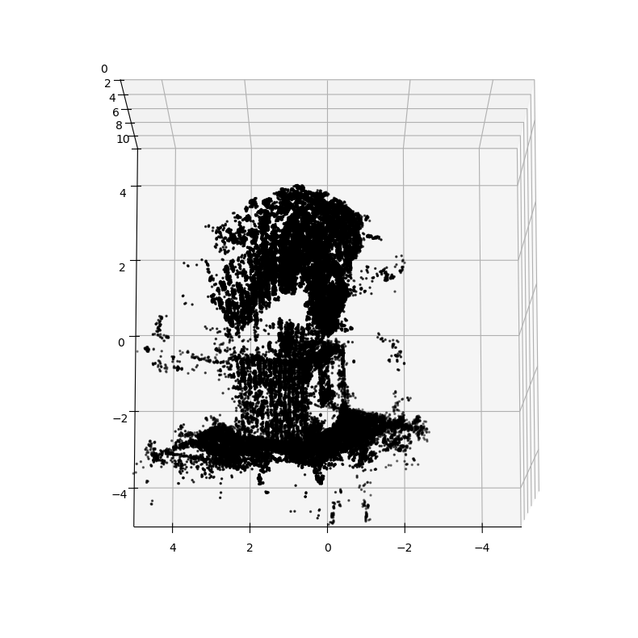
  <figcaption>Reconstructed statue (matplotlib, view from <code>p4.py</code>)</figcaption>
</figure>

The interactive view below shows the same points, coloured from the pixel each one was matched at in the first image of its pair. Drag to rotate, scroll to zoom, right-drag to pan, and double-click to reset. It opens at the viewpoint of the first camera.

<div class="point-cloud" data-src="../images/assignment-4/p4_statue_points.bin" style="width: 100%; height: 520px; border-radius: 4px; overflow: hidden;"></div>

<script type="importmap">
{ "imports": {
  "three": "https://cdn.jsdelivr.net/npm/three@0.160.0/build/three.module.js",
  "three/addons/": "https://cdn.jsdelivr.net/npm/three@0.160.0/examples/jsm/"
} }
</script>
<script type="module" src="../assets/js/point-cloud.js"></script>

<!-- ANSWER 4(f): why a larger scene such as a house would be harder -->

## What I learned

<!-- ANSWER: What I learned -->
